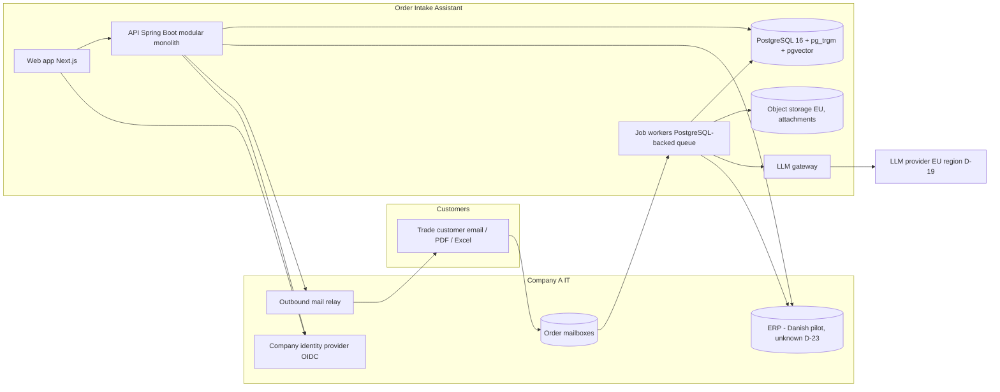
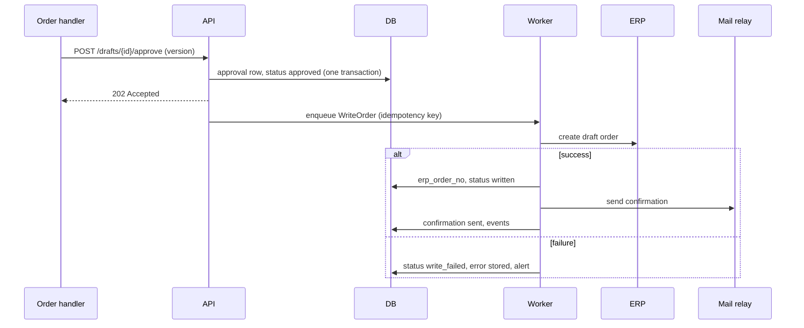

Step 11 · Searches used: 6/10 · Sources: S-014, S-029, S-032, S-046, S-053..S-055, S-059..S-065

# Step 11 — Solution Architecture — Order Intake Assistant

> Authoritative machine files: `05-deliver/build-pack/openapi.yaml` (98 operations, lints clean), `05-deliver/build-pack/schema.sql` (54 tables; applies cleanly to PostgreSQL 16 apart from the two pgvector statements, which could not be run here — see §12 spike SP-04). Values marked **accepted (D-28)** are my defaults for operating parameters and targets that the user has not confirmed; they are listed in one table in §9 and go to the closure batch.

## 1. System context and containers

Actors: OH, OL, AD, AN (staff), trade customers (email only), system principals (webhooks). External systems: mail platform (default Microsoft 365 via Graph, D-29), ERP (adapter, D-23), identity provider (default Entra ID, D-29), LLM provider (D-19), object storage, outbound mail relay, secrets manager, error tracking. R2: telephony/speech-to-text provider, vision/OCR provider, EDI gateway (D-31). R3: transport-visibility tool (D-18).

Containers: (1) `web` Next.js; (2) `api` Spring Boot (HTTP + scheduler); (3) `worker` the same artifact started with the worker profile (consumes jobs); (4) PostgreSQL; (5) object storage; (6) secrets store. One deployable image, two process profiles (ADR-11).

## 2. Frontend architecture
- **Stack (confirmed default):** Next.js App Router + TypeScript + Tailwind + shadcn/ui; TanStack Query; API client generated from `openapi.yaml`; Vitest + Playwright. No business logic in server actions or route handlers (rule 2); the only server-side code is the authentication session and a pass-through proxy that attaches the bearer token (ADR-03, ADR-14).
- **Route map:**

| Route | SCR | Roles | Release |
|---|---|---|---|
| /sign-in | SCR-01 | all | R1 |
| /queue, /queue/[draftId] (drawers: line editor SCR-04, confirmation preview SCR-05, reject/forward SCR-06, attachment viewer SCR-30) | SCR-02, SCR-03 | OH, OL | R1 |
| /status-requests/[draftId] | SCR-07 | OH, OL | R1 |
| /messages | SCR-08 | OH, OL | R1 |
| /exceptions | SCR-09 | OH, OL | R1 |
| /aliases | SCR-10 | OH, OL | R1 |
| /team | SCR-11 | OL, AD | R1 |
| /dashboard | SCR-12 | OL, AN, AD | R1 |
| /shadow, /shadow/[id] | SCR-13, SCR-14 | OL, AN, AD | R1 |
| /admin/mailboxes, /admin/scope, /admin/templates, /admin/models, /admin/users, /admin/markets | SCR-15..SCR-20 | AD | R1 |
| /admin/audit, /admin/privacy | SCR-21, SCR-22 | AD | R1 |
| /preferences, /help, /onboarding | SCR-23, SCR-24, SCR-29 | all | R1 |
| /status, /maintenance, /403, /404, /error | SCR-26..SCR-28 | all | R1 |
| /cases; /admin/auto-approval; /admin/tuning; /admin/estimates | SCR-32..SCR-35 (+ SCR-31 drawer) | OH/OL; AD | R2 |
| /admin/markets/[code]/readiness; /delivery-exceptions | SCR-36, SCR-37 | AD; OH/OL | R3 |

- **State/data:** server state only through TanStack Query hooks from the generated client; local UI state for the review workspace (current line, drawer); the non-sensitive edit cache for session restore (CP-06) lives in `sessionStorage` and holds field values only, never message text.
- **Forms/validation:** zod schemas generated from the OpenAPI constraints; the Approve button disabled states follow 09 §7 and AC-16.2.
- **Auth handling:** Auth.js OIDC (authorization code + PKCE) with tokens in an encrypted httpOnly cookie; route guards by roles from `GET /api/v1/me`; 401 → SCR-01; 403 → SCR-28.
- **i18n:** `da` default, `en`; message catalogues; further languages with markets (F-35, F-36).
- **Analytics wrapper:** UI events are posted to the backend event endpoint indirectly through user actions already captured server-side; the frontend emits only `message_opened_in_workspace` through the API. No third-party analytics scripts (staff app, no cookies beyond strictly necessary).
- **Error boundaries:** per route; shows SCR-28 with a correlation id.
- **Accessibility:** WCAG 2.2 AA; confidence shown as text + icon (F-25).

## 3. Backend architecture
Java 21, Spring Boot 3.x (Web, Validation, Data JPA, Security), PostgreSQL 16, Flyway, springdoc-openapi (used to verify the implementation against the contract; the contract file is the source), Testcontainers, Maven. Controllers implement interfaces generated from `openapi.yaml`.

| Module (package-by-feature) | Epic | Responsibility |
|---|---|---|
| `ingest` | EP-01 | Mailbox connector, de-duplication, threading, attachments, webhook intake (ports: `MailPort`) |
| `understanding` | EP-01 | Classification, extraction, splitting (uses `llm`) |
| `matching` | EP-02 | SKU candidate generation (full-text + trigram + vector fusion, history, aliases), unit normalisation, master-data sync |
| `pricing` | EP-02 | Contract price, stock, credit reads; delivery-date proposal (rules; ML in R2) (port: `ErpPort`) |
| `review` | EP-03 | Drafts, lines, locks, approve/reject/reassign, status requests, post-order exceptions, non-order messages |
| `erp` | EP-04 | Write-back, idempotency, retry, RPA fallback, adapters per market |
| `confirm` | EP-04 | Templates, confirmation and status emails (port: `MailPort.send`) |
| `learning` | EP-05 | Corrections, evaluation runs, shadow comparison, baseline |
| `measure` | EP-05 | Event store, rollups, metrics API (aggregates only) |
| `ops` | EP-06 | Team queue, service timers, notifications, preferences, R2 cases |
| `identity` | EP-07 | OIDC resource server, role mapping, scopes |
| `privacy` | EP-07 | Retention jobs, legal holds, data-subject requests, audit viewer |
| `llm` | EP-07 | Gateway: provider port, prompt versions, schema validation, redaction, cost metering |
| `admin` | EP-08 | Mailboxes, scope, thresholds, models, flags, markets |
| `platform` | EP-07 | Health, status, maintenance |
| R2: `channels`, `autonomy`, `tuning`; R3: `markets`, `deliveryexceptions` | EP-01/03/05/09 | As in stories US-52..US-65 |
| shared | — | `config`, `security`, `error` (problem+json), `audit` (append-only writer), `events` |

**Processing pipeline (jobs, idempotent, each step persists its result):** `IngestMessage → ClassifyMessage → ExtractOrder → MatchLines → CheckPricesAndStock → ProposeDelivery → DraftReady`. Any step failing after retries sets the message to *Manual* (AC-04.5, AC-44.1). Approval triggers `WriteOrder` then `SendConfirmation` (ADR-13). Schedulers: master-data sync, retention, shadow matching, metric rollups, health checks, backlog alerts. Queue: PostgreSQL-backed job library with `FOR UPDATE SKIP LOCKED` semantics (ADR-06).

**Ports and adapters:** `MailPort`, `ErpPort`, `LlmPort`, `ObjectStorePort`, `IdentityPort`; adapters per market under `erp.dk`, `erp.no`, `erp.se`. Every adapter call has a timeout, retry with backoff and a circuit breaker; failures become typed errors (US-26).

**Transactions:** one transaction per job step; approval and `approvals` row + status change are one transaction; ERP calls are outside DB transactions and protected by an idempotency key (US-22).

## 4. Domain model
See `05-deliver/build-pack/domain-model.md` (generated from `schema.sql`; 54 entities, 453 columns, ER diagram, CRUD by role). Key relations: Market 1—N Office 1—N Mailbox 1—N Message 1—N Draft 1—N DraftLine N—1 Sku; Customer 1—N Site, Alias, Contact; Draft 1—N Approval, ErpWriteAttempt, Confirmation, ShadowComparison. There is deliberately no table or column that attributes corrections, handling time or error rates to an individual employee (R-26; the `corrections` table has no user column; baseline handling-time samples are office-level).

## 5. Physical schema
`schema.sql` is authoritative (PostgreSQL 16, extensions `pg_trgm`, `vector`). Highlights: UUID primary keys; enums as `text` + `CHECK`; partial unique indexes for "one active row" rules (thresholds, templates, sku scope, model per kind, auto-approval policy); `skus` with stored `tsvector`, trigram index and an HNSW vector index (dimension 1024, set by the embedding model chosen in Step 23; ADR-04); `audit_events` append-only by trigger; message retention index; soft state only where the domain needs it (`messages.deleted_at`). The job library adds its own tables through its own migration.

## 6. Migration and seeding strategy
- Flyway versioned migrations `V1__baseline.sql` (= `schema.sql`), then `V<n>__<change>.sql`; `ddl-auto=validate`; repeatable `R__reference_data.sql` for markets, role names, thresholds defaults, template defaults, onboarding step keys, component names.
- `demo`/`staging` seed from `build-pack/seed-data-spec.md` (fictional office, customers, SKUs, sample messages in Danish, expected extraction results for evaluation); `prod` = reference data only. Master data in prod comes from the ERP sync, never from seed files.
- Rollback: migrations are forward-only; destructive changes use expand/contract across two releases.

## 7. API surface
98 operations in `openapi.yaml` (R1: 79, R2: 13, R3: 6; counted from `x-release` in the file); summary in `04-specify/_api-surface.md`; contract conventions per `openapi-conventions.md` (versioned `/api/v1`, camelCase, problem+json, pagination `?page=&size=`, one example per request/response drawn from the fictional seed office). Stories without an endpoint are internal: US-26 (adapters), US-32 (events), US-42 (gateway), US-45 (accessibility), US-63, US-64 (adapter sets).

## 8. Security model
- **Authentication:** company OIDC; backend is an OAuth2 resource server validating issuer, audience, expiry and signature (JWKS cache); groups → roles/offices through `role_mappings` (US-37). Access-token lifetime as issued by the IdP; app session idle timeout 30 min, absolute 12 h (accepted, D-28). Service principals for inbound webhooks (Graph validation token + clientState; bearer service tokens for R2/R3).
- **Authorisation:** server-side per `authorisation-matrix.md` (98 rows × 4 roles + anonymous + system); office scoping on every query (`office_id IN scopes`), 404 outside scope; AD does not read draft/message content unless also OH (D-22).
- **Input and output safety:** all inputs validated (Bean Validation mirroring the schema); message content is untrusted data: separated from instructions, model outputs validated against a JSON schema, no tool/function execution by the model, ERP access read-only except draft-order creation (US-26 AC-26.3), human approval before any write (ADR-02, S-055).
- **Rate limiting:** per user 120 req/min and per integration endpoint 60 req/min, returning 429 problem+json (accepted, D-28).
- **CORS:** same-origin through the proxy; no wildcard origins.
- **Secrets:** platform secrets manager; mailbox credentials stored as references (`secret_ref`); no secrets in the database, logs or images.
- **Audit:** every approval, write, mode switch, configuration and privacy action (US-39); append-only trigger.
- **Dependency and code scanning:** dependency scanning (OWASP Dependency-Check or equivalent) and container scanning in CI; SAST on pull requests.

## 9. Production NFR profile
Full tables are in `build-pack/nfr-profile.md` (this section). **Accepted (D-28)** = my proposal, accepted at closure; Company A volumes are unknown (R-06, D-24), so capacity rows follow the labelled illustrative model R-31.

### 9.1 Security
| Requirement | Standard | Target | Verification |
|---|---|---|---|
| Authentication | OIDC via company IdP | No local passwords; MFA as per IdP policy | Integration test with test IdP; configuration review |
| Authorisation | Authorisation matrix | 100% of operations × roles tested | Generated test per matrix row (DoD) |
| Input validation | OWASP ASVS L1 | All inputs validated server-side | ASVS L1 checklist; fuzz tests on ingest |
| LLM-specific risks | OWASP LLM Top 10 (S-055) | Prompt-injection suite passes (no action outside schema) | Red-team test set in shadow mode (RK-08) |
| Encryption at rest | AES-256 managed | DB, object store, backups encrypted | Provider configuration evidence |
| Encryption in transit | TLS 1.2+ | All hops | Scanner (SSL Labs-type) |
| Dependency scanning | CI | No unresolved critical/high at release | CI gate |
| Session management | httpOnly, secure cookies | Idle 30 min, absolute 12 h (accepted, D-28) | Test |

### 9.2 Accessibility
WCAG 2.2 AA on SCR-01..SCR-30; keyboard navigable; screen-reader labels; contrast ≥ 4.5:1; visible focus; confidence never by colour alone. Verification: axe in Playwright on every screen + manual keyboard test of the critical path.

### 9.3 Performance (accepted, D-28)
| Metric | Target | Measurement |
|---|---|---|
| Message arrival → draft in queue | p95 ≤ 5 min (CP-01 polling 60 s + processing), excluding provider outages | `message_received` → `draft_created` events |
| Review workspace open | p95 ≤ 1.5 s | RUM / Playwright |
| LCP on office network | ≤ 2.5 s | Lighthouse CI |
| API read p95 / p99 | ≤ 400 ms / ≤ 1 s | Micrometer |
| API write p95 (excl. async ERP) | ≤ 800 ms | Micrometer |
| DB query p95 | ≤ 100 ms | pg_stat_statements |
| Error rate | < 1% 5xx | Metrics |
No external benchmark sources were found for these targets; they are engineering proposals.

### 9.4 Reliability (accepted, D-28)
| Requirement | Target | Measurement |
|---|---|---|
| Availability | 99.5% monthly, measured Mon-Fri 06:00-18:00 Danish time | Synthetic probes |
| MTTR | ≤ 4 h | Incident log |
| Rollback | Previous image redeployable ≤ 15 min; migrations expand/contract | Release drill |
| Backups | Continuous WAL + daily snapshot; RPO ≤ 15 min, RTO ≤ 4 h | Restore test before go-live and quarterly |
| Degraded mode | Messages continue to arrive as *Manual* when AI is down (US-44) | Fault-injection test |

### 9.5 Scalability (capacity assumptions from R-31, not forecasts)
| Scenario | Load | Approach |
|---|---|---|
| Launch (pilot office) | up to 500 messages/day, 20 concurrent users | Single API + worker instance each, one DB |
| 6 months | up to 2,000 messages/day, 60 concurrent users | Scale workers horizontally; read replica optional |
| 12 months (Denmark, illustrative 300 stores × 20 orders) | up to 6,000 orders/day, 300 concurrent users | Partition metric_events by month; queue concurrency; LLM batching limits |
LLM cost per message is **not estimated here**: it is measured in shadow mode (cost metering, US-42) before any business-case figure uses it.

### 9.6 Configurable parameters CP-01..CP-12 (defaults accepted, D-28)
| CP | Parameter | Default |
|---|---|---|
| CP-01 | Mailbox polling interval (webhook plus poll fallback) | 60 s |
| CP-02 | Draft lock idle timeout | 15 min |
| CP-03 | Small-sample suppression threshold | 10 orders (metrics) / 10 respondents (pulse) |
| CP-04 | Shadow-mode unmatched window | 48 h |
| CP-05 | Data-staleness banner | 5 min |
| CP-06 | Session-restore window | 5 min |
| CP-07 | Retention: messages and attachments | 90 days after processing (drafts keep non-personal fields 24 months, audit 24 months, evaluation data non-personal indefinitely) — legal basis to be confirmed by Company A's DPO (D-33) |
| CP-08 | Auto-approval sampling rate | 10% |
| CP-09 | Master-data freshness limit | 24 h |
| CP-10 | Attachment size limit | 25 MB per file, 50 MB per message |
| CP-11 | Default confidence thresholds | classification ≥ 0.80, field ≥ 0.80, line match ≥ 0.85, review below 0.95 (replaced by evaluation results before go-live) |
| CP-12 | Exception-backlog alert threshold | oldest unhandled item > 4 working hours |

## 10. Compliance, PII register and retention
### 10.1 Applicable regulations
| Regulation | Applies? | Trigger |
|---|---|---|
| GDPR (EU/EEA) | Yes | Customer contacts' data in emails; staff identifiers |
| Datatilsynet guidance and supervision (S-014, S-064) | Yes (Denmark) | DPIA for AI processing; employee-monitoring scrutiny avoided by design (R-26) |
| EU AI Act (S-060) | Yes, classification to confirm | Company A is a deployer of a GPAI-based system; AI literacy duty since 2 Feb 2025; Article 50 transparency from 2 Aug 2026 (customers receive confirmations drafted with AI and approved by a person; wording of any AI disclosure to be confirmed by legal, D-34) |
| Employee consultation rules | NO (WEA ch. 9, S-012), SE (MBL §11, S-013); Danish rules not researched | Relevant when expanding (R3); control measures avoided by design |
| Danish bookkeeping law | Not researched | ERP, not this product, holds the accounting record; to confirm with Company A (D-33) |

### 10.2 PII register
| Entity.field | Subject | Purpose | Legal basis (proposed; DPO to confirm, D-33) | Retention | Access |
|---|---|---|---|---|---|
| messages.from_address, from_name, body_text; attachment content in object store | Customer contacts (business emails, may include sole traders) | Interpret and fulfil orders; audit | Legitimate interests / contract performance | CP-07 | OH, OL (office scope) |
| customer_contacts.email, name, phone; sites.contact_name, contact_phone | Customer contacts | Send confirmations; site delivery coordination | Same | Mirrors ERP sync; deleted via DSR | OH, OL |
| customers.name | Sole traders | Order identification | Same | Mirrors ERP | OH, OL |
| dsr_requests.subject_email | Requesters | Handle data-subject requests | Legal obligation | 24 months after closure | AD |
| app_users.display_name, email; *_user_id columns; audit_events.actor_user_id | Staff | Authentication, attribution of approvals, audit | Employment / legitimate interests | Account life + 24 months for audit | AD (audit), own user |
| feedback.text | Staff | Product improvement | Consent | 12 months | AD |
Redaction before model calls (US-42 AC-42.3): signatures, phone numbers and unrelated personal data are removed before text leaves the platform. Data-subject export/deletion: US-41. Breach notification process: Company A's incident process; the product raises alerts (F-24).
### 10.3 Data processing agreements needed
| Vendor | Data shared | DPA status |
|---|---|---|
| LLM provider | Redacted message text and attachments | Needed; SCCs if third-country access (S-062) — D-19 |
| Cloud hosting + managed PostgreSQL + object storage | All stored data | Needed — D-30 |
| Mail platform (Microsoft 365 default) | Mailbox content | Company A's existing agreement — D-29 |
| Error tracking | Stack traces with no message text | Needed if used (scrubbing enforced) |
| R2 vendors (telephony transcription, vision) | Voice transcripts, images | Needed — D-31 |

## 11. Integrations and fallbacks
| Dependency | Purpose / limits | Terms status | Failure behaviour and fallback |
|---|---|---|---|
| Mail platform (Graph default) | Read order mailboxes, send confirmations. App-only permissions reach all mailboxes unless restricted by an application access policy to the order mailboxes (S-061) | Company A admin consent + policy (D-29) | Poll fallback if webhook fails; alert AD; no message loss on reconnection (AC-01.4) |
| ERP (Danish pilot) | Read master data, price, stock, credit; create draft order | Unknown system and access (D-23, D-03) | API → RPA fallback → item stays queued with alert; handlers key manually |
| Identity provider | SSO | Company A (D-29) | Existing sessions continue until expiry; new sign-ins fail with the IdP message |
| LLM provider | Classification, extraction, embeddings | Contract/DPA (D-19); EU region (S-062) | One retry, then *Manual* route (AC-42.4); degraded-mode banner |
| Object storage (S3-compatible, EU) | Attachments | Provider terms | Ingest retried; attachment marked *skipped* on persistent failure |
| Outbound mail relay | Confirmations | Company A | Retry with exponential backoff; draft shows send failure (AC-24.3) |
| Secrets manager | Credentials | Platform | Service fails closed |
| Error tracking | Errors with scrubbing | Optional | Logs only if unavailable |
| R2: telephony transcripts, vision/OCR, EDI gateway | New channels | Vendors undecided (D-31) | Items route to *Manual* |
| R3: transport-visibility tool | Delivery exceptions | Tool undecided (D-18) | Status page degraded; no item lost on recovery (AC-65.3) |

## 12. Build vs buy, feasibility and spikes
| Component | Verdict | Feasibility | Notes |
|---|---|---|---|
| Mailbox connector | Build thin on the Graph SDK | ✅ | S-061 restriction policy needed |
| Classification and extraction | Buy model API; build prompts, schemas, validation | ⚠️ SP-02 | Accuracy on Danish trade text unproven (D-25) |
| SKU matching | Build on PostgreSQL (full-text + trigram + vector, reciprocal rank fusion) | ✅ / ⚠️ SP-04 | Pattern from S-063; exact SKU codes use lexical matching |
| ERP adapter + draft-order write | Build; RPA tool open-source/buy only if API impossible | ⚠️ SP-01 | D-23 |
| Job queue | Open-source library on PostgreSQL | ✅ | ADR-06 |
| Review UI | Build | ✅ | |
| SSO | Use company IdP | ✅ | D-29 |
| Observability | Open-source (Micrometer, OpenTelemetry) + platform dashboards | ✅ | |
| Netcompany components (EASLEY AI, PULSE, AMPLIO, Feniks AI) | **Not assumed**: optional buy/reuse for extraction, exception queue, delivery exceptions | ⚠️ pending specs | D-18 |
Spikes: **SP-01** (week 1) can a draft order be created in the pilot ERP by API; fallback RPA? **SP-02** (weeks 1-2) extraction/matching accuracy on 500 historical orders. **SP-03** application access policy limited to the order mailboxes works. **SP-04** the chosen managed PostgreSQL offers `pg_trgm` and `pgvector` (the schema itself was verified locally; this checks the provider). Fallback if pgvector is unavailable: drop the vector branch of matching. **SP-05** LLM provider EU region and terms (D-19).

## 13. Analytics events
Event names use `object_action`; properties contain ids, counts, durations and enums only — no names, emails or message text.
| Event | Trigger story | Feeds metric |
|---|---|---|
| message_received | US-01 | Adoption, channel mix |
| message_classified | US-03 | Classification accuracy |
| draft_created | US-04 | Time to confirmation (start), coverage |
| line_matched | US-07 | Match accuracy |
| price_checked | US-09 | Data availability |
| message_opened_in_workspace | US-14 | Adoption |
| draft_approved, draft_edited | US-16 | **North Star** (orders approved without edits) |
| draft_rejected | US-17 | Quality |
| erp_order_created | US-22 | Write success |
| confirmation_sent | US-24 | Time to confirmation (end) |
| status_answer_sent | US-20 | Responsiveness |
| alias_saved | US-11 | Learning |
| masterdata_synced | US-12 | Data freshness |
| baseline_sample, shadow_compared | US-29, US-30 | Baseline, shadow accuracy |
| handling_time_recorded (seconds in review per draft, no user id) | US-14/US-16 | Handling time per order |
| credit_note_coded (from ERP import) | US-29 | Line error rate |
| exception_raised, exception_resolved | US-21, US-34 | Exception backlog age |
| backlog_alert | US-34 | Guardrail |
| pulse_answered | US-50 | Handler usefulness |
| auto_approval_paused | US-59 (R2) | Autonomy guardrail |
Every Step 08 stage metric has at least one event above.

## 14. Observability
Structured JSON logs with correlation ids across API, jobs and adapter calls; message text and attachment names never logged; Actuator health/readiness; Micrometer metrics (queue depth, job latency, model call latency/cost/outcome, ERP success/failure, sync age); error tracking with PII scrubbing; alerts from the NFR profile: mailbox failing > 10 min, ERP write failure rate > 5% over 15 min, model error rate > 10% over 15 min, sync age > CP-09, backlog age > CP-12, availability probe failing.

## 15. Environments, deployment, CI/CD and cost
- **Environments:** dev, staging (shadow-mode rehearsal with seed data and a test mailbox), prod; EU region (D-30); one managed PostgreSQL per environment.
- **Hosting (default stack, with one approved change, D-32):** backend and worker as Docker images on Render/Fly/Railway (default). **Frontend: container alongside the backend instead of Vercel (D-32 decided)** because the proxy carries customer message content and a third-party edge network would become an additional processor.
- **CI/CD (GitHub Actions):** lint → unit tests → contract test against `openapi.yaml` → integration tests (Testcontainers) → build image → scan → migrate staging → Playwright → manual promotion to prod; automatic rollback on failed health checks.
- **Release and rollback:** blue/green or rolling with readiness checks; migrations expand/contract; feature flags per market (F-16).
- **Cost (proposed topology, list prices from S-065, Low-Medium reliability):**

| Item | Launch (monthly) | 12-month load |
|---|---|---|
| API web service (Render Standard, 2 GB) × 1-2 | $25-50 | $50-170 (Standard × 2 / Pro) |
| Worker service | $25 | $50-85 |
| Frontend container | $7-25 | $25 |
| Staging (Starter services) | $14-21 | $21-50 |
| Managed PostgreSQL with pgvector/pg_trgm (Fly Basic $38 / Starter $72 as reference) | $38-72 | $72-282 |
| Object storage, backups, error tracking | estimate not available | estimate not available |
| **LLM usage** | **not estimated: measured in shadow mode** | measured |
Total infrastructure excluding LLM and storage at launch ≈ $110-190 per month by these list prices; the 12-month column is an upper-bound sketch.

## 16. ADR log
| ADR | Decision | Alternatives rejected | Rationale | Source |
|---|---|---|---|---|
| 01 | Overlay on the existing ERP; no replacement | ERP replacement | R-26; Lidl and Travis Perkins | S-029, R-26 |
| 02 | Human approval before any ERP write; confirmation after write | Auto-write; confirmation first | Control, trust, automation illusion | S-053, R-28 |
| 03 | Company OIDC; backend as resource server; Auth.js in the frontend | Backend-issued JWT with local users (stack default) | SSO is required; avoids a second credential store; deviation from default `auth` | D-29 |
| 04 | PostgreSQL for relational data, full-text, trigram and vectors | Separate search/vector database | One store to operate; scale is moderate | S-063 |
| 05 | Rules (not AI) for price, stock, credit; AI for extraction and matching | AI for pricing | Correctness and auditability | R-28 |
| 06 | Job queue on PostgreSQL | Kafka/SQS | No extra infrastructure at this scale | — |
| 07 | S3-compatible EU object storage for attachments | Blobs in PostgreSQL | Size and cost | — |
| 08 | LLM gateway with provider port, EU region, prompt versions | Direct provider calls | Privacy, injection controls, portability | S-055, S-062 |
| 09 | Ports/adapters for ERP and mail | Hard-wired integrations | Markets R3; unknown ERP | D-23 |
| 10 | No employee-level data model | Per-user productivity | R-26, S-014 | R-26 |
| 11 | Modular monolith, one image, API and worker profiles | Microservices | Team size, 12-week plan | R-30 |
| 12 | Contract-first OpenAPI | Code-first | Parallel build, generated clients | stack rules |
| 13 | Order of events: approve → write → confirm | Confirm first | Never confirm a non-existent order | 09 §7 |
| 14 | Frontend container next to the backend (approved change from Vercel, D-32) | Vercel | Message content through the proxy | D-32 |

## Open decisions raised at this step
All decisions raised here were resolved at the Step 12 closure (see `_decisions.md` and `05-deliver/12-closure-log.md`).

## Deliverables checklist
- [x] `openapi.yaml` lints clean (Redocly, 0 warnings); every operation lists US-IDs; UI stories' data needs are served (stories without endpoints listed in §7)
- [x] `schema.sql` applies to an empty PostgreSQL 16 database with pg_trgm and pgvector (54 tables; tested); provider availability of the extensions → spike SP-04
- [x] Every operation has an authorisation-matrix row for every role
- [x] Every NFR target has a measurement method; every dependency has a fallback
- [x] Every stage metric has an event; the PII register covers every flagged field
- [x] Nothing deferred to "to be designed"; no demo-only NFR profile
