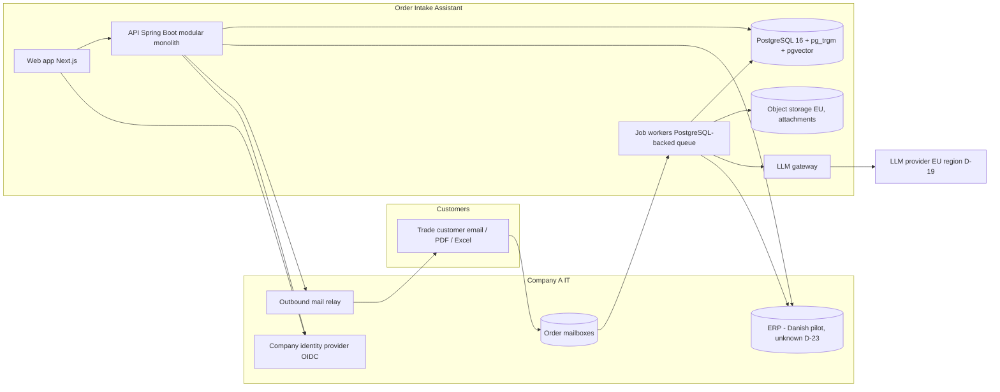
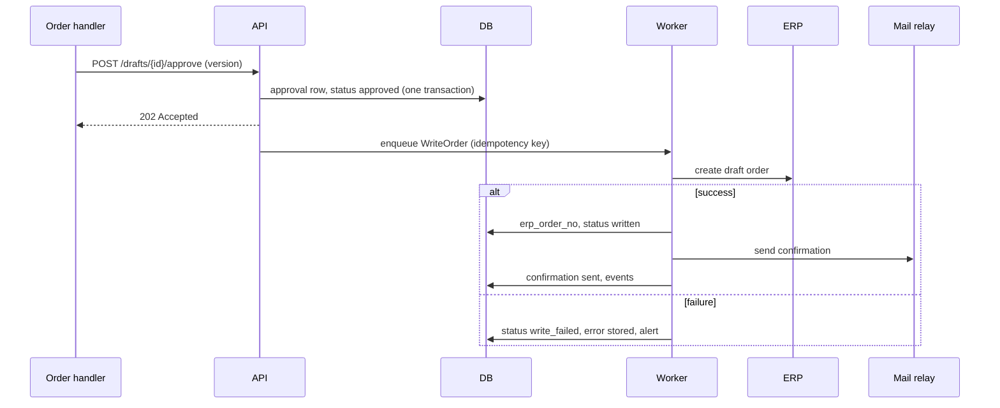

# Product Requirements Documentation — Order Intake Assistant (Company A, case: Netcompany)
**Version:** 1.0 · **Date:** 2026-10-23 · **Status:** Final (quality rubric passed, see §11.3)
**Scope:** the complete deployable product, all releases (R1, R2, R3)
**Closure:** 0 open items, completeness check clean — `12-closure-log.md` (2026-10-23) · **Pipeline:** v2
**Audience:** engineers and coding agents building the product; reviewers of the case. Company A is an anonymised archetype; all evidence comes from peers and the team's own desk research (S-037) — the size of the problem at Company A is a hypothesis to be measured (D-24).

---

## 0. Summary
- **Question** — How might we read the orders trade customers already send (email, PDF, Excel) and prepare a correct, priced draft order that a person approves in one click, without asking customers to change how they order? (06, HMW-1)
- **Opportunity** — Order handlers in Danish builders' merchants re-key unstructured orders; peers still receive about 35% of order lines outside digital channels (Solar, S-038) and Danish firms earn only 8 of 33 points of online revenue through web shops versus 25 through EDI (S-039). Job ads at Beijer, Bygma and Optimera name order and quote handling as a core duty (S-043). Cost at Company A is unmeasured: the team's illustrative model gives about EUR 14m a year (range EUR 1.9m-33.1m), explicitly an assumption (R-31).
- **Challenge** — EDI covers large repeat buyers, portals see low uptake (S-047), and interpreting trade shorthand, contract prices and project context has been human work; the cost is hidden inside general sales roles (S-037 §4.1). The journey bottleneck is between receiving the message and the confirmed ERP order (05 update §U4).
- **Solution** — The Order Intake Assistant: an overlay on the existing ERP that classifies the message, extracts the order with an LLM, matches lines to SKUs semantically using the catalogue and purchase history, applies contract prices and checks stock and credit by rules, proposes a delivery date with a confidence level, and presents a draft next to the original for one-click approval; then writes the order to the ERP and confirms to the customer. Aha moment: the order handler approves the first draft with one click and the confirmation goes out.
- **Releases** — R1: the full intake loop for a Danish pilot office (12-week plan: baseline, shadow mode, supervised go-live). R2: more channels (phone, photos, EDI changes), complaint routing, full catalogue and languages, auto-approval by confidence, ML delivery estimate, model tuning. R3: Norway and Sweden adapter sets and Swedish proactive delivery exceptions.
- **Success** — North Star: orders approved without edits, paired with post-approval line error rate; targets are gains over the weeks 1-2 baseline (R-27, D-13). Stage metrics in §1.4.
- **Not in scope** — ERP replacement, project-quote automation, forecasting, any monitoring of individual employees (R-26); delivery orchestration, store assistant, PIM, claims processing, account opening, click-and-collect, DIY consumer features (Parking Lot, §12).

## 1. Personas & Customer Journey (04, 05, 08)

### 1.1 Primary persona and secondary persona
#### PER-4 — "Order handler" (SEG-3a) — **primary user**
**Role / context:** employee in a store or regional order office who receives B2B orders by email/PDF/phone and enters them in the ERP | **Buyer, user, or both:** user (buyer = executive board) | **Primary**

| Attribute | Content | Evidence |
|---|---|---|
| Goals | Not evidenced in the handler's words — omitted | — |
| Current alternative / workaround | Reads each message, matches items to SKUs, applies the contract price, keys the order into the ERP | S-037 §2 G1, S-043 |
| Frustrations | Re-keying ("type all of that into our ERP"); order and quote handling sits inside general sales roles so the cost is invisible | E38, S-037 §4.1 |
| Context of use | Regional order mailbox; branch order emails; ERP such as AS400 at STARK (Company A's ERP unknown) | S-043, S-044, S-042 |
| Tools used | Email, ERP, phone | S-043, S-042 |
| Tech proficiency, decision authority | not evidenced — omitted | — |

#### PER-1 — "Trade customer ordering by email" (SEG-1), revised
Small/mid contractor with contract prices who sends orders as lists, PDFs, photos or emails. Goals/frustrations as above in Step 04 (S-017, S-011) and E32-E37: wants a fast confirmation, correct prices, no need to "ask for a quote". Tech proficiency and decision authority are not evidenced.

### 1.2 Stakeholder map
| ID | Stakeholder | Role | Gives | Gets | Evidence |
|---|---|---|---|---|---|
| STK-1 | Executive board | Buyer / sponsor | Investment | One solution with the greatest business impact | S-001 |
| STK-5 | Country management | Owner of local processes and systems | Requirements, rollout capacity | Fit with local needs | S-001 |
| STK-10 | Order-office lead | Supervises handlers, owns exceptions | Working practice, rules | Faster, more accurate order intake | S-044 |
| STK-11 | ERP / IT owner (Denmark) | Controls API and write access | Access, change windows | A safe overlay | S-042, D-23 |
| STK-12 | LLM provider | Processes redacted message content | Model API | Usage fees | D-19 |
| STK-6 | Employee representatives | Statutory consultation (NO, SE; Danish rules not researched) | Consultation | Early involvement; no individual monitoring | S-012, S-013 |
| STK-7 | Data protection authorities | Supervision | — | Compliant processing | S-014 |
Tensions: efficiency vs perceived monitoring of handlers (resolved by R-26); relationship channel vs digitisation (the product keeps the channel, S-047); legacy ERP write access vs the 12-week plan (RK-07, D-23). Source: `02-discover/04-persona-research.md`.

### 1.3 As-is journey: bottleneck and top pains
**Between receipt of the message and the confirmed ERP order** (steps Receive → Confirm). Evidence of existence is strong (4+ source types); evidence of cost is absent (R-27 baseline). **Cross-lane link:** the customer's confirmation speed and correctness depend on the handler's interpretation work; the delivery date given at confirmation inherits the earlier promise problem (P-01, P-02). That link is why the delivery-promise check sits inside the chosen scope (R-23).

#### U3. Registry additions
| ID | Pain | Stage | Lane | Segment | Severity | Freq. | Workaround | Evidence |
|---|---|---|---|---|---|---|---|---|
| P-09 | Unstructured B2B orders (email, PDF, Excel, photo, list, phone) must be read and re-keyed into the ERP | DEC | C (and A) | SEG-3a, SEG-1 | M-H (unmeasured) | H existence, size unknown | Staff re-keying | S-038, S-039, S-043, S-044, S-046 → 4+ source types; **size weak** |
| P-10 | SKU matching of trade shorthand and application of contract prices by hand | DEC | C | SEG-3a | M | unknown | Staff knowledge, ERP search | S-043, S-049 → `Evidence: thin` |
| P-11 | Quotes and order confirmations slow or missing | DEC | A | SEG-1 | M | single reviews | Chasing by phone | S-037 via S-005 → `Evidence: thin` |

Borrowed for the delivery-promise check: P-01 (availability promise broken) and P-02 (delivery date slips) — see `02-discover/05-customer-journey.md` §4. Evidence strength for P-09..P-11 is existence-strong, size-weak (S-037).

### 1.4 To-be journey, aha moment, stage metrics
**Aha moment (handler):** the first morning the queue holds ready drafts and the handler clears the easy ones with one click each.
**Aha moment (customer):** a correct, correctly priced confirmation arrives within minutes, with no need to ask.

| Stage | What changes | Surfaces | Release |
|---|---|---|---|
| Mandate/Rollout | Staff know what the assistant does and does not do (no individual monitoring); the order-office lead configures and monitors | Onboarding and guidance, admin, lead view | R1 |
| AWR, CON | Not served (reasons in §3) | — | — |
| DEC | Message → draft → one-click approval → confirmation; exceptions queued by confidence | Mailbox connector, review workspace, confirmation email | R1 |
| RET | Drafts are written to the ERP; corrections feed learning; exceptions after the order are listed | Write-back, exceptions list, dashboard | R1 (auto-approval policy and tuning R2) |
| ADV | Handlers rate usefulness; customers feel faster service | Pulse | R1 |

#### Stage metrics and guardrails
| Stage | Metric | Definition | Measurement event (names finalised in Step 11) | Benchmark |
|---|---|---|---|---|
| Mandate/Rollout | Adoption | Share of order messages in the pilot office processed through the workspace (vs outside it) | `message_received`, `message_opened_in_workspace` | none; baseline |
| AWR | Not served | Existing B2B customers already email their orders; the product changes handling, not discovery | — | — |
| CON | Not served | Same reason; customers keep their channel (R-25) | — | — |
| DEC | **Orders approved without edits** (North Star) and **time to confirmation** (median minutes from message received to confirmation sent) | As §2 and §3 text | `draft_created`, `draft_approved`, `draft_edited`, `confirmation_sent` | S-052, S-057 |
| RET | **Line error rate** (credit notes coded wrong item, quantity or price per 1,000 order lines) and **handling time per order** (median minutes of handler time, measured at team level) | R-27 measures | `credit_note_coded` (from ERP), `handling_time_recorded` | APQC cost per order context (S-048) |
| ADV | Handler usefulness | Anonymous team-level score from a short in-product pulse | `pulse_answered` | none |

Guardrails:
1. **Post-approval line error rate** must not rise versus baseline (protects the North Star).
2. **Exception-queue backlog age** (oldest unhandled item) stays below a threshold set after baseline.
3. **Cost per processed order** (LLM and run cost) stays below a ceiling set after baseline (D-13 decided).
4. **Structural guardrail (R-26):** no metric is reported, stored or displayed at the level of an individual employee; aggregation is by team and office only.

#### North Star
**Orders approved without edits** (OAWE).
- **Definition:** among orders for which the assistant produced a draft, the share that the order handler approved with no change to customer, lines, quantities, units, SKUs, prices or delivery date. Measured weekly per office and market.
- **Why it reflects value:** it is the point where interpretation work has moved from the person to the assistant while the person remains accountable. It is the first measure in the user's plan (R-27).
- **Guardrail pairing:** it is only meaningful together with the post-approval line error rate (§3), because approving a wrong draft without edits would otherwise score as success.
- **Benchmarks (adjacent, not identical):** APQC touchless order rate: average ~67%, top performers ~94% (S-057, cross-industry, fully touchless); Esker/Siemens Healthineers: automated-order rate 8% → 85% (S-052, vendor). Company A baseline unknown.
- **Targets at 3 and 12 months:** set after the weeks 1-2 baseline, as gains over baseline (R-27, D-13 decided).

Critical path to the aha moment: SCR-01 → SCR-02 → SCR-03 → approve → write-back → confirmation (`09-solution-design.md` §1).

## 2. Scope & Releases (08)

| F-ID | Feature | Type | Stage | O-IDs / basis | Release | Priority | Notes |
|---|---|---|---|---|---|---|---|
| F-01 | Mailbox connector: ingest email, PDF, Excel from configured order mailboxes; de-duplication, threading, attachments, non-order filtering | integration | DEC | O-01 | [R1] | P1 | critical path |
| F-02 | Message classification and routing: order, quote request, status request, complaint, other | back-office | DEC | O-01 | [R1] | P1 | MVP acts on order and status; others routed to a human queue |
| F-03 | Order extraction: customer, site, lines, quantities, units, delivery wishes, each with confidence | back-office | DEC | O-01 | [R1] | P1 | R-28 |
| F-04 | SKU matching on catalogue and purchase history (top ~2,000 SKUs first), unit normalisation, alternatives | back-office | DEC | O-01 | [R1] | P1 | R-25 |
| F-05 | Price and availability check (read-only): contract/project price, stock, credit from the ERP | integration | DEC | O-01, O-02 | [R1] | P1 | rules, not AI (R-28) |
| F-06 | Delivery-date proposal with a confidence level (rule-based) | back-office | DEC | O-02 | [R1] | P2 | G2 borrow (R-23) |
| F-07 | Review workspace: message and draft side by side; approve in one click; edit lines; reject, forward, reassign; exception queue by confidence | user-facing | DEC | O-01, O-03 | [R1] | P1 | critical path |
| F-08 | Draft-order write-back to the ERP via API with RPA fallback; idempotency, retry, error queue, status sync | integration | DEC | O-01 | [R1] | P1 | RK-07, D-23 |
| F-09 | Customer confirmation in the customer's language after approval; templates; reply tracking | user-facing | DEC | O-02 | [R1] | P1 | Danish with English fallback (D-20) |
| F-10 | Status-request answers from ERP data, sent after approval | user-facing | DEC | O-02 | [R1] | P2 | S-037 §4.3 "order and status requests" |
| F-11 | Correction capture as evaluation data; evaluation harness; model/prompt version metrics | back-office | RET | O-03, O-04 | [R1] | P1 | R-27 |
| F-12 | Read-only list of exceptions after the order (missing site data, stock shortfall) | user-facing | RET | O-03 | [R1] | P3 | S-037 step 10 |
| F-13 | Order-office lead view: queue monitor, assignment, service timers; aggregate only | user-facing | RET | O-03, R-26 | [R1] | P2 | four roles (D-22) |
| F-14 | Measurement dashboard including baseline mode for weeks 1-2 | user-facing | RET | O-04, R-27 | [R1] | P1 | North Star and stage metrics |
| F-15 | Shadow-mode comparison: assistant draft vs the human-entered order; no ERP write | back-office | DEC | R-27 (weeks 3-8) | [R1] | P1 | part of the real rollout plan, not a demo device |
| F-16 | Admin configuration: mailboxes, SKU scope, confidence thresholds, templates, languages, feature flags per market, model/prompt versions | operational | all | R-24, R-26 | [R1] | P1 | |
| F-17 | Master-data sync (catalogue, units, customer purchase history) and a customer-specific alias dictionary managed by handlers | integration | DEC | O-01 | [R1] | P1 | |
| F-18 | Pilot-market adapters for ERP and mail (Denmark) | integration | all | R-30, D-23 | [R1] | P1 | |
| F-19 | Staff identity and access: corporate SSO, roles, scoping by office/market | operational | all | security, (D-22 decided) | [R1] | P1 | |
| F-20 | Privacy and audit: DPIA artefacts, retention and deletion, redaction before LLM calls, data-subject requests for customer contacts, audit log of approvals and ERP writes | operational | all | GDPR (S-014) | [R1] | P1 | required to operate legally |
| F-21 | LLM gateway: provider abstraction, prompt versioning, injection guardrails, cost metering, EU region | operational | all | S-055, (D-19 decided) | [R1] | P1 | |
| F-22 | Staff notifications (queue alerts) and preferences | operational | DEC | O-03 | [R1] | P3 | |
| F-23 | Localisation, help, status/maintenance/not-found pages, degraded mode (AI unavailable → messages pass through unprocessed) | operational | all | NFR | [R1] | P2 | (D-20 decided) |
| F-24 | Observability: mailbox, ERP and model health; alerts | operational | all | NFR | [R1] | P2 | |
| F-25 | Accessibility conformance for the review workspace (WCAG 2.2 AA commitment) | operational | all | accessibility checklist | [R1] | P2 | |
| F-26 | Staff onboarding and in-product guidance; rollout materials stating what the assistant does and does not do | operational | Mandate/Rollout | R-26 | [R1] | P2 | |
| F-27 | Feedback and support channel to the project team | operational | ADV | support | [R1] | P3 | |
| F-28 | Analytics instrumentation for stage metrics | operational | all | §3 | [R1] | P2 | |
| F-29 | Additional intake channels: phone/voicemail transcripts, photo/image orders, EDI change messages | integration | DEC | O-01, S-037 §4.3 | [R2] | P1 | |
| F-30 | Complaint and return message handling: classify, draft acknowledgement, route to a case queue (no claims processing) | user-facing | DEC, RET | O-03, S-037 §4.3 | [R2] | P2 | claims handling stays parked |
| F-31 | Full-catalogue matching and additional languages | back-office | DEC | O-01, S-037 §4.3 | [R2] | P1 | |
| F-32 | Confidence-based auto-approval policy (gradual autonomy) with guardrails and audit | back-office | DEC | O-01, S-037 §4.3 | [R2] | P2 | requires baseline data |
| F-33 | ML-based delivery-date estimate once 6+ months of delivery data exist | back-office | DEC | O-02, S-032 | [R2] | P3 | |
| F-34 | Model tuning from stored corrections, with evaluation-gated release | back-office | RET | O-03, S-037 §4.3 | [R2] | P2 | |
| F-35 | Norway adapter set: ERP/mail adapters, Norwegian language, local configuration | integration | all | R-24, S-037 §4.3 | [R3] | P1 | |
| F-36 | Sweden adapter set: ERP/mail adapters, Swedish language, local configuration | integration | all | R-24, S-037 §4.3 | [R3] | P1 | |
| F-37 | Sweden proactive delivery exceptions linked to carrier or transport-visibility tools | integration | RET | O-02, S-037 §4.3 | [R3] | P3 | tools optional and vendor-neutral (D-18) |

Release summary: **R1** delivers the full order-intake loop for the Denmark pilot office: mailbox in, extraction and matching, pricing and checks, review and one-click approval, write-back, confirmation, measurement, shadow mode, and every operational surface needed to run it legally and safely. **R2** adds channels (phone, photos, EDI changes), complaint and return routing, the full catalogue and more languages, auto-approval by confidence, ML delivery estimate and model tuning. **R3** adds Norway and Sweden adapter sets and Swedish proactive delivery exceptions.

Product definition: *The Order Intake Assistant reads the orders Company A's trade customers already send and prepares correct, priced draft orders that order handlers approve in one click, so that interpretation work moves from people to the assistant while people stay in control.*

### Completeness checklist
| Surface | Covered by | N/A reason |
|---|---|---|
| Public entry (website/landing/app listing) | — | N/A: internal staff product; customers use their existing email channel |
| Sign-up, login, logout, session expiry | F-19 (staff SSO) | Customer sign-up N/A: customers have no accounts in this product |
| Identity verification / KYC | — | N/A: staff identity via corporate SSO; customers not identified by the product beyond ERP records |
| Onboarding to the aha moment | F-26 | — |
| Core loop features | F-01..F-12 | — |
| Roles & permissions; invitations | F-19 | Invitations N/A: users come from corporate SSO groups |
| Admin / back-office / operator tools | F-13, F-14, F-16, F-17 | — |
| Settings & profile; notification preferences | F-16 (admin settings), F-22 (user preferences) | — |
| Notifications | F-22 (staff), F-09 (customer confirmation email) | — |
| Payments, billing, invoices, refunds | — | N/A: no money moves; prices are read from the ERP |
| Consent, terms, privacy, cookies | F-20 | Cookie consent N/A: staff app without tracking cookies beyond strictly necessary (to confirm in Step 11) |
| Data subject rights: export, correction, deletion | F-20 | — |
| Help, support contact, feedback | F-23, F-27 | — |
| Audit log / activity history | F-20 | — |
| Integrations & webhooks | F-01, F-05, F-08, F-18, F-29, F-35, F-36 | — |
| Analytics instrumentation | F-28 | — |
| Error, maintenance, not-found pages; degraded behaviour | F-23 | — |
| Localisation | F-23, F-31 | — |
| Accessibility commitments | F-25 | — |

### Scale: rollout across markets
One core, per-market adapter sets (R-24, R-26). Denmark is R1 (pilot); Norway and Sweden are R3 (F-35, F-36).

| | Denmark (R1) | Norway (R3) | Sweden (R3) |
|---|---|---|---|
| Brief's stated priority | Manual processes (the chosen opportunity) | Store operations (not this product) | Delivery and fulfilment (F-37 only) |
| Employee-facing legal step | GDPR; Datatilsynet scrutiny of monitoring (S-014); Danish consultation rules not yet researched | Working Environment Act ch. 9 applies to control measures; this product has none by design (R-26), consultation on changed work routines to be confirmed (S-012) | MBL §11 negotiation before significant changes (S-013) |
| Adapters | ERP/mail for the pilot (D-23) | (D-03 accepted-risk) | (D-03 accepted-risk) |
| Language | Danish, English (D-20 decided) | Norwegian (R2/R3) | Swedish (R2/R3) |

## 3. Functional Specification (10)
Every story and acceptance criterion of every release, verbatim. Configurable parameters CP-01..CP-12 are defined in §7.1.

### 3.1 Epic overview
| Epic | Name | Stages | F-IDs | Success signal |
|---|---|---|---|---|
| EP-01 | Intake & understanding | DEC | F-01, F-02, F-03, F-29, F-31 | Messages ingested and understood without loss; share needing manual reading |
| EP-02 | Matching, pricing & promise | DEC | F-04, F-05, F-06, F-17, F-33 | SKU match accuracy; correct contract price; believable date |
| EP-03 | Review & approval | DEC, RET | F-07, F-10, F-12, F-32 | Orders approved without edits (North Star); time to confirmation |
| EP-04 | ERP integration & confirmation | DEC | F-08, F-09, F-18 | Orders written once and confirmed; write failures recovered |
| EP-05 | Learning & measurement | RET | F-11, F-14, F-15, F-28, F-34 | Baseline captured; shadow comparison; line error rate |
| EP-06 | Operations & queue management | RET | F-13, F-22, F-30 | Backlog age; reassign speed |
| EP-07 | Platform, security & compliance | all | F-19, F-20, F-21, F-24, F-25 | No unauthorised access; every approval and write audited |
| EP-08 | Administration & product support | Mandate/Rollout, ADV | F-16, F-23, F-26, F-27 | Configuration changes safe; adoption; handler usefulness |
| EP-09 | Market expansion | all | F-35, F-36, F-37 | Market enabled only when ready |

### 3.2 Stories and acceptance criteria

#### EP-01 Intake & understanding

#### US-01 — Connect an order mailbox and ingest messages · F-01 · EP-01 · SCR-15 · [R1] · P1 · M
**As an** AD, **I want** to connect a shared order mailbox **so that** customer messages enter the assistant without anyone forwarding them.
Depends on: US-37 · Emits: `message_received`
- **AC-01.1** `ui+api` — Given valid mailbox credentials, when AD saves and tests the connection, then the status shows *Connected* and the last-checked time.
- **AC-01.2** `api` — Given a connected mailbox, when a new message arrives, then within CP-01 it is stored once with its attachments and visible to users in the office scope.
- **AC-01.3** `api` (edge) — Given the same message is delivered twice (same Message-ID or identical content hash), when ingestion runs, then the second copy is marked *Duplicate* and no second draft is created.
- **AC-01.4** `ui+api` (error) — Given invalid or revoked credentials, when polling fails, then the status shows *Failed* with a short reason, no message is lost (it is retrieved after reconnection), and AD receives an alert.
- **AC-01.5** `api` (edge) — Given an attachment larger than CP-10 or of an unsupported type, when ingested, then the attachment is skipped with the label "Vedhæftning sprunget over" and the message is still processed.

#### US-02 — Thread messages and filter out non-order mail · F-01 · EP-01 · non-UI (trigger: message ingested) · [R1] · P2 · S
**As an** OH, **I want** replies grouped and automatic mail ignored **so that** my queue contains only work.
Depends on: US-01
- **AC-02.1** `api` — Given a reply to an existing conversation, when ingested, then it is linked to the thread and the draft shows the thread.
- **AC-02.2** `api` — Given an out-of-office or delivery-failure notice, when ingested, then it is stored with status *Filtered* and does not appear in My queue.
- **AC-02.3** `ui+api` (edge) — Given a filtered message that is actually an order, when OH marks it "Mark as order", then it is processed as an order and the correction is stored (US-27).

#### US-03 — Classify messages · F-02 · EP-01 · SCR-02, SCR-08 · [R1] · P1 · M
**As an** OH, **I want** each message classified as order, quote request, status request, complaint or other **so that** I only open the right ones in the right place.
Depends on: US-01 · Emits: `message_classified`
- **AC-03.1** `api` — Given an ingested message, when classification runs, then exactly one category and a confidence value are stored.
- **AC-03.2** `ui+api` — Given a message classified *order*, when it is processed, then a draft appears in My queue; given *status request*, it appears via SCR-07; given quote request, complaint (R1) or other, it appears in SCR-08 with the category chip.
- **AC-03.3** `ui+api` (edge) — Given a wrong category, when OH re-classifies it, then the message is routed accordingly and the correction is stored.
- **AC-03.4** `api` (error) — Given the classifier is unavailable, when a message arrives, then it is stored as *Manual* and shown in My queue with the original only (degraded mode, US-44).

#### US-04 — Extract order content with per-field confidence · F-03 · EP-01 · non-UI (trigger: message classified *order*) · [R1] · P1 · L
**As an** OH, **I want** customer, site, lines, quantities, units and delivery wishes extracted **so that** I do not read and key them by hand.
Depends on: US-03, US-42 · Emits: `draft_created`
- **AC-04.1** `api` — Given an order message with text, PDF or Excel content, when extraction runs, then a draft is created containing customer reference, site, lines (description, quantity, unit), delivery wishes and a confidence value per field, each linked to the evidence span in the source.
- **AC-04.2** `ui` — Given a draft, when OH opens it, then each field shows its evidence in the message when selected (SCR-03).
- **AC-04.3** `api` (edge) — Given a field that cannot be found in the message, when the draft is built, then the field is empty and flagged *Missing*, never filled by guess.
- **AC-04.4** `api` (edge) — Given text in the message that gives instructions to the system, when extraction runs, then the text is treated as data, no instruction is followed, and the message is flagged *Suspicious content* for review (US-42).
- **AC-04.5** `api` (error) — Given the model returns output that fails schema validation, when extraction runs, then the draft is discarded, the message is routed to *Manual* and the failure is logged.

#### US-05 — Split messages containing several orders · F-03 · EP-01 · SCR-03 · [R1] · P2 · S
**As an** OH, **I want** a message with several orders split into linked drafts **so that** each can be approved separately.
Depends on: US-04
- **AC-05.1** `ui+api` — Given a message with two distinct sites or delivery dates, when extraction runs, then two drafts are created, linked, and each shows "Del af samme besked" / "Part of the same message".
- **AC-05.2** `ui` (edge) — Given an incorrect split, when OH merges the drafts, then one draft holds all lines and the merge is stored as a correction.

#### US-06 — Handle unreadable messages and attachments · F-01, F-03 · EP-01 · SCR-03, SCR-30 · [R1] · P2 · S
**As an** OH, **I want** a clear route when the assistant cannot read something **so that** nothing is silently lost.
Depends on: US-04
- **AC-06.1** `ui` — Given an unreadable or password-protected attachment, when OH opens the draft, then the notice "Vedhæftningen kan ikke åbnes." is shown and a template request for a new file is offered.
- **AC-06.2** `ui+api` (edge) — Given a message in an unsupported language (before R2), when ingested, then it is flagged *Unsupported language* and routed to manual handling.
- **AC-06.3** `api` (error) — Given extraction failure of any kind, when the item is stored, then it appears in My queue as *Manual* within the same time as normal drafts.

#### EP-02 Matching, pricing & promise

#### US-07 — Match lines to SKUs and normalise units · F-04 · EP-02 · SCR-03, SCR-04 · [R1] · P1 · L
**As an** OH, **I want** each line mapped to a catalogue SKU with a unit and confidence **so that** I confirm instead of searching.
Depends on: US-04, US-12 · Emits: `line_matched`
- **AC-07.1** `api` — Given an extracted line within the SKU scope (CP-scope in SCR-16), when matching runs, then up to three candidates with SKU number, description, unit and confidence are stored and the best candidate above its threshold is preselected.
- **AC-07.2** `ui` — Given a preselected line, when OH opens the draft, then the SKU, description and unit are visible with a text confidence label (Sikker / Tjek / Usikker).
- **AC-07.3** `api` (edge) — Given quantities expressed in different units (pieces, bundles, running metres), when matching runs, then quantities are converted using master-data conversion factors, both original and converted values are stored, and an unavailable factor flags the line *Unit unknown*.
- **AC-07.4** `api` (edge) — Given a line outside the SKU scope, when matching runs, then the line is marked *Outside scope* and sent to the exception queue without a candidate.
- **AC-07.5** `ui` (error) — Given no candidate above the lowest threshold, when OH opens the line, then the message "Ingen forslag. Søg i kataloget." is shown with a search box.

#### US-08 — Use purchase history and customer-specific names in matching · F-04, F-17 · EP-02 · non-UI · [R1] · P1 · M
**As an** OH, **I want** matching to prefer what this customer usually buys and calls things **so that** shorthand resolves correctly.
Depends on: US-07, US-11
- **AC-08.1** `api` — Given an active alias for the customer, when a line text equals the alias, then the aliased SKU is the top candidate with the reason "Kundens betegnelse".
- **AC-08.2** `api` — Given purchase history for the customer, when two candidates tie, then the one bought more recently by this customer ranks higher.
- **AC-08.3** `api` (edge) — Given a new customer with no history, when matching runs, then only catalogue and generic logic are used and the draft is marked "Ny kunde – ingen historik".

#### US-09 — Read contract price, stock and credit · F-05 · EP-02 · SCR-03 · [R1] · P1 · M
**As an** OH, **I want** the customer's contract price, stock and credit status shown per line **so that** I do not look them up.
Depends on: US-07, US-26 · Emits: `price_checked`
- **AC-09.1** `api` — Given a matched line and a customer, when the check runs, then the contract or project price, available stock and credit status are read from the ERP (read-only) and stored with a timestamp.
- **AC-09.2** `ui` — Given a customer-stated price that differs from the contract price, when OH opens the draft, then both prices are shown, the contract price is used, and the line is flagged "Prisafvigelse".
- **AC-09.3** `ui+api` (error) — Given the ERP is unreachable, when the check runs, then the fields show "Pris/lager kunne ikke hentes. Kontroller manuelt før godkendelse." and the Approve action stays disabled until OH ticks "Manuel kontrol udført".
- **AC-09.4** `api` — Given any price check, when it runs, then no ERP data is changed (read-only credentials and no write call exist in the price check path).

#### US-10 — Propose a delivery date with a confidence level · F-06 · EP-02 · SCR-03 · [R1] · P2 · M
**As an** OH, **I want** a proposed delivery date with its confidence and reason **so that** the confirmation is believable.
Depends on: US-09
- **AC-10.1** `api` — Given stock status, customer delivery wishes and configured delivery calendar rules, when the proposal runs, then a date and a confidence level (Høj / Middel / Lav) with a reason text are stored.
- **AC-10.2** `ui` — Given a proposed date, when OH changes it, then the change is stored as a correction and the confirmation uses the new date.
- **AC-10.3** `ui` (edge) — Given stock shortfall on any line, when the proposal runs, then the date shows confidence Lav and the reason "Lager mangler på linje [n]".

#### US-11 — Manage customer-specific names (aliases) · F-17 · EP-02 · SCR-10, SCR-04 · [R1] · P1 · M
**As an** OH, **I want** to save a customer's own name for an item **so that** future orders resolve automatically.
Depends on: US-07 · Emits: `alias_saved`
- **AC-11.1** `ui+api` — Given a resolved line in SCR-04, when OH ticks "Gem som kundens betegnelse" and approves, then an alias (customer, text, SKU) is created and visible in SCR-10.
- **AC-11.2** `ui+api` (edge) — Given an alias that would map the same text to two different SKUs for one customer, when saving, then it is blocked with the message "Betegnelsen findes allerede for en anden vare."
- **AC-11.3** `ui+api` — Given aliases above the policy threshold, when OH proposes one, then it becomes active only after OL approval; otherwise it is active immediately.
- **AC-11.4** `api` (authorisation) — Given a user without the OH, OL or AD role, when they call alias endpoints, then the response is 403 problem+json and nothing is changed.

#### US-12 — Synchronise master data from the ERP · F-17, F-18 · EP-02 · non-UI (trigger: schedule) · [R1] · P1 · M
**As an** AD, **I want** catalogue, units, conversion factors and purchase history kept in sync **so that** matching uses current data.
Depends on: US-26 · Emits: `masterdata_synced`
- **AC-12.1** `api` — Given a scheduled sync, when it runs, then SKUs, units, conversion factors and customer purchase history in scope are updated and the sync time is stored.
- **AC-12.2** `ui+api` (error) — Given a failed sync, when the data age exceeds CP-09, then SCR-26 shows the component as degraded, AD receives an alert, and drafts show "Stamdata kan være forældet".
- **AC-12.3** `api` (edge) — Given a SKU withdrawn in the ERP, when synced, then it is excluded from new candidates but remains visible in existing drafts with a *Withdrawn* label.

#### EP-03 Review & approval

#### US-13 — See my queue · F-07 · EP-03 · SCR-02 · [R1] · P1 · S
**As an** OH, **I want** a prioritised queue of drafts **so that** I know what to do next.
Depends on: US-04
- **AC-13.1** `ui` — Given drafts in my office scope, when I open SCR-02, then drafts are listed with customer, age, line count and confidence chip, oldest first by default, with filters for status and confidence.
- **AC-13.2** `ui` (edge) — Given no drafts, when I open SCR-02, then "Ingen ordrer venter." is shown.
- **AC-13.3** `api` (authorisation) — Given a user from another office, when requesting the queue, then items outside their office scope are not returned.
- **AC-13.4** `ui` (error) — Given the API fails, when the page loads, then "Køen kunne ikke hentes." is shown with a Retry button.

#### US-14 — Review a draft against the original message · F-07 · EP-03 · SCR-03, SCR-30 · [R1] · P1 · L
**As an** OH, **I want** to see the message and draft side by side with flagged fields first **so that** I can check quickly.
Depends on: US-13, US-07, US-09
- **AC-14.1** `ui` — Given a draft, when I open it, then the message (with attachments via SCR-30) is on the left and the draft on the right, and fields with confidence below threshold are listed first and marked with text and icon.
- **AC-14.2** `ui` — Given a field, when I select it, then its evidence span is highlighted in the message.
- **AC-14.3** `ui` (edge) — Given an attachment in Excel format, when I open it, then sheets and cells are readable and the source cell for a line is highlighted.
- **AC-14.4** `ui` — Given keyboard use only, when I review, then every action in SCR-03 is reachable and focus is visible.

#### US-15 — Resolve a flagged line · F-04, F-07 · EP-03 · SCR-04 · [R1] · P1 · M
**As an** OH, **I want** to pick or search a SKU for a flagged line **so that** every line is confirmed before approval.
Depends on: US-14
- **AC-15.1** `ui+api` — Given a flagged line, when I select a candidate, then the line becomes *Confirmed* and the choice is stored as a correction.
- **AC-15.2** `ui+api` — Given no suitable candidate, when I search the catalogue by free text, then results show SKU number, description, unit, last bought by this customer and stock, and I can select one.
- **AC-15.3** `ui` (edge) — Given a stock shortfall, when I open the line, then I can choose Split, Backorder or Substitute and see the available quantity and next delivery date.
- **AC-15.4** `ui` (edge) — Given a quantity of zero or below, when I save the line, then "Mængde skal være større end 0." is shown and nothing is saved.
- **AC-15.5** `ui` — Given a line I cannot resolve, when I choose "Hold linje", then it is excluded from the order, listed as held on the draft, and included in the confirmation as "afventer afklaring".

#### US-16 — Approve a draft · F-07 · EP-03 · SCR-03 · [R1] · P1 · M
**As an** OH, **I want** to approve a draft in one action **so that** the order is created and confirmed.
Depends on: US-14, US-22 · Emits: `draft_approved`, `draft_edited`
- **AC-16.1** `ui+api` — Given all required fields valid and no unconfirmed manual check, when I select Godkend, then the approval is recorded with my role, time and any edits, and the order moves to write-back (US-22).
- **AC-16.2** `ui` (edge) — Given a required field invalid, a flagged line unresolved, or a manual check unconfirmed, when I view the Approve action, then it is disabled with the reason listed.
- **AC-16.3** `api` — Given an approval with no edits, when stored, then the draft is counted as *approved without edits*; given any edit, then it is counted as *edited* (feeds the North Star).
- **AC-16.4** `api` (authorisation) — Given a user without OH or OL role in the office, when they call the approve endpoint, then 403 and nothing is stored.
- **AC-16.5** `api` (concurrency) — Given two approve requests for the same draft, when processed, then exactly one succeeds and the other returns 409 problem+json.

#### US-17 — Reject, forward or reassign a draft · F-07 · EP-03 · SCR-06 · [R1] · P2 · S
**As an** OH, **I want** to reject, forward or reassign a draft with a reason **so that** it reaches the right person.
Depends on: US-13 · Emits: `draft_rejected`
- **AC-17.1** `ui+api` — Given an open draft, when I choose Reject with a reason, then the draft is closed with the reason stored and the message moves to SCR-08.
- **AC-17.2** `ui+api` — Given an open draft, when I reassign it to a user or team in my office, then it appears in their queue and an entry is added to the audit log.
- **AC-17.3** `ui` (edge) — Given I choose a user outside my office scope, when I confirm, then the option is not offered.

#### US-18 — Prevent two handlers editing the same draft · F-07 · EP-03 · SCR-03 · [R1] · P2 · S
**As an** OH, **I want** a draft locked while a colleague works on it **so that** we do not duplicate effort.
Depends on: US-14
- **AC-18.1** `ui+api` — Given a draft opened by another handler, when I open it, then it is read-only with the banner "Åbnet af en kollega" and the lock owner's display name.
- **AC-18.2** `api` — Given a lock idle for CP-02, when another user opens the draft, then the lock is released and the new user obtains it.
- **AC-18.3** `api` (concurrency) — Given a stale edit from the former lock holder, when it is submitted, then 409 is returned and nothing is overwritten.

#### US-19 — Work non-order messages · F-02 · EP-03 · SCR-08 · [R1] · P2 · S
**As an** OH, **I want** quote requests, complaints and other messages listed **so that** nothing is missed.
Depends on: US-03
- **AC-19.1** `ui` — Given messages classified quote request, complaint (R1) or other, when I open SCR-08, then they are listed with category, customer guess and age.
- **AC-19.2** `ui+api` — Given a message I handled outside the tool, when I mark it *Handled elsewhere*, then it leaves the list and the action is audited.
- **AC-19.3** `ui` (edge) — Given an empty list, when I open SCR-08, then "Ingen øvrige beskeder." is shown.

#### US-20 — Answer status requests · F-10 · EP-03 · SCR-07 · [R1] · P2 · M
**As an** OH, **I want** a proposed answer to a status request **so that** I reply quickly and correctly.
Depends on: US-03, US-26 · Emits: `status_answer_sent`
- **AC-20.1** `ui+api` — Given a status request that identifies an order, when I open SCR-07, then the order status and expected delivery are read from the ERP and a proposed answer in the customer's language is shown.
- **AC-20.2** `ui+api` (edge) — Given the order cannot be identified, when I open SCR-07, then a request-for-order-number template is proposed.
- **AC-20.3** `ui` (edge) — Given several matching orders, when I open SCR-07, then I choose one from a list before the answer is built.
- **AC-20.4** `ui` (error) — Given the ERP is unavailable, when I open SCR-07, then "Status kunne ikke hentes." is shown and no answer is proposed.
- **AC-20.5** `api` — Given I send the answer, when it is sent, then it is stored with approver, time and the ERP data used.

#### US-21 — See exceptions after the order · F-12 · EP-03 · SCR-09 · [R1] · P3 · S
**As an** OH, **I want** a read-only list of orders with missing site data or stock shortfall **so that** I can contact the customer.
Depends on: US-22
- **AC-21.1** `ui` — Given written orders with missing site data or shortfall, when I open SCR-09, then they are listed with the exception type and a link to the ERP order.
- **AC-21.2** `ui+api` — Given an exception I resolved, when I mark it resolved, then it leaves the list and the action is audited.
- **AC-21.3** `api` (edge) — Given an order cancelled in the ERP, when the list is refreshed, then its exception is closed automatically with a note.

#### EP-04 ERP integration & confirmation

#### US-22 — Write the approved draft to the ERP · F-08 · EP-04 · SCR-03 · [R1] · P1 · L
**As an** OH, **I want** the approved order created in the ERP **so that** I do not key it.
Depends on: US-16, US-26 · Emits: `erp_order_created`
- **AC-22.1** `api` — Given an approved draft outside shadow mode, when write-back runs, then one draft order is created in the ERP through the adapter and the ERP order number is stored on the draft.
- **AC-22.2** `ui` — Given success, when I view the draft, then the banner "Ordren er oprettet i ERP (nr. …). Bekræftelse sendt." is shown.
- **AC-22.3** `api` (edge) — Given the same approval is submitted twice, when write-back runs, then an idempotency key prevents a second ERP order.
- **AC-22.4** `api` (error) — Given the ERP rejects the order, when write-back fails, then the status is *Write failed*, the ERP error is stored, no confirmation is sent, and the draft remains in the queue.
- **AC-22.5** `api` — Given write-back succeeds, when finished, then the audit log records approver, draft version and ERP order number.

#### US-23 — Retry and fall back when the write fails · F-08 · EP-04 · SCR-03, SCR-02 · [R1] · P1 · M
**As an** OL, **I want** failed writes retried and visible **so that** no approved order is lost.
Depends on: US-22
- **AC-23.1** `ui+api` — Given a *Write failed* draft, when OH or OL selects Retry, then write-back runs again with the same idempotency key.
- **AC-23.2** `api` — Given the API path fails and the RPA fallback is enabled, when write-back runs, then the fallback is tried once, and its outcome is recorded.
- **AC-23.3** `api` (edge) — Given the ERP reports that the order already exists, when write-back runs, then the existing ERP order number is stored and no second order is created.
- **AC-23.4** `api` — Given a draft in *Write failed* longer than CP-12, when evaluated, then OL receives an alert.

#### US-24 — Send the customer confirmation · F-09 · EP-04 · SCR-05 · [R1] · P1 · M
**As an** OH, **I want** the confirmation sent to the customer after the order exists **so that** they know what to expect.
Depends on: US-22 · Emits: `confirmation_sent`
- **AC-24.1** `api` — Given a successful ERP write, when it completes, then a confirmation email with order number, lines, prices and delivery date is sent to the original sender, in the customer's language.
- **AC-24.2** `ui+api` — Given a required custom note, when I open the preview (SCR-05) and edit the text, then the edited text is sent and both versions are stored.
- **AC-24.3** `api` (error) — Given email sending fails, when the order exists, then the draft shows "Bekræftelsen kunne ikke sendes." with Retry, and the ERP order is not duplicated.
- **AC-24.4** `api` — Given a held line, when the confirmation is built, then it lists the line as "afventer afklaring".
- **AC-24.5** `api` (edge) — Given no confirmation may be sent in shadow mode, when a draft is approved in shadow mode, then no email is sent.

#### US-25 — Manage confirmation and status templates · F-09, F-16 · EP-04 · SCR-17 · [R1] · P2 · S
**As an** AD, **I want** to maintain templates per language **so that** wording stays consistent.
Depends on: US-24
- **AC-25.1** `ui+api` — Given a template, when AD edits and saves it, then a new version is stored and used for later messages only.
- **AC-25.2** `ui` — Given a template with an unknown placeholder, when AD saves, then saving is blocked with the placeholder named.
- **AC-25.3** `ui` — Given a preview request, when AD selects Preview, then the template renders with sample data and no real customer data.
- **AC-25.4** `api` (error) — Given a template missing its subject, body, kind or language, when AD saves, then 422 problem+json with errors[] is returned and nothing is stored.

#### US-26 — Provide ERP and mail adapters for the pilot market · F-18 · EP-04 · non-UI (trigger: any ERP or mailbox call) · [R1] · P1 · L
**As an** AD, **I want** all ERP and mail access to go through adapters **so that** other markets can be added without changing the core.
Depends on: —
- **AC-26.1** `api` — Given the Danish adapter set, when the core calls read-price, read-stock, read-credit, read-customer, read-catalogue, create-draft-order or read-order-status, then each call returns the contract-defined result or a typed error.
- **AC-26.2** `api` (error) — Given a timeout, when an adapter call exceeds its limit, then the call is retried per policy and then fails with a typed error; the core never hangs.
- **AC-26.3** `api` — Given the adapter's credentials, when reading, then they are read-only for price, stock, credit and catalogue and have draft-order creation as the only write permission.
- **AC-26.4** `api` (edge) — Given the adapter returns unexpected fields or formats, when parsed, then the response is rejected and logged without crashing.

#### EP-05 Learning & measurement

#### US-27 — Capture corrections as evaluation data · F-11 · EP-05 · non-UI (trigger: approval, edit, re-classification) · [R1] · P1 · M
**As an** AD, **I want** every correction stored **so that** accuracy can be measured and improved.
Depends on: US-16
- **AC-27.1** `api` — Given an edit, re-classification, merge or SKU change, when saved, then the original machine value, corrected value, field, draft version and model version are stored.
- **AC-27.2** `api` (edge) — Given a correction on a deleted message (retention), when retention runs, then the evaluation record keeps only non-personal fields.
- **AC-27.3** `api` — Given corrections, when exported for evaluation by AD, then no individual employee identifier is included.

#### US-28 — Run evaluations per model and prompt version · F-11 · EP-05 · SCR-18 · [R1] · P1 · M
**As an** AD, **I want** to evaluate a model/prompt version on stored corrections **so that** changes are evidence-based.
Depends on: US-27, US-42
- **AC-28.1** `ui+api` — Given a version and an evaluation set, when AD starts an evaluation, then field accuracy, line-match accuracy and edit rate are computed and shown with the version.
- **AC-28.2** `ui` (edge) — Given no evaluation data, when AD opens SCR-18, then "Ingen evalueringsdata endnu." is shown.
- **AC-28.3** `api` (error) — Given the evaluation fails, when it stops, then the failure is stored and no partial scores are shown.

#### US-29 — Run in baseline mode · F-14 · EP-05 · SCR-12, SCR-20 · [R1] · P1 · M
**As an** OL, **I want** to measure how orders arrive before the assistant acts **so that** targets are set from facts.
Depends on: US-01 · Emits: `baseline_sample`
- **AC-29.1** `ui+api` — Given an office in baseline mode, when messages arrive, then they are counted by channel and format and no draft is shown to handlers.
- **AC-29.2** `ui+api` — Given baseline mode, when OL opens SCR-12, then a banner says "Baseline-periode: tal er ikke assistentens resultater." and channel mix and volumes are shown.
- **AC-29.3** `ui` (edge) — Given AD or OL switches an office from baseline to shadow mode, when confirming, then a dialog states the effect and the change is audited.
- **AC-29.4** `api` — Given a sample request for 500 historical orders (weeks 1-2 plan), when the sample is imported from the ERP, then the credit notes coded wrong item/quantity/price are counted in the baseline.

#### US-30 — Run in shadow mode and compare with human-entered orders · F-15 · EP-05 · SCR-13, SCR-14 · [R1] · P1 · L
**As an** OL, **I want** the assistant's drafts compared with what staff keyed **so that** we see accuracy before going live.
Depends on: US-04, US-09, US-29 · Emits: `shadow_compared`
- **AC-30.1** `api` — Given an office in shadow mode, when a draft is created, then it is never written to the ERP and no confirmation is sent.
- **AC-30.2** `api` — Given a human-entered ERP order for the same customer and message reference, when found, then it is linked to the draft and field-level differences are stored.
- **AC-30.3** `ui` — Given a comparison, when OL opens SCR-14, then differences are highlighted side by side with counts per field.
- **AC-30.4** `api` (edge) — Given no human order within CP-04, when evaluated, then the draft moves to *Unmatched* and OL can link orders manually (many drafts to one order allowed).
- **AC-30.5** `api` (authorisation) — Given an OH, when requesting comparison data, then the response is 403 (OL, AN, AD only).

#### US-31 — Measurement dashboard · F-14 · EP-05 · SCR-12 · [R1] · P1 · M
**As an** OL, **I want** the plan's measures on one screen **so that** the go/no-go is evidence-based.
Depends on: US-27, US-32 · Emits: —
- **AC-31.1** `ui+api` — Given data, when I open SCR-12, then I see channel mix by order line, orders approved without edits (North Star), time to confirmation, handling time per order, line error rate, exception backlog, cost per processed order, by office and period.
- **AC-31.2** `ui` (edge) — Given fewer than CP-03 orders in a period, when displayed, then "For få data" replaces the figure.
- **AC-31.3** `api` (authorisation) — Given any role, when requesting metrics, then no endpoint returns data at employee level.
- **AC-31.4** `ui+api` — Given I export, when I choose CSV, then the file contains the displayed aggregates only.
- **AC-31.5** `ui` — Given no data, when I open SCR-12, then "Ingen data endnu." is shown.

#### US-32 — Emit analytics events · F-28 · EP-05 · non-UI (trigger: each event) · [R1] · P2 · S
**As an** AN, **I want** events with no personal data **so that** stage metrics can be calculated.
Depends on: —
- **AC-32.1** `api` — Given each event in the Step 11 schema, when it occurs, then it is stored with event name, time, office, market and object ids, and no names, emails or message text.
- **AC-32.2** `api` (edge) — Given an event with an unknown property, when emitted, then it is rejected and logged.
- **AC-32.3** `api` — Given a stage metric defined in Step 08, when metrics are calculated, then each is derivable from stored events.

#### EP-06 Operations & queue management

#### US-33 — Manage the team queue · F-13 · EP-06 · SCR-11 · [R1] · P2 · M
**As an** OL, **I want** a team view of queue counts, ages and assignments **so that** I can balance work.
Depends on: US-13
- **AC-33.1** `ui` — Given items in my office, when I open SCR-11, then I see counts by status, age distribution, oldest item and assignments by team.
- **AC-33.2** `ui+api` — Given an item, when I reassign it, then it moves to the new assignee and the action is audited.
- **AC-33.3** `ui` (edge) — Given data older than CP-05, when displayed, then the banner "Data er ældre end 5 minutter." is shown.
- **AC-33.4** `api` (authorisation) — Given an OH calling team queue endpoints, then 403.
- **AC-33.5** `ui` — Given the screen, when displayed, then no per-person ranking or productivity figure appears.

#### US-34 — Service timers and backlog alerts · F-13, F-22 · EP-06 · SCR-11 · [R1] · P2 · S
**As an** OL, **I want** a service timer on items and alerts when the backlog grows **so that** nothing waits unnoticed.
Depends on: US-33 · Emits: `backlog_alert`
- **AC-34.1** `ui+api` — Given a service timer on an item, when it expires, then the item is flagged *Overdue* on SCR-02 and SCR-11.
- **AC-34.2** `api` — Given the oldest unhandled item exceeds CP-12, when evaluated, then OL receives an alert.
- **AC-34.3** `api` (edge) — Given alerts already sent for the same condition, when re-evaluated, then no duplicate is sent until the condition clears.

#### US-35 — Staff notifications and preferences · F-22 · EP-06 · SCR-23 · [R1] · P3 · S
**As an** OH, **I want** to choose how I am notified **so that** alerts fit my work.
Depends on: US-37
- **AC-35.1** `ui+api` — Given SCR-23, when I save channel (in-app/email) and digest time, then the preference is stored for my account only.
- **AC-35.2** `api` — Given notifications, when sent, then they contain counts and links only, never message content.
- **AC-35.3** `api` (edge) — Given nothing new, when the digest time arrives, then no digest is sent.

#### US-36 — Complaint and return messages (R1 routing) · F-02 · EP-06 · SCR-08 · [R1] · P3 · S
**As an** OH, **I want** complaints visible and labelled **so that** they are not mistaken for orders.
Depends on: US-03
- **AC-36.1** `ui` — Given a complaint message, when listed in SCR-08, then the label "Reklamation" is shown and no draft order is created.
- **AC-36.2** `api` (edge) — Given a message that contains both an order and a complaint, when processed, then both a draft and an SCR-08 entry are created and linked.

#### EP-07 Platform, security & compliance

#### US-37 — Sign in with the company account and resolve roles · F-19 · EP-07 · SCR-01, SCR-19, SCR-28 · [R1] · P1 · M
**As a** staff member, **I want** to sign in with my company account **so that** I get the right access without a new password.
Depends on: —
- **AC-37.1** `ui+api` — Given a user in a mapped SSO group, when they sign in, then they land on My queue (OH/OL) or the dashboard (AN) or Admin (AD) with the roles and office scopes mapped to the group.
- **AC-37.2** `ui` (error) — Given a user in no mapped group, when they sign in, then SCR-28 shows "Du har ikke adgang." with the administrator contact.
- **AC-37.3** `ui+api` — Given an expired session, when the user acts, then they are returned to SCR-01 and, after sign-in, non-sensitive edits within CP-06 are restored.
- **AC-37.4** `api` — Given a removed group membership, when the user's next token refresh occurs, then access ends.
- **AC-37.5** `api` (security) — Given repeated failed token validation, when thresholds are reached, then the requests are rate-limited and logged.

#### US-38 — Enforce office scope and role permissions · F-19 · EP-07 · SCR-19, SCR-28 · [R1] · P1 · M
**As an** AD, **I want** permissions enforced on the server **so that** users only see what their role and office allow.
Depends on: US-37
- **AC-38.1** `api` — Given each endpoint in the authorisation matrix, when called by each role, then the response is allow, own-office-only or 403 exactly as the matrix states.
- **AC-38.2** `api` — Given an AD who is not also an OH, when requesting draft or message content, then 403; configuration and audit endpoints are allowed.
- **AC-38.3** `api` (edge) — Given an object id from another office, when requested, then the response is 404 (no existence leak).

#### US-39 — Audit log of approvals, writes and configuration · F-20 · EP-07 · SCR-21 · [R1] · P1 · M
**As an** AD, **I want** an audit log **so that** every approval, write and configuration change can be reviewed.
Depends on: US-38
- **AC-39.1** `api` — Given approvals, rejections, reassignments, ERP writes, template, threshold, model and role-mapping changes, mode switches and privacy actions, when they occur, then an audit event with actor role, time, object and before/after is stored.
- **AC-39.2** `ui+api` — Given SCR-21, when AD filters by event type, object and period, then matching events are listed and can be exported.
- **AC-39.3** `api` (immutability) — Given an audit event, when any user attempts to edit or delete it via the API, then the request is refused with 405/403 and nothing changes.
- **AC-39.4** `ui` — Given no events, when AD opens SCR-21, then "Ingen hændelser i perioden." is shown.

#### US-40 — Retention and automatic deletion · F-20 · EP-07 · SCR-22 · [R1] · P1 · M
**As an** AD, **I want** messages deleted after the retention period **so that** personal data is not kept longer than necessary.
Depends on: US-01
- **AC-40.1** `ui+api` — Given a retention period CP-07, when AD saves it in SCR-22, then it is stored and audited.
- **AC-40.2** `api` — Given messages and attachments older than CP-07 without legal hold, when the daily job runs, then they are deleted, drafts keep only non-personal fields and the ERP order reference.
- **AC-40.3** `api` (edge) — Given a legal hold on a message, when the job runs, then it is not deleted.
- **AC-40.4** `api` (error) — Given a job failure, when it stops, then AD is alerted and nothing is partially deleted.

#### US-41 — Handle data-subject requests for customer contacts · F-20 · EP-07 · SCR-22 · [R1] · P2 · M
**As an** AD, **I want** to find and delete or export a person's data **so that** we meet GDPR requests.
Depends on: US-40
- **AC-41.1** `ui+api` — Given a request type (access, rectification, deletion) and an email address, when AD registers it, then the system lists messages, drafts and aliases containing that address.
- **AC-41.2** `ui+api` — Given a deletion request, when AD executes it, then the personal data is erased or anonymised, ERP order references are kept, and a closing record is stored.
- **AC-41.3** `ui` (error) — Given deletion fails, when executing, then "Sletning mislykkedes. Intet er slettet." is shown.
- **AC-41.4** `api` (edge) — Given an access request, when executed, then the export contains only the requester's data.

#### US-42 — Route all model calls through a guarded gateway · F-21 · EP-07 · non-UI (trigger: every model call) · [R1] · P1 · L
**As an** AD, **I want** one gateway for model calls **so that** prompts, privacy and safety are controlled.
Depends on: —
- **AC-42.1** `api` — Given a model call, when made, then the gateway applies the active prompt version, separates instructions from message content, validates output against a schema, and records model version, tokens and cost.
- **AC-42.2** `api` (security) — Given message content containing instructions aimed at the system, when processed, then no instruction is executed, the output is limited to the schema, and the message is flagged *Suspicious content*.
- **AC-42.3** `api` — Given personal data not needed for the task (for example signatures, phone numbers), when sent to the model, then it is redacted or removed before the call.
- **AC-42.4** `api` (error) — Given a provider timeout, when it occurs, then one retry is made and then the message is routed to *Manual*.
- **AC-42.5** `api` — Given the provider setting, when the region is not the configured EU region, then calls are refused.

#### US-43 — Monitor component health and alert · F-24 · EP-07 · SCR-26 · [R1] · P2 · M
**As an** AD, **I want** health shown and alerts raised **so that** failures are noticed quickly.
Depends on: US-01, US-26, US-42
- **AC-43.1** `ui+api` — Given mailbox, ERP adapter, master-data sync and model components, when I open SCR-26, then each shows status and last check time.
- **AC-43.2** `api` — Given a component failure, when it persists beyond its limit, then AD receives an alert with component, time and link.
- **AC-43.3** `ui` (edge) — Given unavailable status data, when I open SCR-26, then "Status utilgængelig." is shown.

#### US-44 — Degraded mode when the assistant is unavailable · F-23 · EP-07 · SCR-02 · [R1] · P2 · M
**As an** OH, **I want** messages still delivered to me when the assistant fails **so that** orders are never delayed by an outage.
Depends on: US-03
- **AC-44.1** `ui+api` — Given the model or extraction service is unavailable, when a message arrives, then it appears in My queue as *Manual* with the original only and the banner "Assistenten er midlertidigt utilgængelig. Beskeder behandles manuelt." is shown.
- **AC-44.2** `api` (edge) — Given recovery, when the service returns, then queued *Manual* messages are not re-processed unless a user selects "Prøv assistenten".
- **AC-44.3** `ui` — Given manual items, when OH works them, then the KPIs count them as manual, not as assistant results.

#### US-45 — Accessibility of the review workspace · F-25 · EP-07 · SCR-02..SCR-05 · [R1] · P2 · M
**As an** OH using assistive technology, **I want** the review workspace to be accessible **so that** I can do the job.
Depends on: US-14
- **AC-45.1** `ui` — Given keyboard-only use, when I complete the path queue → review → approve, then every step is operable with visible focus.
- **AC-45.2** `ui` — Given a screen reader, when I open a draft, then fields, confidence labels and errors are announced with labels.
- **AC-45.3** `ui` — Given the interface, when contrast is measured, then text and controls meet the stated WCAG 2.2 AA commitment and confidence is never conveyed by colour alone.
- **AC-45.4** `ui` (edge) — Given browser zoom at 200% or a narrow window, when I use SCR-02..SCR-05, then no content or action is lost and no horizontal scrolling is needed for the main text.

#### EP-08 Administration & product support

#### US-46 — Configure SKU scope and confidence thresholds · F-16 · EP-08 · SCR-16 · [R1] · P1 · M
**As an** AD, **I want** to set the SKU scope and thresholds and test them **so that** the assistant acts only where it is reliable.
Depends on: US-28
- **AC-46.1** `ui+api` — Given a scope definition (for example top ~2,000 SKUs), when AD saves it, then matching uses only that scope and the change is audited.
- **AC-46.2** `ui+api` — Given a new threshold set, when AD tests it on the evaluation set, then expected review volume and edit rate are shown before activation.
- **AC-46.3** `ui` (error) — Given an invalid threshold (outside 0-1 or inconsistent order), when saving, then it is blocked with the reason.
- **AC-46.4** `api` (authorisation) — Given a non-AD user, when calling the endpoints, then 403.

#### US-47 — Manage model and prompt versions · F-16, F-21 · EP-08 · SCR-18 · [R1] · P1 · M
**As an** AD, **I want** to activate and roll back versions **so that** a bad change can be undone fast.
Depends on: US-28, US-42
- **AC-47.1** `ui+api` — Given a version with evaluation results, when AD activates it, then new messages use it and the audit log records who and when.
- **AC-47.2** `ui+api` — Given an active version, when AD rolls back, then the previous version is active immediately for new messages.
- **AC-47.3** `ui` (edge) — Given a version without evaluation results, when AD tries to activate, then a confirmation dialog warns "Ingen evaluering".

#### US-48 — Markets and feature flags · F-16 · EP-08 · SCR-20 · [R1] · P2 · S
**As an** AD, **I want** per-market feature flags **so that** capabilities are enabled only where ready.
Depends on: US-38
- **AC-48.1** `ui+api` — Given a flag, when AD toggles it, then the change applies to the market and is audited.
- **AC-48.2** `ui` (edge) — Given only Denmark enabled, when AD opens SCR-20, then "Kun Danmark er aktiveret." is shown.
- **AC-48.3** `api` — Given a disabled flag, when its feature is called, then the response is 404 or the feature is absent in the UI.

#### US-49 — Help, onboarding and trust statement · F-26 · EP-08 · SCR-24, SCR-29 · [R1] · P2 · S
**As an** OH, **I want** to understand what the assistant does and does not do **so that** I trust and use it.
Depends on: US-37
- **AC-49.1** `ui` — Given first sign-in, when I arrive, then the onboarding checklist (SCR-29) is shown with steps and progress.
- **AC-49.2** `ui` — Given SCR-24, when I open it, then it states what the assistant does and "Assistenten overvåger ikke enkeltpersoner."
- **AC-49.3** `ui+api` (edge) — Given I skip the checklist, when I later open Help, then I can resume it and progress is stored per user without being reported to management.

#### US-50 — Feedback and usefulness pulse · F-27 · EP-08 · SCR-25 · [R1] · P3 · S
**As an** OH, **I want** to send feedback and rate usefulness **so that** the team improves the tool.
Depends on: US-37 · Emits: `pulse_answered`
- **AC-50.1** `ui+api` — Given SCR-25, when I send text and a 1-5 rating, then it is stored; ratings are reported only as team aggregates above CP-03 respondents.
- **AC-50.2** `ui` (error) — Given a failure, when sending, then "Kunne ikke sendes." is shown with Retry.
- **AC-50.3** `ui` — Given I skip, when I close the modal, then nothing is stored.

#### US-51 — Language, status, maintenance and error pages · F-23 · EP-08 · SCR-23, SCR-26, SCR-27, SCR-28 · [R1] · P2 · S
**As a** user, **I want** the interface in my language and clear status and error pages **so that** I am never stuck.
Depends on: US-37
- **AC-51.1** `ui` — Given Danish or English selected in SCR-23, when I use the app, then all fixed UI text appears in that language.
- **AC-51.2** `ui` — Given planned maintenance, when I open the app, then SCR-27 shows the end time.
- **AC-51.3** `ui` (error) — Given an unknown route or failure, when it occurs, then SCR-28 shows "Siden findes ikke." or an error code to quote.

#### R2 stories

#### US-52 — Ingest phone and voicemail transcripts · F-29 · EP-01 · SCR-31, SCR-03 · [R2] · P1 · L
**As an** OH, **I want** phone and voicemail orders to arrive as drafts **so that** all channels are handled the same way.
Depends on: US-04
- **AC-52.1** `api` — Given a transcript delivered by the telephony integration, when received, then it is stored with a *Speech-to-text* label and processed like an order message.
- **AC-52.2** `ui` — Given the draft, when I open it, then the transcript is shown beside the draft with evidence highlighted.
- **AC-52.3** `api` (error) — Given a transcript below the quality threshold, when processed, then it is routed to *Manual* with the notice "Lav transskriptionskvalitet".

#### US-53 — Ingest photo and image orders · F-29 · EP-01 · SCR-31 · [R2] · P1 · L
**As an** OH, **I want** photos of handwritten lists processed **so that** site-originated orders are not re-keyed.
Depends on: US-04
- **AC-53.1** `api` — Given an image attachment, when processed, then text is read and lines extracted with confidence.
- **AC-53.2** `ui` (error) — Given an unreadable image, when I open it, then "Billedet er for utydeligt." is shown with a request-resend template.
- **AC-53.3** `api` (edge) — Given an image that contains no order, when processed, then it is classified *other*.

#### US-54 — Process EDI change messages · F-29 · EP-01 · SCR-03 · [R2] · P2 · M
**As an** OH, **I want** EDI change messages interpreted **so that** changes to existing orders are drafted for approval.
Depends on: US-04, US-22
- **AC-54.1** `api` — Given an EDI change for an existing ERP order, when received, then a change draft is created linking the order and listing differences.
- **AC-54.2** `ui+api` — Given a change draft, when OH approves, then the change is applied through the adapter and audited.
- **AC-54.3** `api` (error) — Given the referenced order does not exist, when processed, then the message is routed to *Manual*.

#### US-55 — Acknowledge and route complaints and returns · F-30 · EP-06 · SCR-32 · [R2] · P2 · M
**As an** OH, **I want** complaints classified with a draft acknowledgement and a case **so that** customers hear back and cases are tracked.
Depends on: US-03
- **AC-55.1** `ui+api` — Given a complaint or return message, when classified, then a case is created with category and a linked order if identified.
- **AC-55.2** `ui+api` — Given a case, when I send the draft acknowledgement, then it is sent in the customer's language and logged on the case.
- **AC-55.3** `ui` (edge) — Given a message containing an order and a complaint, when processed, then both a draft and a case are created.
- **AC-55.4** `api` — Given a case, when closed, then the closure is audited; no claim or credit note is created (outside scope).

#### US-56 — Match against the full catalogue · F-31 · EP-02 · SCR-16 · [R2] · P1 · M
**As an** AD, **I want** matching extended to the whole catalogue **so that** fewer lines are outside scope.
Depends on: US-46
- **AC-56.1** `ui+api` — Given AD extends the scope, when evaluated on the evaluation set, then accuracy by scope is shown before activation.
- **AC-56.2** `api` — Given activation, when matching runs, then lines outside the earlier scope receive candidates.
- **AC-56.3** `api` (edge) — Given a drop in accuracy beyond the guardrail after activation, when detected, then AD is alerted and may roll back.

#### US-57 — Process additional languages · F-31 · EP-01 · SCR-17 · [R2] · P2 · M
**As an** OH, **I want** Swedish, Norwegian and English messages handled **so that** cross-border customers are served.
Depends on: US-04, US-25
- **AC-57.1** `api` — Given a message in an enabled language, when processed, then extraction and matching run and the language is stored.
- **AC-57.2** `ui+api` — Given the customer's language, when a confirmation is sent, then the matching template is used.
- **AC-57.3** `api` (edge) — Given a mixed-language message, when processed, then the language is recorded per line.

#### US-58 — Define an auto-approval policy · F-32 · EP-03 · SCR-33 · [R2] · P2 · L
**As an** AD, **I want** eligible drafts written without a click **so that** handlers focus on exceptions.
Depends on: US-16, US-31
- **AC-58.1** `ui+api` — Given a policy (customer group, minimum confidence, maximum order value, excluded categories), when AD saves it, then it is versioned and audited.
- **AC-58.2** `api` — Given a draft that meets the policy, when created, then it is approved automatically with the policy version recorded and the confirmation process follows US-22 and US-24.
- **AC-58.3** `api` (edge) — Given a draft with any flagged line, a price deviation or a new customer, when evaluated, then it is never auto-approved.
- **AC-58.4** `api` (authorisation) — Given a user who is not AD, when calling the policy endpoints, then 403.

#### US-59 — Sample auto-approved orders and stop on error · F-32 · EP-03 · SCR-33, SCR-02 · [R2] · P2 · M
**As an** OL, **I want** a sample of auto-approved orders reviewed and a kill switch **so that** errors are caught.
Depends on: US-58 · Emits: `auto_approval_paused`
- **AC-59.1** `api` — Given auto-approved orders, when the sampling rate CP-08 applies, then that share is placed in a review queue after the fact.
- **AC-59.2** `ui+api` — Given a sampled order with an error, when OH marks it wrong, then auto-approval pauses for that customer group and OL is alerted.
- **AC-59.4** `api` (edge) — Given the kill switch is active, when an otherwise eligible draft is created, then it follows normal review and is not auto-approved.
- **AC-59.3** `ui+api` — Given the kill switch, when AD selects Pause all, then no new draft is auto-approved and the action is audited.

#### US-60 — Use an ML-based delivery estimate · F-33 · EP-02 · SCR-35 · [R2] · P3 · M
**As an** AD, **I want** to activate an ML delivery estimate once enough data exists **so that** dates are more accurate.
Depends on: US-10
- **AC-60.1** `ui` — Given fewer than six months of delivery history, when AD opens SCR-35, then "Mindre end 6 måneders historik. Ikke tilgængelig." is shown and activation is disabled.
- **AC-60.2** `ui+api` — Given enough history, when AD compares the ML and rule-based estimates on stored data, then accuracy for both is shown before activation.
- **AC-60.3** `api` (error) — Given the ML service fails, when a date is needed, then the rule-based estimate is used.

#### US-61 — Tune the model from corrections with a release gate · F-34 · EP-05 · SCR-34 · [R2] · P2 · L
**As an** AD, **I want** a candidate model evaluated against the current one **so that** only improvements are released.
Depends on: US-27, US-28, US-47
- **AC-61.1** `ui+api` — Given stored corrections, when AD starts tuning, then a candidate is produced and evaluated on a held-out set.
- **AC-61.2** `ui+api` — Given a candidate that does not beat the current model on the agreed measures, when AD tries to release, then release is blocked with the comparison shown.
- **AC-61.3** `ui+api` — Given a released candidate, when AD rolls back, then the previous model is active immediately.
- **AC-61.4** `api` (edge) — Given corrections from messages deleted by retention, when tuning, then only non-personal fields are used.

#### R3 stories

#### US-62 — Enable a market only when it is ready · F-35, F-36 · EP-09 · SCR-36, SCR-20 · [R3] · P1 · M
**As an** AD, **I want** a readiness checklist before a market goes live **so that** adapters, language, templates and consultation steps are complete.
Depends on: US-48
- **AC-62.1** `ui+api` — Given a market, when AD opens SCR-36, then the checklist shows adapters tested, language and templates reviewed, thresholds evaluated and the consultation step recorded as complete by an authorised user.
- **AC-62.2** `api` (edge) — Given an incomplete checklist, when AD tries to enable the market, then the request is refused with 409 problem+json listing the open items.
- **AC-62.3** `api` — Given enablement, when completed, then office scopes and flags for the market are created and audited.

#### US-63 — Norway adapter set · F-35 · EP-09 · non-UI (trigger: market enabled) · [R3] · P1 · L
**As an** AD, **I want** Norwegian ERP and mail adapters and language **so that** Norwegian offices can use the assistant.
Depends on: US-26, US-62, (D-03 accepted-risk)
- **AC-63.1** `api` — Given the Norwegian adapter set, when the core calls any adapter operation of US-26, then results follow the same contract.
- **AC-63.2** `api` — Given a Norwegian message, when processed, then Norwegian language handling and templates apply.
- **AC-63.3** `api` (edge) — Given adapter operations that Norwegian systems cannot support, when called, then a typed *Unsupported* error is returned and the item is routed to *Manual*.

#### US-64 — Sweden adapter set · F-36 · EP-09 · non-UI (trigger: market enabled) · [R3] · P1 · L
**As an** AD, **I want** Swedish ERP and mail adapters and language **so that** Swedish offices can use the assistant.
Depends on: US-26, US-62, (D-03 accepted-risk)
- **AC-64.1** `api` — Same contract tests as AC-63.1 for the Swedish adapter set.
- **AC-64.2** `api` — Given a Swedish message, when processed, then Swedish language handling and templates apply.
- **AC-64.3** `api` (edge) — Given unsupported operations, when called, then a typed *Unsupported* error is returned and the item routed to *Manual*.

#### US-65 — Sweden proactive delivery exceptions · F-37 · EP-09 · SCR-37 · [R3] · P3 · M
**As an** OH in Sweden, **I want** delivery exceptions from the transport tool listed **so that** I can inform customers early.
Depends on: US-64, (D-18 decided)
- **AC-65.1** `api` — Given an exception event from the connected transport-visibility tool (delay, missing site data), when received, then a DeliveryException item is created and linked to the ERP order.
- **AC-65.2** `ui+api` — Given an item, when I send the pre-approved notice, then it is sent in the customer's language and logged.
- **AC-65.3** `api` (error) — Given the tool is unavailable, when polling, then the status page shows degraded and no item is lost on recovery.

### 3.3 Slice plan
See `build-pack/slices.md` for the full detail (stories and ACs per slice, endpoints, entities, dependencies).

| Slice | Release | Stories | Screens | Endpoints / entities (indicative; Step 11 authoritative) |
|---|---|---|---|---|
| SL-1 Walking skeleton | R1 | US-37, US-01 (ingest via test mailbox), US-04 (single-path extraction), US-13, US-14 (basic), US-16, US-22 (stub adapter), US-24 | SCR-01, 02, 03, 05 | auth, messages, drafts, approve, write-back, confirmation; Message, Draft, User, AuditEvent |
| SL-2 Matching, pricing, promise | R1 | US-07, US-08, US-09, US-10, US-11, US-12, US-15 | SCR-04, SCR-10 | candidates, prices, aliases, sync; SKU, ContractPrice, Alias |
| SL-3 Review completeness | R1 | US-02, US-03, US-05, US-06, US-17, US-18, US-19, US-20, US-21, US-36 | SCR-06..09, SCR-30 | classification, locks, status requests, exceptions |
| SL-4 ERP and mail adapters (production) | R1 | US-26, US-23, US-25, US-44 | SCR-17, SCR-26 | adapter contracts, retry, templates, degraded mode |
| SL-5 Measurement, baseline, shadow | R1 | US-27, US-28, US-29, US-30, US-31, US-32 | SCR-12..14, SCR-18 | corrections, evaluation, comparison, metrics |
| SL-6 Admin and platform | R1 | US-38, US-39, US-40, US-41, US-42, US-43, US-46, US-47, US-48 | SCR-15..SCR-22, SCR-20 | configuration, audit, privacy, gateway, health |
| SL-7 Operations and support | R1 | US-33, US-34, US-35, US-45, US-49, US-50, US-51 | SCR-11, 23..29 | team queue, notifications, help, accessibility |
| SL-8 Channels and intelligence | R2 | US-52, US-53, US-54, US-55, US-56, US-57 | SCR-31, SCR-32 | new channels, cases, catalogue, languages |
| SL-9 Autonomy and tuning | R2 | US-58, US-59, US-60, US-61 | SCR-33..35 | policy, sampling, ML estimate, tuning |
| SL-10 Market expansion | R3 | US-62, US-63, US-64, US-65 | SCR-36, SCR-37 | readiness, adapters, delivery exceptions |
SL-1 contains the walking skeleton and the critical path to the aha moment (SCR-01 → 02 → 03 → approve → confirmation).

### 3.4 Definition of Done
As `templates/dod-checklist.md`, adapted to the product: Playwright for `ui`, integration tests (Testcontainers) for `api`, contract test against `openapi.yaml`, Flyway migrations, authorisation tests per role, accessibility checks (SCR-02..05 WCAG 2.2 AA), analytics events per schema, problem+json errors, structured logs with correlation IDs, only the generated API client in the frontend, and — specific to this product — an automated test that no endpoint or log exposes employee-level metrics (R-26).

### 3.5 Count summary
| | R1 | R2 | R3 | Total |
|---|---|---|---|---|
| Epics | 9 (EP-09 holds R3 stories) | — | — | 9 |
| Features | 28 | 6 | 3 | 37 |
| Stories | 51 | 10 | 4 | 65 |
| ACs | 191 | 34 | 12 | 237 |

(Counted from the story lists above by script.)

## 4. Experience Specification (09)
### 4.1 Information architecture
| Role | Navigation (left menu) | Entry points |
|---|---|---|
| OH | Kø (My queue) · Undtagelser (Exceptions) · Øvrige beskeder (Non-order) · Kunde-betegnelser (Aliases) · Hjælp | Email alert, deep link to a draft, ERP link (if provided) |
| OL | OH items plus Teamkø (Team queue) · Måling (Dashboard) · Skyggetest (Shadow comparison) | Same |
| AN | Måling (Dashboard) · Skyggetest | Dashboard link |
| AD | Everything above plus Administration (Mailboxes, Scope, Thresholds, Templates, Model versions, Users, Markets, Privacy & audit, Status) | Status page, alert email |
Cross-cutting: global search by customer, message or ERP order number; profile menu (preferences, language, feedback, sign out).
Visibility: OH sees drafts in their office scope; OL sees all items in the office; AN sees aggregates only; AD sees configuration and audit but no draft content unless also OH (separation of duties; (D-22 decided)).

### 4.2 Flows (happy, alternative, error, edge)

Each flow lists happy, alternative, error and edge cases. "Becomes AC" = turned into an acceptance criterion in Step 10.

#### FL-01 Receive to approve (F-01..F-09, F-11, F-15, F-28) · DEC · [R1]
**User goal:** turn a customer message into a confirmed ERP order. **Entry:** My queue (SCR-02) or an alert link. **Success:** order in the ERP, confirmation sent, correction data stored. **Removes:** P-09, P-10, P-11.

| # | Action | System response | Screen | State |
|---|---|---|---|---|
| 1 | (non-UI) Message arrives in a configured order mailbox | Connector ingests it once, threads it, stores attachments, classifies it as *order*, extracts customer, site, lines, quantities, units, delivery wishes with per-field confidence, matches SKUs, reads contract prices and stock/credit, proposes a delivery date with confidence | — | draft created |
| 2 | OH opens My queue | Drafts listed by age and confidence; badge shows count needing attention | SCR-02 | populated |
| 3 | OH opens a draft | Message and draft shown side by side; fields with low confidence highlighted and linked to the evidence in the message | SCR-03 | draft |
| 4 | OH approves ("Godkend") | Approval recorded; if the office is in **shadow mode**, nothing is written (see FL-06); otherwise the draft order is written to the ERP | SCR-03 | approving |
| 5 | (non-UI) Write-back succeeds | ERP order number stored; confirmation sent to the customer in the customer's language | SCR-03 banner | written |
| 6 | OH sees success and the next draft opens | | SCR-03 | success |

Alternative paths:
| Condition | Variation | Outcome |
|---|---|---|
| Line below threshold | Line flagged amber/red with text label ("Usikker"/"Unsure") and 1-3 SKU candidates | OH picks candidate in line editor (SCR-04) |
| OH edits any field | Edit recorded as a correction (F-11) | Draft is no longer counted as approved without edits |
| Confirmation requires a custom note | OH opens preview (SCR-05) before sending | Edited text sent |
| Message not an order | Routed to Non-order queue (SCR-08) | OH handles outside the assistant |
| Message is a status request | FL-03 | |
| Message is a complaint | R1: routed to SCR-08 with label; R2: FL-20 | |

Error paths:
| Trigger | Message (exact copy) | Recovery |
|---|---|---|
| ERP write fails | "Ordren blev ikke oprettet i ERP. Intet er sendt til kunden. Prøv igen eller kontakt administrator." / "The order was not created in the ERP. Nothing was sent to the customer. Retry or contact an administrator." | Retry button; item stays in queue with status *Write failed* (FL-05) |
| Stock or price check unavailable | "Pris/lager kunne ikke hentes. Kontroller manuelt før godkendelse." / "Price/stock could not be retrieved. Check manually before approving." | Approve disabled until the OH confirms manual check |
| Extraction failed | "Assistenten kunne ikke læse denne besked." / "The assistant could not read this message." | Message opens in manual mode with the original only |
| Attachment unreadable or password-protected | "Vedhæftningen kan ikke åbnes." / "The attachment cannot be opened." | OH requests a new file; template reply offered |

Edge cases:
| Edge case | Handling | AC? |
|---|---|---|
| Same message received twice or forwarded | De-duplicated by message ID and content hash; second marked *Duplicate* | Yes |
| Several orders in one message | Split into separate drafts, linked | Yes |
| Customer not found in ERP | Draft held; OH searches or creates request for customer set-up (outside product); no write | Yes |
| Units in packs vs pieces vs running metres (S-059) | Unit normalised; both shown; conversion factor from master data | Yes |
| Message language other than Danish/English | Flagged *Unsupported language* until R2 (F-31); routed to manual | Yes |
| Two handlers open the same draft | The second user sees the draft read-only with the banner "Åbnet af en kollega" / "Opened by another handler" and the lock owner's display name; the lock expires after a configured idle time | Yes |
| Message contains instructions aimed at the system (injection) | Content treated as data; any directive is ignored; message flagged if it matches known patterns (S-055) | Yes |

#### FL-02 Resolve exceptions in review (F-04, F-05, F-06, F-07) · DEC · [R1]
Happy: OH opens an exception line → line editor (SCR-04) shows the original text span, candidates with SKU number, description, unit, last bought by this customer, stock → OH selects → line becomes *Confirmed*.
Alternative: no candidate fits → OH searches the catalogue by free text; → *No match* line can be removed or held back; order can be approved partially only if the customer's message allows ("Hold linje"). Stock shortfall: shows available quantity and next delivery date; OH chooses *Split*, *Backorder*, or *Substitute*. Price mismatch: contract price differs from customer-stated price → highlights both; OH keeps contract price and adds a note, or flags to OL.
Errors: catalogue search timeout → "Søgningen tog for lang tid." / "Search timed out." + retry. Edge: customer-specific name saved as alias (FL-07); quantity zero or negative → inline validation "Mængde skal være større end 0."

#### FL-03 Status request (F-02, F-10) · DEC · [R1]
Happy: message classified *status request* → system finds the order number or customer+date in the ERP → proposes an answer (status, expected delivery) → OH reviews (SCR-07) → sends. Alternative: order not found → asks customer for order number (template). Error: ERP unavailable → "Status kunne ikke hentes." Edge: ambiguous reference to several orders → list for OH to choose.

#### FL-04 Non-order messages (F-02) · DEC · [R1]
Happy: quote requests, complaints (R1), other → listed in SCR-08 with category, customer guess, age; OH marks *Handled elsewhere*, replies from their mail client, or reassigns. Edge: mis-classified order → "Mark as order" re-runs extraction; the correction is stored (F-11).

#### FL-05 Write-back failure and retry (F-08) · DEC · [R1]
Happy: write fails (timeout, validation error, duplicate) → draft status *Write failed* → OH or OL retries; idempotency key prevents duplicate ERP orders. Alternative: API unavailable → RPA fallback (if enabled) → if both fail, item stays queued and OL is alerted. Error copy as in FL-01. Edge: ERP reports the order exists (duplicate) → show existing ERP order number and link; no second order.

#### FL-06 Baseline mode and shadow mode (F-14, F-15) · RET · [R1]
Weeks 1-2 (baseline mode): messages are only logged and counted (channel mix, volumes, handling-time samples); no drafts are shown. Weeks 3-8 (shadow mode): drafts are created but never written; OL sees them in SCR-13/14 next to what the handler keyed in the ERP; differences are listed per field. Switching mode is an AD/OL action with a confirmation dialog. Error: no human-entered order found for a draft after 48 h → *Unmatched* bucket. Edge: a human order covering several drafts → many-to-one matching shown with a manual link control.

#### FL-07 Aliases and customer-specific names (F-17) · DEC · [R1]
Happy: in SCR-04 OH ticks "Gem som kundens betegnelse" → alias saved for that customer→SKU; managed in SCR-10 (search, edit, deactivate, history). Alternative: OL approves aliases above a policy threshold. Edge: alias conflicts (same name → two SKUs) → blocked with explanation. Error: save fails → toast with retry.

#### FL-08 Queue management by the lead (F-13) · RET · [R1]
Happy: OL opens SCR-11: counts by status, age distribution, oldest item, assignments by team; reassigns items or sets a service timer; sees alerts. No individual productivity ranking (R-26): the screen offers team and office aggregates only. Error: data stale → banner "Data er ældre end 5 minutter." Edge: item assigned to an absent person → offered for reassign.

#### FL-09 Measurement dashboard (F-14, F-28) · RET · [R1]
Happy: OL/AN/AD see channel mix, volumes, North Star (orders approved without edits), time to confirmation, handling time per order (team level), line error rate, exception backlog, cost per order; filter by office and period; export as CSV. Baseline banner while in baseline mode. Empty state until data exists. Edge: metrics with fewer than 10 orders in a period shown as "For få data" to avoid individual inference.

#### FL-10 Admin configuration (F-16, F-18, F-19, F-21) · all · [R1]
Mailboxes: connect, test, pause, set polling rules, set non-order filters. SKU scope: define the in-scope catalogue (top ~2,000) and alias policy. Thresholds: per-field confidence thresholds, with a test against the evaluation set before activation. Templates and languages: confirmation and status templates. Model/prompt versions: view versions, evaluation results, activate or roll back (two-person rule optional). Users and roles: map SSO groups to roles and office scopes. Errors: connection test fails → exact provider error summarised, no secrets shown. Edge: changing a threshold records who/when/previous value in the audit log.

#### FL-11 Privacy, retention and audit (F-20) · all · [R1]
Audit log viewer (filter by event type, object, user, period; export). Retention settings (message and attachment retention in days; automatic deletion job). Data-subject requests for customer contacts: AD registers a request (access, rectification, deletion); the system finds messages and drafts containing the contact; AD reviews and executes deletion/anonymisation; the request is closed with a record. Edge: legal hold flag blocks deletion; deleting a message that has an ERP order keeps the order reference only.

#### FL-12 Onboarding, help, feedback (F-26, F-27) · Mandate/Rollout, ADV · [R1]
First sign-in shows a short onboarding checklist (SCR-29) and the page "What the assistant does and does not do" (SCR-24), including: "Assistenten overvåger ikke enkeltpersoner." / "The assistant does not monitor individuals." Feedback modal (SCR-25) with free text and a 1-5 usefulness pulse (team-level reporting only).

#### FL-13 Notifications and preferences (F-22) · DEC · [R1]
In-app badge and optional email digest for new drafts needing attention, write failures, and mailbox problems (for AD/OL). Preferences (SCR-23): channels, digest time, UI language. Edge: quiet hours; digest not sent if nothing new.

#### FL-14 Degraded mode and status (F-23, F-24) · all · [R1]
If the model or the extraction service is unavailable, incoming messages are still ingested and shown in My queue as *Manual* with the original message only; a banner states "Assistenten er midlertidigt utilgængelig. Beskeder behandles manuelt." / "The assistant is temporarily unavailable. Messages are handled manually." The status page (SCR-26) shows mailbox, ERP and model health. Maintenance page SCR-27 during planned downtime.

#### FL-15 Sign-in and access (F-19) · all · [R1]
Happy: SSO redirect → role and office scope resolved → My queue. Error: not in any mapped group → SCR-28 "Du har ikke adgang." / "You do not have access." with the AD contact. Edge: session expiry mid-edit keeps the draft edits locally for 5 minutes and restores after sign-in (non-sensitive fields only).

#### FL-16 Master-data sync and adapters (F-17, F-18) · all · [R1]
(non-UI) A scheduled job pulls catalogue, units, conversion factors and purchase history from the ERP; a freshness check raises an alert if older than the configured age. Adapters isolate ERP specifics behind one interface. Errors: sync failure → alert to AD and status page; the last good snapshot continues to serve with a *stale* marker on drafts.

#### FL-17 LLM gateway and guardrails (F-21) · all · [R1]
(non-UI) All model calls go through the gateway: redaction/minimisation, versioned prompts, system instructions separated from message content, outputs validated against a schema, per-call cost recorded. A model output that fails schema validation or contains actions outside the allowed set is discarded and the message is routed to manual (S-055). Edge: provider timeout → retry once, then manual route.

#### FL-18 After-the-order exceptions (F-12) · RET · [R1]
SCR-09 lists orders with missing site data or stock shortfall detected after write-back; OH or OL marks resolved or contacts the customer from their mail client; read-only data from the ERP. Edge: ERP shows the order cancelled → item auto-closed with a note.

#### R2 flows
**FL-19 Additional intake channels (F-29):** voicemail and phone-call transcripts, photos and EDI change messages enter the same queue; SCR-03 shows the transcript or image beside the draft with highlighted evidence; edge: low-quality image → "Billedet er for utydeligt" / "The image is too unclear" + request-resend template; transcripts carry a *Speech-to-text* label.
**FL-20 Complaints and returns (F-30):** classified complaint → draft acknowledgement → case queue (SCR-32) with category and linked order; no claims processing; edge: complaint containing an order → both paths.
**FL-21 Full catalogue and languages (F-31):** SKU scope extended in admin to full catalogue; additional languages enabled per mailbox; edge: mixed-language message → language per line recorded.
**FL-22 Auto-approval policy (F-32):** AD defines a policy (customer groups, minimum confidence, maximum order value, excluded categories); eligible drafts are written without a click; every automatic approval is auditable and sampled for review (default 10%); a kill switch pauses all. Edge: a sampled review finds an error → auto-approval pauses for that customer group and OL is alerted.
**FL-23 ML delivery estimate (F-33):** admin compares rule-based and ML estimates on stored history; activation only after evaluation threshold; fallback to rules. Edge: fewer than 6 months of history → option disabled with explanation.
**FL-24 Model tuning (F-34):** AD runs an evaluation on stored corrections; a candidate model is released only if it beats the current model on the evaluation set; rollback in one click.

#### R3 flows
**FL-25 Market adapter sets (F-35, F-36):** AD enables a market: adds adapters, language set, office scopes, templates, thresholds; a checklist shows readiness (adapters tested, templates reviewed, consultation step recorded as complete by an authorised user). Edge: market flag cannot be enabled before the checklist is complete.
**FL-26 Sweden delivery exceptions (F-37):** exceptions from the carrier/transport-visibility tool (delay, missing site data) arrive as items in SCR-37; OH or OL can send a pre-approved customer notice; (D-18 decided) for the named tools.

### 4.3 Screen inventory

| SCR-ID | Screen | Type | Role | Stage | F-IDs | Data shown (entities) | Primary action | Secondary actions | Release |
|---|---|---|---|---|---|---|---|---|---|
| SCR-01 | Sign in / session expired | page | all | all | F-19 | User, Session | Sign in with company account | — | R1 |
| SCR-02 | My queue | page | OH, OL | DEC | F-07, F-22 | Message, Draft, confidence summary, status | Open draft | Filter, search, assign to me | R1 |
| SCR-03 | Review workspace | page | OH | DEC | F-02, F-03, F-04, F-05, F-06, F-07, F-08, F-09, F-10, F-11, F-25 | Message, Attachment, Draft, DraftLine, Customer, Site, SKU, ContractPrice, StockCheck, DeliveryProposal, Confidence, Exception | Approve | Edit line, reject, forward, reassign, open preview | R1 |
| SCR-04 | Line editor | drawer | OH | DEC | F-04, F-07, F-17 | DraftLine, SKU candidates, Unit conversions, Alias, purchase history | Select SKU | Search catalogue, hold line, save as customer name | R1 |
| SCR-05 | Confirmation preview | modal | OH | DEC | F-09 | Confirmation text, language, recipients | Send | Edit text, cancel | R1 |
| SCR-06 | Reject / forward / reassign | modal | OH, OL | DEC | F-07 | Draft, reason list, users/teams | Confirm | Cancel | R1 |
| SCR-07 | Status request review | page | OH | DEC | F-10 | Message, Order status (ERP), proposed answer | Send answer | Edit, reject | R1 |
| SCR-08 | Non-order messages | page | OH, OL | DEC | F-02 | Message, category | Mark handled | Re-classify as order, reassign | R1 |
| SCR-09 | After-the-order exceptions | page | OH, OL | RET | F-12 | ErpOrderRef, exception type | Mark resolved | Open order, assign | R1 |
| SCR-10 | Customer-specific names (aliases) | page | OH, OL | DEC | F-17 | Alias, Customer, SKU, history | Add / edit alias | Deactivate, view history | R1 |
| SCR-11 | Team queue | page | OL | RET | F-13 | Queue aggregates, ages, assignments | Reassign | Set service timer, view alerts | R1 |
| SCR-12 | Measurement dashboard | page | OL, AN, AD | RET | F-14, F-28 | MetricSnapshot, ChannelMix | Change filter | Export CSV | R1 |
| SCR-13 | Shadow comparison list | page | OL, AN, AD | RET | F-15 | ShadowComparison summary | Open comparison | Filter, export | R1 |
| SCR-14 | Shadow comparison detail | page | OL, AN, AD | RET | F-15 | Draft vs human-entered ERP order, field differences | Link orders manually | Mark reviewed | R1 |
| SCR-15 | Admin: mailboxes | page | AD | all | F-01, F-16 | MailboxConfig, status | Save | Test connection, pause | R1 |
| SCR-16 | Admin: scope and thresholds | page | AD | all | F-16, F-31 | SKU scope, Threshold, evaluation results | Activate | Test on evaluation set | R1 |
| SCR-17 | Admin: templates and languages | page | AD | all | F-09, F-16, F-23, F-31 | Template, Language | Save template | Preview | R1 |
| SCR-18 | Admin: model and prompt versions | page | AD | all | F-11, F-16, F-21 | ModelVersion, EvalRun | Activate version | Roll back, compare | R1 |
| SCR-19 | Admin: users, roles, offices | page | AD | all | F-19 | SSO group mapping, Office, Role | Save mapping | — | R1 |
| SCR-20 | Admin: markets and feature flags | page | AD | all | F-16 | Market, FeatureFlag | Toggle | Show readiness checklist | R1 |
| SCR-21 | Audit log | page | AD | all | F-20 | AuditEvent | Filter | Export | R1 |
| SCR-22 | Privacy: retention and data-subject requests | page | AD | all | F-20 | RetentionPolicy, DsrRequest | Execute request | Register request, set legal hold | R1 |
| SCR-23 | My preferences | page | all | all | F-22, F-23 | NotificationPreference, Language | Save | — | R1 |
| SCR-24 | Help: what the assistant does | page | all | Mandate/Rollout | F-23, F-26 | Help articles | — | Open feedback | R1 |
| SCR-25 | Feedback and pulse | modal | all | ADV | F-27 | Feedback | Send | Skip | R1 |
| SCR-26 | System status | page | all | all | F-23, F-24 | Component health | — | — | R1 |
| SCR-27 | Maintenance | page | all | all | F-23 | Notice | — | — | R1 |
| SCR-28 | No access / not found / error | page | all | all | F-23 | Message | Go to My queue | Contact administrator | R1 |
| SCR-29 | Onboarding checklist | page/modal | all | Mandate/Rollout | F-26 | Checklist state | Mark step done | Skip | R1 |
| SCR-30 | Draft side panel: attachment viewer (PDF/Excel/image) | drawer | OH | DEC | F-01, F-07 | Attachment | — | Zoom, download | R1 |
| SCR-31 | Intake channel viewer: transcript and image | drawer | OH | DEC | F-29 | Transcript, Image | — | Request resend | R2 |
| SCR-32 | Complaint and return case queue | page | OH, OL | RET | F-30 | Case, Message, linked Order | Acknowledge | Assign, close | R2 |
| SCR-33 | Admin: auto-approval policy | page | AD | all | F-32 | Policy, sampling results | Save policy | Pause all | R2 |
| SCR-34 | Admin: model evaluation and release gate | page | AD | all | F-34, F-33 | EvalRun, candidate vs current | Release | Roll back | R2 |
| SCR-35 | Admin: delivery estimate settings | page | AD | all | F-33 | EstimateModel, comparison | Activate | Fall back | R2 |
| SCR-36 | Admin: market readiness checklist | page | AD | all | F-35, F-36 | Market, Checklist | Enable market | — | R3 |
| SCR-37 | Delivery exceptions (Sweden) | page | OH, OL | RET | F-37 | DeliveryException, ErpOrderRef | Send notice | Mark resolved | R3 |

Non-UI features and their triggers: F-01 (new message in mailbox), F-02, F-03, F-04, F-05, F-06 (run on draft creation), F-08 (on approval), F-11 (on approval/edit; evaluation run on schedule or request), F-17 sync (schedule), F-18 (adapter calls: every ERP or mail operation), F-20 retention job (daily), F-21 (every model call), F-24 (continuous), F-28 (every event), F-29 channels (arrival), F-31, F-33, F-34, F-35, F-36 configuration-driven. Every F-ID is covered by a screen or a documented non-UI trigger.

### 4.4 Screen-state matrix (with copy)

| SCR | Empty | Loading | Error | Success / populated | Permission / role |
|---|---|---|---|---|---|
| SCR-01 | — | "Sender dig videre…" / "Redirecting you…" | "Login mislykkedes. Prøv igen." / "Sign-in failed. Try again." | My queue | No mapped role → SCR-28 |
| SCR-02 | "Ingen ordrer venter. Godt gået." / "No orders waiting." | Skeleton of 8 rows | "Køen kunne ikke hentes." + Retry | List of drafts with age and confidence chip (Sikker / Tjek / Usikker with text) | OH sees own office; OL all in office |
| SCR-03 | n/a | Message left, skeleton right | "Kunne ikke åbne udkastet." + Retry; field errors inline | Banner "Ordren er oprettet i ERP (nr. …). Bekræftelse sendt." / "Order created in ERP (no. …). Confirmation sent." | Read-only if locked: "Åbnet af en kollega." / "Opened by another handler." |
| SCR-04 | "Ingen forslag. Søg i kataloget." / "No suggestions. Search the catalogue." | Spinner on list | "Søgningen tog for lang tid." + Retry | Candidates with SKU no., description, unit, last bought, stock | OH, OL |
| SCR-05 | n/a | — | "Bekræftelsen kunne ikke sendes." / "The confirmation could not be sent." + Retry | "Bekræftelse sendt." | OH |
| SCR-06 | n/a | — | "Handlingen mislykkedes." | Toast "Gemt." | OH, OL |
| SCR-07 | n/a | Skeleton | "Status kunne ikke hentes." | Proposed answer with order status and expected delivery | OH |
| SCR-08 | "Ingen øvrige beskeder." / "No other messages." | Skeleton | "Listen kunne ikke hentes." | List with category chips | OH, OL |
| SCR-09 | "Ingen undtagelser." / "No exceptions." | Skeleton | "Kunne ikke hentes." | List with exception type | OH, OL |
| SCR-10 | "Ingen kundebetegnelser endnu." / "No customer-specific names yet." | Skeleton | Save error toast + Retry | List with search | Edit: OH propose, OL approve per policy |
| SCR-11 | "Køen er tom." | Skeleton | "Data er ældre end 5 minutter." banner | Aggregates by status/age/team | OL, AD only |
| SCR-12 | "Ingen data endnu. Baseline starter ved første besked." / "No data yet." | Skeleton charts | "Målinger kunne ikke hentes." | Tiles + charts; "For få data" under 10 orders | OL, AN, AD; no per-person data for any role |
| SCR-13 | "Skyggetest er ikke aktiv." / "Shadow mode is not active." | Skeleton | "Kunne ikke hentes." | Summary of matches/differences | OL, AN, AD |
| SCR-14 | n/a | Skeleton | "Sammenligning ikke mulig: ingen ERP-ordre fundet." | Side-by-side with differences highlighted | OL, AN, AD |
| SCR-15 | "Ingen postkasser tilsluttet." | Spinner on Test | "Forbindelsen mislykkedes: [kort årsag]." | Mailbox list with status | AD |
| SCR-16 | "Ingen tærskler sat; standard bruges." | Spinner | "Evaluering mislykkedes." | Thresholds with last evaluation | AD |
| SCR-17 | "Ingen skabeloner." | Skeleton | Save error | Template list, preview | AD |
| SCR-18 | "Ingen modelversioner." | Skeleton | "Versionen kunne ikke aktiveres." | Version list with evaluation scores | AD |
| SCR-19 | "Ingen grupper tilknyttet." | Skeleton | Save error | Group → role/office mapping | AD |
| SCR-20 | "Kun Danmark er aktiveret." | Skeleton | Save error | Flags with readiness | AD |
| SCR-21 | "Ingen hændelser i perioden." | Skeleton | "Loggen kunne ikke hentes." | Filterable list | AD |
| SCR-22 | "Ingen åbne anmodninger." | Skeleton | "Sletning mislykkedes. Intet er slettet." | Requests with status; retention rules | AD |
| SCR-23 | n/a | — | Save error | "Gemt." | own profile |
| SCR-24 | n/a | — | — | Help text incl. "Assistenten overvåger ikke enkeltpersoner." | all |
| SCR-25 | n/a | — | "Kunne ikke sendes." | "Tak for din feedback." | all |
| SCR-26 | n/a | Skeleton | "Status utilgængelig." | Component health with timestamps | all |
| SCR-27 | n/a | — | — | "Planlagt vedligeholdelse til [tid]." | all |
| SCR-28 | n/a | — | "Der opstod en fejl. Henvis til kode [id]." | "Siden findes ikke." / "Du har ikke adgang." | all |
| SCR-29 | n/a | — | — | Checklist progress | all |
| SCR-30 | "Ingen vedhæftninger." | Spinner | "Vedhæftningen kan ikke åbnes." | Viewer | OH |
| SCR-31 (R2) | "Ingen transskription." | Spinner | "Billedet er for utydeligt." | Transcript / image with highlights | OH |
| SCR-32 (R2) | "Ingen åbne sager." | Skeleton | "Kunne ikke hentes." | Case list | OH, OL |
| SCR-33 (R2) | "Ingen politik oprettet." | Skeleton | Save error | Policy with sampling results | AD |
| SCR-34 (R2) | "Ingen kandidatmodeller." | Spinner | "Evaluering mislykkedes." | Candidate vs current | AD |
| SCR-35 (R2) | "Mindre end 6 måneders historik. Ikke tilgængelig." | Skeleton | Error | Comparison | AD |
| SCR-36 (R3) | "Ingen markeder tilføjet." | Skeleton | Error | Checklist | AD |
| SCR-37 (R3) | "Ingen leveringsundtagelser." | Skeleton | Error | List | OH, OL |

Copy rule: confidence is always shown as text and icon as well as colour (accessibility, F-25). Danish strings are drafts for review (D-20 decided).

### 4.5 Off-app touchpoints
| Touchpoint | Trigger | Content outline |
|---|---|---|
| Order confirmation email | After successful ERP write (F-09) | Order number, lines, prices, delivery date, contact; language of customer's message |
| Status answer email | After OH sends (F-10) | Order number, status, expected delivery |
| Request for missing information | OH uses template | Which fields are missing (site, contact, quantity) |
| Staff digest/alert email | New drafts needing attention, write failures, mailbox errors (F-22) | Counts and deep links; no message content |
| Admin alert email | Mailbox, ERP sync, model health failures (F-24) | Component, time, link to SCR-26 |
| Acknowledgement email for complaints (R2) | OH sends (F-30) | Receipt confirmation, reference |
| Delivery notice (R3, Sweden) | OH sends from SCR-37 (F-37) | Delay information |

### 4.6 Design decision log
| Decision | Choice | Rationale | Alternatives | ID |
|---|---|---|---|---|
| Layout of review | One workspace: message left, draft right, flagged fields first | HITL practice (S-058); minimises context switching | Wizard; separate pages | — |
| Confidence display | Three levels with text and icon | Accessibility; avoids colour-only | Numeric percentage | S-058 |
| Order of events | Approve → ERP write → then send confirmation | Customers never receive a confirmation for an order that does not exist | Confirmation first | — |
| Approve gating | Approve disabled while a required field is invalid or a mandatory manual check is unconfirmed | Prevents the "automation illusion" (S-053) | Warn only | S-053 |
| No individual metrics | No per-employee view anywhere; team aggregates only; small-sample suppression | R-26, S-014 | Per-user dashboards | R-26 |
| Shadow mode | Controlled per office by OL/AD with a confirmation dialog | R-27 | Global switch | R-27 |
| Locking | Soft lock on opened drafts with read-only for others | Avoids double handling | Optimistic merge | — |
| Draft recovery after session expiry | Local non-sensitive edit cache, 5 minutes | Avoids lost edits | None | — |
| Message content in alerts | Counts and links only | Privacy | Content previews | GDPR |
| Separation of duties | AD sees configuration and audit, not draft content unless also OH | Least privilege | AD sees everything | D-22 |
| UI language | Danish with English fallback | D-20 | English only | D-20 |

## 5. Technical Specification (11)
### 5.1 System context and containers

Actors: OH, OL, AD, AN (staff), trade customers (email only), system principals (webhooks). External systems: mail platform (default Microsoft 365 via Graph, D-29), ERP (adapter, D-23), identity provider (default Entra ID, D-29), LLM provider (D-19), object storage, outbound mail relay, secrets manager, error tracking. R2: telephony/speech-to-text provider, vision/OCR provider, EDI gateway (D-31). R3: transport-visibility tool (D-18).

Containers: (1) `web` Next.js; (2) `api` Spring Boot (HTTP + scheduler); (3) `worker` the same artifact started with the worker profile (consumes jobs); (4) PostgreSQL; (5) object storage; (6) secrets store. One deployable image, two process profiles (ADR-11).

### 5.2 Frontend architecture
- **Stack (confirmed default):** Next.js App Router + TypeScript + Tailwind + shadcn/ui; TanStack Query; API client generated from `openapi.yaml`; Vitest + Playwright. No business logic in server actions or route handlers (rule 2); the only server-side code is the authentication session and a pass-through proxy that attaches the bearer token (ADR-03, ADR-14).
- **Route map:**

| Route | SCR | Roles | Release |
|---|---|---|---|
| /sign-in | SCR-01 | all | R1 |
| /queue, /queue/[draftId] (drawers: line editor SCR-04, confirmation preview SCR-05, reject/forward SCR-06, attachment viewer SCR-30) | SCR-02, SCR-03 | OH, OL | R1 |
| /status-requests/[draftId] | SCR-07 | OH, OL | R1 |
| /messages | SCR-08 | OH, OL | R1 |
| /exceptions | SCR-09 | OH, OL | R1 |
| /aliases | SCR-10 | OH, OL | R1 |
| /team | SCR-11 | OL, AD | R1 |
| /dashboard | SCR-12 | OL, AN, AD | R1 |
| /shadow, /shadow/[id] | SCR-13, SCR-14 | OL, AN, AD | R1 |
| /admin/mailboxes, /admin/scope, /admin/templates, /admin/models, /admin/users, /admin/markets | SCR-15..SCR-20 | AD | R1 |
| /admin/audit, /admin/privacy | SCR-21, SCR-22 | AD | R1 |
| /preferences, /help, /onboarding | SCR-23, SCR-24, SCR-29 | all | R1 |
| /status, /maintenance, /403, /404, /error | SCR-26..SCR-28 | all | R1 |
| /cases; /admin/auto-approval; /admin/tuning; /admin/estimates | SCR-32..SCR-35 (+ SCR-31 drawer) | OH/OL; AD | R2 |
| /admin/markets/[code]/readiness; /delivery-exceptions | SCR-36, SCR-37 | AD; OH/OL | R3 |

- **State/data:** server state only through TanStack Query hooks from the generated client; local UI state for the review workspace (current line, drawer); the non-sensitive edit cache for session restore (CP-06) lives in `sessionStorage` and holds field values only, never message text.
- **Forms/validation:** zod schemas generated from the OpenAPI constraints; the Approve button disabled states follow 09 §7 and AC-16.2.
- **Auth handling:** Auth.js OIDC (authorization code + PKCE) with tokens in an encrypted httpOnly cookie; route guards by roles from `GET /api/v1/me`; 401 → SCR-01; 403 → SCR-28.
- **i18n:** `da` default, `en`; message catalogues; further languages with markets (F-35, F-36).
- **Analytics wrapper:** UI events are posted to the backend event endpoint indirectly through user actions already captured server-side; the frontend emits only `message_opened_in_workspace` through the API. No third-party analytics scripts (staff app, no cookies beyond strictly necessary).
- **Error boundaries:** per route; shows SCR-28 with a correlation id.
- **Accessibility:** WCAG 2.2 AA; confidence shown as text + icon (F-25).

### 5.3 Backend architecture
Java 21, Spring Boot 3.x (Web, Validation, Data JPA, Security), PostgreSQL 16, Flyway, springdoc-openapi (used to verify the implementation against the contract; the contract file is the source), Testcontainers, Maven. Controllers implement interfaces generated from `openapi.yaml`.

| Module (package-by-feature) | Epic | Responsibility |
|---|---|---|
| `ingest` | EP-01 | Mailbox connector, de-duplication, threading, attachments, webhook intake (ports: `MailPort`) |
| `understanding` | EP-01 | Classification, extraction, splitting (uses `llm`) |
| `matching` | EP-02 | SKU candidate generation (full-text + trigram + vector fusion, history, aliases), unit normalisation, master-data sync |
| `pricing` | EP-02 | Contract price, stock, credit reads; delivery-date proposal (rules; ML in R2) (port: `ErpPort`) |
| `review` | EP-03 | Drafts, lines, locks, approve/reject/reassign, status requests, post-order exceptions, non-order messages |
| `erp` | EP-04 | Write-back, idempotency, retry, RPA fallback, adapters per market |
| `confirm` | EP-04 | Templates, confirmation and status emails (port: `MailPort.send`) |
| `learning` | EP-05 | Corrections, evaluation runs, shadow comparison, baseline |
| `measure` | EP-05 | Event store, rollups, metrics API (aggregates only) |
| `ops` | EP-06 | Team queue, service timers, notifications, preferences, R2 cases |
| `identity` | EP-07 | OIDC resource server, role mapping, scopes |
| `privacy` | EP-07 | Retention jobs, legal holds, data-subject requests, audit viewer |
| `llm` | EP-07 | Gateway: provider port, prompt versions, schema validation, redaction, cost metering |
| `admin` | EP-08 | Mailboxes, scope, thresholds, models, flags, markets |
| `platform` | EP-07 | Health, status, maintenance |
| R2: `channels`, `autonomy`, `tuning`; R3: `markets`, `deliveryexceptions` | EP-01/03/05/09 | As in stories US-52..US-65 |
| shared | — | `config`, `security`, `error` (problem+json), `audit` (append-only writer), `events` |

**Processing pipeline (jobs, idempotent, each step persists its result):** `IngestMessage → ClassifyMessage → ExtractOrder → MatchLines → CheckPricesAndStock → ProposeDelivery → DraftReady`. Any step failing after retries sets the message to *Manual* (AC-04.5, AC-44.1). Approval triggers `WriteOrder` then `SendConfirmation` (ADR-13). Schedulers: master-data sync, retention, shadow matching, metric rollups, health checks, backlog alerts. Queue: PostgreSQL-backed job library with `FOR UPDATE SKIP LOCKED` semantics (ADR-06).

**Ports and adapters:** `MailPort`, `ErpPort`, `LlmPort`, `ObjectStorePort`, `IdentityPort`; adapters per market under `erp.dk`, `erp.no`, `erp.se`. Every adapter call has a timeout, retry with backoff and a circuit breaker; failures become typed errors (US-26).

**Transactions:** one transaction per job step; approval and `approvals` row + status change are one transaction; ERP calls are outside DB transactions and protected by an idempotency key (US-22).

### 5.4 Domain model
See `05-deliver/build-pack/domain-model.md` (generated from `schema.sql`; 54 entities, 453 columns, ER diagram, CRUD by role). Key relations: Market 1—N Office 1—N Mailbox 1—N Message 1—N Draft 1—N DraftLine N—1 Sku; Customer 1—N Site, Alias, Contact; Draft 1—N Approval, ErpWriteAttempt, Confirmation, ShadowComparison. There is deliberately no table or column that attributes corrections, handling time or error rates to an individual employee (R-26; the `corrections` table has no user column; baseline handling-time samples are office-level).

### 5.5 Physical schema and migrations
`schema.sql` is authoritative (PostgreSQL 16, extensions `pg_trgm`, `vector`). Highlights: UUID primary keys; enums as `text` + `CHECK`; partial unique indexes for "one active row" rules (thresholds, templates, sku scope, model per kind, auto-approval policy); `skus` with stored `tsvector`, trigram index and an HNSW vector index (dimension 1024, set by the embedding model chosen in Step 23; ADR-04); `audit_events` append-only by trigger; message retention index; soft state only where the domain needs it (`messages.deleted_at`). The job library adds its own tables through its own migration.

- Flyway versioned migrations `V1__baseline.sql` (= `schema.sql`), then `V<n>__<change>.sql`; `ddl-auto=validate`; repeatable `R__reference_data.sql` for markets, role names, thresholds defaults, template defaults, onboarding step keys, component names.
- `demo`/`staging` seed from `build-pack/seed-data-spec.md` (fictional office, customers, SKUs, sample messages in Danish, expected extraction results for evaluation); `prod` = reference data only. Master data in prod comes from the ERP sync, never from seed files.
- Rollback: migrations are forward-only; destructive changes use expand/contract across two releases.

### 5.6 API
98 operations in `openapi.yaml` (R1: 79, R2: 13, R3: 6; counted from `x-release` in the file); summary in `04-specify/_api-surface.md`; contract conventions per `openapi-conventions.md` (versioned `/api/v1`, camelCase, problem+json, pagination `?page=&size=`, one example per request/response drawn from the fictional seed office). Stories without an endpoint are internal: US-26 (adapters), US-32 (events), US-42 (gateway), US-45 (accessibility), US-63, US-64 (adapter sets).

Full operation list: `04-specify/_api-surface.md`; contract: `build-pack/openapi.yaml`.

### 5.7 Integrations and fallbacks
| Dependency | Purpose / limits | Terms status | Failure behaviour and fallback |
|---|---|---|---|
| Mail platform (Graph default) | Read order mailboxes, send confirmations. App-only permissions reach all mailboxes unless restricted by an application access policy to the order mailboxes (S-061) | Company A admin consent + policy (D-29) | Poll fallback if webhook fails; alert AD; no message loss on reconnection (AC-01.4) |
| ERP (Danish pilot) | Read master data, price, stock, credit; create draft order | Unknown system and access (D-23, D-03) | API → RPA fallback → item stays queued with alert; handlers key manually |
| Identity provider | SSO | Company A (D-29) | Existing sessions continue until expiry; new sign-ins fail with the IdP message |
| LLM provider | Classification, extraction, embeddings | Contract/DPA (D-19); EU region (S-062) | One retry, then *Manual* route (AC-42.4); degraded-mode banner |
| Object storage (S3-compatible, EU) | Attachments | Provider terms | Ingest retried; attachment marked *skipped* on persistent failure |
| Outbound mail relay | Confirmations | Company A | Retry with exponential backoff; draft shows send failure (AC-24.3) |
| Secrets manager | Credentials | Platform | Service fails closed |
| Error tracking | Errors with scrubbing | Optional | Logs only if unavailable |
| R2: telephony transcripts, vision/OCR, EDI gateway | New channels | Vendors undecided (D-31) | Items route to *Manual* |
| R3: transport-visibility tool | Delivery exceptions | Tool undecided (D-18) | Status page degraded; no item lost on recovery (AC-65.3) |

### 5.8 Build vs buy, feasibility, spikes
| Component | Verdict | Feasibility | Notes |
|---|---|---|---|
| Mailbox connector | Build thin on the Graph SDK | ✅ | S-061 restriction policy needed |
| Classification and extraction | Buy model API; build prompts, schemas, validation | ⚠️ SP-02 | Accuracy on Danish trade text unproven (D-25) |
| SKU matching | Build on PostgreSQL (full-text + trigram + vector, reciprocal rank fusion) | ✅ / ⚠️ SP-04 | Pattern from S-063; exact SKU codes use lexical matching |
| ERP adapter + draft-order write | Build; RPA tool open-source/buy only if API impossible | ⚠️ SP-01 | D-23 |
| Job queue | Open-source library on PostgreSQL | ✅ | ADR-06 |
| Review UI | Build | ✅ | |
| SSO | Use company IdP | ✅ | D-29 |
| Observability | Open-source (Micrometer, OpenTelemetry) + platform dashboards | ✅ | |
| Netcompany components (EASLEY AI, PULSE, AMPLIO, Feniks AI) | **Not assumed**: optional buy/reuse for extraction, exception queue, delivery exceptions | ⚠️ pending specs | D-18 |
Spikes: **SP-01** (week 1) can a draft order be created in the pilot ERP by API; fallback RPA? **SP-02** (weeks 1-2) extraction/matching accuracy on 500 historical orders. **SP-03** application access policy limited to the order mailboxes works. **SP-04** the chosen managed PostgreSQL offers `pg_trgm` and `pgvector` (the schema itself was verified locally; this checks the provider). Fallback if pgvector is unavailable: drop the vector branch of matching. **SP-05** LLM provider EU region and terms (D-19).

### 5.9 Analytics events
Event names use `object_action`; properties contain ids, counts, durations and enums only — no names, emails or message text.
| Event | Trigger story | Feeds metric |
|---|---|---|
| message_received | US-01 | Adoption, channel mix |
| message_classified | US-03 | Classification accuracy |
| draft_created | US-04 | Time to confirmation (start), coverage |
| line_matched | US-07 | Match accuracy |
| price_checked | US-09 | Data availability |
| message_opened_in_workspace | US-14 | Adoption |
| draft_approved, draft_edited | US-16 | **North Star** (orders approved without edits) |
| draft_rejected | US-17 | Quality |
| erp_order_created | US-22 | Write success |
| confirmation_sent | US-24 | Time to confirmation (end) |
| status_answer_sent | US-20 | Responsiveness |
| alias_saved | US-11 | Learning |
| masterdata_synced | US-12 | Data freshness |
| baseline_sample, shadow_compared | US-29, US-30 | Baseline, shadow accuracy |
| handling_time_recorded (seconds in review per draft, no user id) | US-14/US-16 | Handling time per order |
| credit_note_coded (from ERP import) | US-29 | Line error rate |
| exception_raised, exception_resolved | US-21, US-34 | Exception backlog age |
| backlog_alert | US-34 | Guardrail |
| pulse_answered | US-50 | Handler usefulness |
| auto_approval_paused | US-59 (R2) | Autonomy guardrail |
Every Step 08 stage metric has at least one event above.

## 6. Security, Privacy & Compliance (11)
### 6.1 Authentication, session and security model
- **Authentication:** company OIDC; backend is an OAuth2 resource server validating issuer, audience, expiry and signature (JWKS cache); groups → roles/offices through `role_mappings` (US-37). Access-token lifetime as issued by the IdP; app session idle timeout 30 min, absolute 12 h (accepted, D-28). Service principals for inbound webhooks (Graph validation token + clientState; bearer service tokens for R2/R3).
- **Authorisation:** server-side per `authorisation-matrix.md` (98 rows × 4 roles + anonymous + system); office scoping on every query (`office_id IN scopes`), 404 outside scope; AD does not read draft/message content unless also OH (D-22).
- **Input and output safety:** all inputs validated (Bean Validation mirroring the schema); message content is untrusted data: separated from instructions, model outputs validated against a JSON schema, no tool/function execution by the model, ERP access read-only except draft-order creation (US-26 AC-26.3), human approval before any write (ADR-02, S-055).
- **Rate limiting:** per user 120 req/min and per integration endpoint 60 req/min, returning 429 problem+json (accepted, D-28).
- **CORS:** same-origin through the proxy; no wildcard origins.
- **Secrets:** platform secrets manager; mailbox credentials stored as references (`secret_ref`); no secrets in the database, logs or images.
- **Audit:** every approval, write, mode switch, configuration and privacy action (US-39); append-only trigger.
- **Dependency and code scanning:** dependency scanning (OWASP Dependency-Check or equivalent) and container scanning in CI; SAST on pull requests.

### 6.2 Authorisation matrix
`build-pack/authorisation-matrix.md` (98 operations × OH, OL, AN, AD, anonymous, system). Principles: office scoping on every query; administrators do not read draft or message content unless also order handlers; no employee-level data anywhere (ADR-10).

### 6.3 Compliance, PII register and retention
#### 6.3.1 Applicable regulations
| Regulation | Applies? | Trigger |
|---|---|---|
| GDPR (EU/EEA) | Yes | Customer contacts' data in emails; staff identifiers |
| Datatilsynet guidance and supervision (S-014, S-064) | Yes (Denmark) | DPIA for AI processing; employee-monitoring scrutiny avoided by design (R-26) |
| EU AI Act (S-060) | Yes, classification to confirm | Company A is a deployer of a GPAI-based system; AI literacy duty since 2 Feb 2025; Article 50 transparency from 2 Aug 2026 (customers receive confirmations drafted with AI and approved by a person; wording of any AI disclosure to be confirmed by legal, D-34) |
| Employee consultation rules | NO (WEA ch. 9, S-012), SE (MBL §11, S-013); Danish rules not researched | Relevant when expanding (R3); control measures avoided by design |
| Danish bookkeeping law | Not researched | ERP, not this product, holds the accounting record; to confirm with Company A (D-33) |

#### 6.3.2 PII register
| Entity.field | Subject | Purpose | Legal basis (proposed; DPO to confirm, D-33) | Retention | Access |
|---|---|---|---|---|---|
| messages.from_address, from_name, body_text; attachment content in object store | Customer contacts (business emails, may include sole traders) | Interpret and fulfil orders; audit | Legitimate interests / contract performance | CP-07 | OH, OL (office scope) |
| customer_contacts.email, name, phone; sites.contact_name, contact_phone | Customer contacts | Send confirmations; site delivery coordination | Same | Mirrors ERP sync; deleted via DSR | OH, OL |
| customers.name | Sole traders | Order identification | Same | Mirrors ERP | OH, OL |
| dsr_requests.subject_email | Requesters | Handle data-subject requests | Legal obligation | 24 months after closure | AD |
| app_users.display_name, email; *_user_id columns; audit_events.actor_user_id | Staff | Authentication, attribution of approvals, audit | Employment / legitimate interests | Account life + 24 months for audit | AD (audit), own user |
| feedback.text | Staff | Product improvement | Consent | 12 months | AD |
Redaction before model calls (US-42 AC-42.3): signatures, phone numbers and unrelated personal data are removed before text leaves the platform. Data-subject export/deletion: US-41. Breach notification process: Company A's incident process; the product raises alerts (F-24).
#### 6.3.3 Data processing agreements needed
| Vendor | Data shared | DPA status |
|---|---|---|
| LLM provider | Redacted message text and attachments | Needed; SCCs if third-country access (S-062) — D-19 |
| Cloud hosting + managed PostgreSQL + object storage | All stored data | Needed — D-30 |
| Mail platform (Microsoft 365 default) | Mailbox content | Company A's existing agreement — D-29 |
| Error tracking | Stack traces with no message text | Needed if used (scrubbing enforced) |
| R2 vendors (telephony transcription, vision) | Voice transcripts, images | Needed — D-31 |

### 6.4 Audit logging
US-39; append-only table with trigger protection (`schema.sql`, `audit_events`).

## 7. Quality Bar (10, 11)
### 7.1 NFR profile
Full tables are in `build-pack/nfr-profile.md` (this section). **Accepted (D-28)** = my proposal, accepted at closure; Company A volumes are unknown (R-06, D-24), so capacity rows follow the labelled illustrative model R-31.

#### 7.1.1 Security
| Requirement | Standard | Target | Verification |
|---|---|---|---|
| Authentication | OIDC via company IdP | No local passwords; MFA as per IdP policy | Integration test with test IdP; configuration review |
| Authorisation | Authorisation matrix | 100% of operations × roles tested | Generated test per matrix row (DoD) |
| Input validation | OWASP ASVS L1 | All inputs validated server-side | ASVS L1 checklist; fuzz tests on ingest |
| LLM-specific risks | OWASP LLM Top 10 (S-055) | Prompt-injection suite passes (no action outside schema) | Red-team test set in shadow mode (RK-08) |
| Encryption at rest | AES-256 managed | DB, object store, backups encrypted | Provider configuration evidence |
| Encryption in transit | TLS 1.2+ | All hops | Scanner (SSL Labs-type) |
| Dependency scanning | CI | No unresolved critical/high at release | CI gate |
| Session management | httpOnly, secure cookies | Idle 30 min, absolute 12 h (accepted, D-28) | Test |

#### 7.1.2 Accessibility
WCAG 2.2 AA on SCR-01..SCR-30; keyboard navigable; screen-reader labels; contrast ≥ 4.5:1; visible focus; confidence never by colour alone. Verification: axe in Playwright on every screen + manual keyboard test of the critical path.

#### 7.1.3 Performance (accepted, D-28)
| Metric | Target | Measurement |
|---|---|---|
| Message arrival → draft in queue | p95 ≤ 5 min (CP-01 polling 60 s + processing), excluding provider outages | `message_received` → `draft_created` events |
| Review workspace open | p95 ≤ 1.5 s | RUM / Playwright |
| LCP on office network | ≤ 2.5 s | Lighthouse CI |
| API read p95 / p99 | ≤ 400 ms / ≤ 1 s | Micrometer |
| API write p95 (excl. async ERP) | ≤ 800 ms | Micrometer |
| DB query p95 | ≤ 100 ms | pg_stat_statements |
| Error rate | < 1% 5xx | Metrics |
No external benchmark sources were found for these targets; they are engineering proposals.

#### 7.1.4 Reliability (accepted, D-28)
| Requirement | Target | Measurement |
|---|---|---|
| Availability | 99.5% monthly, measured Mon-Fri 06:00-18:00 Danish time | Synthetic probes |
| MTTR | ≤ 4 h | Incident log |
| Rollback | Previous image redeployable ≤ 15 min; migrations expand/contract | Release drill |
| Backups | Continuous WAL + daily snapshot; RPO ≤ 15 min, RTO ≤ 4 h | Restore test before go-live and quarterly |
| Degraded mode | Messages continue to arrive as *Manual* when AI is down (US-44) | Fault-injection test |

#### 7.1.5 Scalability (capacity assumptions from R-31, not forecasts)
| Scenario | Load | Approach |
|---|---|---|
| Launch (pilot office) | up to 500 messages/day, 20 concurrent users | Single API + worker instance each, one DB |
| 6 months | up to 2,000 messages/day, 60 concurrent users | Scale workers horizontally; read replica optional |
| 12 months (Denmark, illustrative 300 stores × 20 orders) | up to 6,000 orders/day, 300 concurrent users | Partition metric_events by month; queue concurrency; LLM batching limits |
LLM cost per message is **not estimated here**: it is measured in shadow mode (cost metering, US-42) before any business-case figure uses it.

#### 7.1.6 Configurable parameters CP-01..CP-12 (defaults accepted, D-28)
| CP | Parameter | Default |
|---|---|---|
| CP-01 | Mailbox polling interval (webhook plus poll fallback) | 60 s |
| CP-02 | Draft lock idle timeout | 15 min |
| CP-03 | Small-sample suppression threshold | 10 orders (metrics) / 10 respondents (pulse) |
| CP-04 | Shadow-mode unmatched window | 48 h |
| CP-05 | Data-staleness banner | 5 min |
| CP-06 | Session-restore window | 5 min |
| CP-07 | Retention: messages and attachments | 90 days after processing (drafts keep non-personal fields 24 months, audit 24 months, evaluation data non-personal indefinitely) — legal basis to be confirmed by Company A's DPO (D-33) |
| CP-08 | Auto-approval sampling rate | 10% |
| CP-09 | Master-data freshness limit | 24 h |
| CP-10 | Attachment size limit | 25 MB per file, 50 MB per message |
| CP-11 | Default confidence thresholds | classification ≥ 0.80, field ≥ 0.80, line match ≥ 0.85, review below 0.95 (replaced by evaluation results before go-live) |
| CP-12 | Exception-backlog alert threshold | oldest unhandled item > 4 working hours |

### 7.2 Definition of Done
See §3.4.

### 7.3 Slice plan summary per release
See §3.3 and `build-pack/slices.md`.

## 8. Deployment & Operations (11)
### 8.1 Environments and topology, CI/CD, release and rollback, cost
- **Environments:** dev, staging (shadow-mode rehearsal with seed data and a test mailbox), prod; EU region (D-30); one managed PostgreSQL per environment.
- **Hosting (default stack, with one approved change, D-32):** backend and worker as Docker images on Render/Fly/Railway (default). **Frontend: container alongside the backend instead of Vercel (D-32 decided)** because the proxy carries customer message content and a third-party edge network would become an additional processor.
- **CI/CD (GitHub Actions):** lint → unit tests → contract test against `openapi.yaml` → integration tests (Testcontainers) → build image → scan → migrate staging → Playwright → manual promotion to prod; automatic rollback on failed health checks.
- **Release and rollback:** blue/green or rolling with readiness checks; migrations expand/contract; feature flags per market (F-16).
- **Cost (proposed topology, list prices from S-065, Low-Medium reliability):**

| Item | Launch (monthly) | 12-month load |
|---|---|---|
| API web service (Render Standard, 2 GB) × 1-2 | $25-50 | $50-170 (Standard × 2 / Pro) |
| Worker service | $25 | $50-85 |
| Frontend container | $7-25 | $25 |
| Staging (Starter services) | $14-21 | $21-50 |
| Managed PostgreSQL with pgvector/pg_trgm (Fly Basic $38 / Starter $72 as reference) | $38-72 | $72-282 |
| Object storage, backups, error tracking | estimate not available | estimate not available |
| **LLM usage** | **not estimated: measured in shadow mode** | measured |
Total infrastructure excluding LLM and storage at launch ≈ $110-190 per month by these list prices; the 12-month column is an upper-bound sketch.

### 8.2 Seed and reference data
See `build-pack/seed-data-spec.md`. Migration and seeding strategy: §5.5.

### 8.3 Observability and alerting
Structured JSON logs with correlation ids across API, jobs and adapter calls; message text and attachment names never logged; Actuator health/readiness; Micrometer metrics (queue depth, job latency, model call latency/cost/outcome, ERP success/failure, sync age); error tracking with PII scrubbing; alerts from the NFR profile: mailbox failing > 10 min, ERP write failure rate > 5% over 15 min, model error rate > 10% over 15 min, sync age > CP-09, backlog age > CP-12, availability probe failing.

### 8.4 Architecture decision records
| ADR | Decision | Alternatives rejected | Rationale | Source |
|---|---|---|---|---|
| 01 | Overlay on the existing ERP; no replacement | ERP replacement | R-26; Lidl and Travis Perkins | S-029, R-26 |
| 02 | Human approval before any ERP write; confirmation after write | Auto-write; confirmation first | Control, trust, automation illusion | S-053, R-28 |
| 03 | Company OIDC; backend as resource server; Auth.js in the frontend | Backend-issued JWT with local users (stack default) | SSO is required; avoids a second credential store; deviation from default `auth` | D-29 |
| 04 | PostgreSQL for relational data, full-text, trigram and vectors | Separate search/vector database | One store to operate; scale is moderate | S-063 |
| 05 | Rules (not AI) for price, stock, credit; AI for extraction and matching | AI for pricing | Correctness and auditability | R-28 |
| 06 | Job queue on PostgreSQL | Kafka/SQS | No extra infrastructure at this scale | — |
| 07 | S3-compatible EU object storage for attachments | Blobs in PostgreSQL | Size and cost | — |
| 08 | LLM gateway with provider port, EU region, prompt versions | Direct provider calls | Privacy, injection controls, portability | S-055, S-062 |
| 09 | Ports/adapters for ERP and mail | Hard-wired integrations | Markets R3; unknown ERP | D-23 |
| 10 | No employee-level data model | Per-user productivity | R-26, S-014 | R-26 |
| 11 | Modular monolith, one image, API and worker profiles | Microservices | Team size, 12-week plan | R-30 |
| 12 | Contract-first OpenAPI | Code-first | Parallel build, generated clients | stack rules |
| 13 | Order of events: approve → write → confirm | Confirm first | Never confirm a non-existent order | 09 §7 |
| 14 | Frontend container next to the backend (approved change from Vercel, D-32) | Vercel | Message content through the proxy | D-32 |

## 9. Why This Solution (06, 07)
**POV.** Order handlers in Danish builders' merchants, who turn emails, PDFs, photos and lists from trade customers into ERP orders by hand, need a way to get a correct, priced draft order they can approve in one click, because the long tail of trade orders will not move to EDI or portals (customers choose on service and convenience), so the interpretation work stays with people and its cost stays invisible.
**Root causes** (hypotheses, D-24): interpreting free-form trade orders has been human work because no tool could read them reliably until 2026; there is no confidence-based check between the message and the ERP (06 §4).
**Concepts considered** (07 §2): (1) Order Intake Assistant — chosen, weighted score 3.85; (2) structured self-service channel — 2.90, low portal uptake (S-047, S-056); (3) template-based capture with RPA — 3.15, brittle (S-053). Decision matrix weights derive from the case rubric and the time-to-market constraint.
**Fit evidence and failures:** vendor cases in other industries (S-052), a first building-supply launch with no results (S-046), the "automation illusion" (S-053), ERP-replacement failures (S-029).
**USPs:** keeps the customer's channel and removes the re-keying; human in control with confidence routing and a learning loop; trade-aware SKU resolution from purchase history; overlay on the existing ERP with one core and market adapters.
**Limitations:** problem size at Company A unmeasured (RK-05); accuracy unproven (RK-06); requires ERP read and draft-order write access (D-23); mailbox only in R1; does not touch delivery orchestration, quotes or forecasting.
Source files: `03-define/06-problem-statement.md`, `03-define/07-solution-proposal.md`, `01-intake/user-research-gap-analysis.md`.

## 10. Business Snapshot (08)
- **Who pays:** Company A (executive board investment); no external price for the pilot.
- **Supplier angle (context, S-037 §3):** the solution is intended to be productisable and resellable to other wholesalers, supporting Netcompany's EBITDA target for 2029 (R-29); this is not a Company A requirement.
- **Value logic:** handler time released, fewer line errors and credit notes, faster confirmations. Sized only by the labelled illustrative model (R-31) until the baseline.
- **Adoption channel:** internal rollout through the order-office lead; customers are reached by the existing order mailbox.
- **Main cost drivers:** ERP integration per market, LLM usage, change management, evaluation and monitoring.
- **Key partners:** ERP vendor/IT owner (STK-11), LLM provider (STK-12, D-19), mail platform.

**Positioning (02 update §U5):** EDI — structured, low trade fit for small customers; portals — structured where used, low uptake; manual order office — high trade fit, low automation; AI order entry (Toolbx-type) — claimed both, unproven. Whitespace: keep the relationship channel and remove the re-keying; no independent Nordic result found.

**Market sizing:** no TAM/SAM/SOM (internal investment); labelled illustrative model R-31 (≈ EUR 14m a year, range EUR 1.9m-33.1m; assumption).

The business-case track (Steps 13-16: go-to-market, financial model, roadmap and risk, pitch deck) is switched on but not yet run; pitch-deck slides are withheld until the user asks (R-13).

## 11. Risks & Closure Record
### 11.1 Risks (all accepted, with validation methods)
| ID | Raised in | Risk | Phase | Likelihood (H/M/L) | Impact (H/M/L) | Mitigation | Validation method | Status |
|---|---|---|---|---|---|---|---|---|
| RK-01 | 01 | R-22 allows replacing core systems, while R-15 requires a pilot live in ~3 months: the two pull in opposite directions | Define | M | H | Define chooses MVP that wraps/integrates existing systems; replacement stays a later-release option unless evidence says otherwise | Feasibility check in 07/08 | closed (R-26 excludes ERP replacement) |
| RK-02 | 03/04 | Almost no first-hand Nordic professional-customer voice; pro evidence is UK/vendor | Discover | H | M | Treat pro pains as hypotheses; validate with pro interviews or Company A order data | Interviews / data pull in pilot market | accepted-risk |
| RK-03 | 03/05 | No store/warehouse employee voice; lane B is thin throughout | Discover | H | H | Do not size store-ops benefit from staff effort claims; validate with staff interviews | 5-8 staff interviews in the pilot market (user-run kit available on request) | accepted-risk |
| RK-04 | 02/03 | Evidence from peers' Trustpilot pages is self-selected and consumer-skewed; peers are proxies, not Company A | Discover | H | M | Present as sector evidence; tag claims 'proxy' | Company A's own NPS/complaint data | accepted-risk |
| RK-05 | S-037 | G1's size at Company A is unmeasured: share of unstructured orders, minutes per order, error rate, ERP and API readiness are assumptions | Define | M | H | Weeks 1-2 baseline; go/no-go at week 12; S-037 §4.2 ranking-change table | Baseline measurements (R-27) | accepted-risk |
| RK-06 | S-037 | AI order entry has no independent results in building materials (Toolbx GA 1 Sep 2026, vendor claims only) | Define | M | M | 100% human review; shadow mode first | Edit-rate and line-error measurements | accepted-risk |
| RK-07 | S-037 | Write access to legacy ERP (AS400/SAP) may be hard; RPA fallback is brittle | Specify | M | H | Draft-order write-back via API; RPA fallback; week-1 spike (D-23) | Spike result | accepted-risk |
| RK-08 | S-037 | Prompt-injection and mis-extraction from untrusted customer emails could create wrong orders or leak data | Specify | M | H | Human approval before ERP; treat message content as data; least-privilege read-only ERP access for pricing | Red-team test set in shadow mode | accepted-risk |
| RK-09 | 12 | `schema.sql` was applied unmodified to PostgreSQL 16 with pg_trgm 1.6 and pgvector 0.8.0 (built in a local container) and succeeded; the remaining risk is that the chosen managed PostgreSQL may not offer pgvector or pg_trgm | Specify | L | M | Spike SP-04 on the chosen provider before Step 23; fallback: drop the vector branch of matching (lexical + trigram only) | Apply `schema.sql` on the target database | accepted-risk |
| RK-10 | 12 | Sources S-040 to S-051 are carried from the user's research and not independently verified by the pipeline; Eurostat sector labour-cost figures unverified (S-041) | Define | M | M | Figures appear only as labelled assumptions or context; the baseline replaces them | Re-check before external use | accepted-risk |

### 11.2 Closure certification
- Files swept: `_requirements.md`, `_glossary.md`, `_decisions.md`, `_sources.md`, `_context.md`, `01-intake/*`, `02-discover/*`, `03-define/06-08`, `04-specify/09-11`, `05-deliver/build-pack/openapi.yaml`, `schema.sql`.
- Decisions resolved at Gate 0 / Gate A / here: Gate 0 (D-none; R-01..R-22), the user's research (D-01, D-02, D-04, D-06, D-07, D-08, D-13, D-14), closure (D-03, D-05, D-17..D-34 except those already resolved).
- Items resolved by research instead of asking: S-038, S-039, S-046 verified; EU AI Act timeline, Graph permissions, LLM EU residency, hybrid search, hosting prices researched in Step 11.
- Accepted risks (D-IDs): D-03, D-23, D-24, D-25, D-33, D-34; risks RK-02..RK-10.
- Not verified here (stated, not hidden): managed-provider availability of pgvector and pg_trgm (RK-09, SP-04); S-040..S-051 (RK-10).
- **Remaining open items: 0** · **Completeness check: clean**
- Confirmed by user: 2026-10-23, answers to the 14 closure questions (all recommended options chosen: R2/R3 as specified; AI core for extraction/matching; vendor-neutral on Netcompany components; one regional order office and four roles; EU-region hosted model and EU hosting; Microsoft 365 + Entra ID; frontend container next to the backend; ERP-agnostic adapter with week-1 spike; Danish UI with English fallback and email/in-app notifications; NFR proposals accepted; D-24/D-25 as accepted hypotheses; DPO/legal sign-off as a go-live gate; R2 vendors at R2 start; no fixed date).

### 11.3 PRD quality rubric result
See `05-deliver/12-prd-rubric.md` — Pass.

## 12. Parking Lot (08)
| PL-ID | Item | Why outside scope | Revisit condition | Status |
|---|---|---|---|---|
| PL-01 | Project-quote automation (G5) | Excluded by the user (R-26) | After R1 baseline shows quote handling is large | open |
| PL-02 | Forecasting and replenishment (G6) | Excluded by the user (R-26); already served by specialists (S-051) | Board request | open |
| PL-03 | ERP replacement or consolidation (G10) | Excluded by the user (R-26); S-029 | Overlay proves infeasible | open |
| PL-04 | Delivery orchestration and proactive tracking beyond the date proposal (G2) | Outside the chosen solution; ranked second (S-037 §3) | Nordic data show late/failed deliveries above 10% (S-037 §4.2) | open |
| PL-05 | Store staff assistant (G3), PIM (G4), claims and credit-note processing (G8), account opening and credit (G9), click and collect / OMS (G7) | Outside the chosen solution; weaker evidence (S-037 §2-3) | Per S-037 ranking-change table | open |
| PL-06 | DIY consumer features | D-02 decided: B2B only | Board request | open |
Permanently excluded (not parked): monitoring of individual employees (R-26).

## 13. Glossary (01)

| ID | Term (as the user writes it) | Definition (user's words) | Not to be confused with | Source |
|---|---|---|---|---|
| G-01 | Company A | Anonymised Danish construction retailer from the case; treated as an archetype of a Nordic building-materials retailer, not a real named company | A specific real retailer | Round 1 (R-17) |
| G-02 | Opportunity | One of the candidate business problems (manual processes / store operations / delivery & fulfilment) that could be the single focus | Challenge (the four named in the brief, incl. fragmented systems) | Round 1 (R-03) |
| G-03 | MVP | The focused scope piloted in one first market within ~3 months; a release of the complete product, not a thinned spec | Demo (mock-data subset) | Round 1/2 (R-11, R-15) |
| G-04 | Root cause / constraint | Fragmented systems: shapes how any solution is integrated and rolled out, but is not itself chosen as the opportunity | Opportunity | Round 1 (R-03) |
| G-05 | Fulfilment / delivery | Order picking, dispatch and delivery to customer sites/homes and click-and-collect pickup, as in the brief's 'delivery and fulfilment'; precise processes to be defined in Discover from sources | Store operations | Round 1 (D-06 to confirm scope) |
| G-06 | Unstructured B2B order | An order from a trade customer that arrives as email text, PDF, Excel, photo, list or phone call rather than EDI, web shop or app, and must be read and keyed by staff | Structured order (EDI, web shop, app) | S-037, Round 3 |
| G-07 | Order handler | Company A employee in a store or regional order office who receives, interprets, prices and enters B2B orders; reviews every AI-prepared draft in the MVP | Customer; ERP user in general | S-037 §4.1 (order handling sits inside sales roles) |
| G-08 | Draft order | An order prepared by the system from an incoming message (customer, site, lines, quantities, units, matched SKUs, contract prices, delivery proposal) that has not yet been approved by a person or written to the ERP | Confirmed order in the ERP | S-037 §4.3 |
| G-09 | Review screen / exception queue | The screen where an order handler approves or corrects a draft order in one click; lines below a confidence threshold are routed to the exception queue | Back-office dashboard | S-037 §4.3 |
| G-10 | Contract price | Customer- or project-specific price or discount held in the ERP and applied read-only by the system | List price | S-037 §4.3 |
| G-11 | Shadow mode | Weeks 3-8 of the pilot: the system prepares drafts for incoming orders while staff continue the normal process; outputs are compared, nothing is written to the ERP | Supervised go-live | S-037 §4.3 |

## 14. Change Log
| Version | Date | Change |
|---|---|---|
| 1.0 | 2026-10-23 | First complete PRD after Step 12 closure. Supersedes the earlier delivery-hub Define output (archived), following the user's research S-037 (problem G1, Denmark, scope and plan). |

## 15. Sources
Only the S-IDs cited in this document (full registry: `_sources.md`; reliability notes there).

| ID | Title / description | Publisher | URL or file | Date | Type | Reliability | Used in |
|---|---|---|---|---|---|---|---|
| S-001 | Case Study: Company A (the brief) | Netcompany (case author, per folder name) | outputs/netcompany/case.md | 2026 | user-supplied | High (it defines the task; contains no quantitative data) | 00, 01 |
| S-005 | STARK Danmark on Trustpilot: 3.3/5, 6,791 reviews (68% five-star, 11% one-star); praised: delivery speed, staff; criticised: delivery issues, stock problems, service responsiveness | Trustpilot (reviewers) | https://ca.trustpilot.com/review/www.stark.dk | 2022-2024 | review-site (page fetched) | Medium | 02,03 |
| S-011 | DispatchTrack / Descartes construction-delivery pieces: construction sites lack reception/loading docks, person ordering often absent, access points change, wrong access point, missed windows; last-mile ~53% of delivery cost | DispatchTrack, Descartes (vendors) | https://www.dispatchtrack.com/blog/construction-material-delivery-app-2/ | 2023-2025 | industry-report (vendor; search-result summary) | Low | 03 |
| S-012 | Eurofound ERM database, Norway: Working Environment Act 2005 ch. 9 — control measures must be objectively justified, discussed with elected representatives as early as possible (need, design, implementation, major changes), staff informed, evaluated regularly | Eurofound | https://apps.eurofound.europa.eu/legislationdb/algorithmic-management/norway | 2024-2025 | official-statistics / documentation (page fetched) | High | 02 |
| S-013 | Sweden: Co-determination Act (MBL) §11 — employer must negotiate with unions before deciding on significant changes to operations | Azets; Lund University HR | https://www.azets.com/en-se/insights/blog/mbl-co-determination-act | n.d. | documentation (search-result summary) | Medium | 02 |
| S-014 | Denmark: Datatilsynet (DPA) 2026 supervision focus on employee monitoring with new technologies (access logging, CCTV, GPS tracking, AI); GDPR applies to employee monitoring | Njord Law; IDA guide for union representatives (2024) | https://www.njordlaw.com/danish-data-protection-agency-steps-supervision-employee-monitoring-2026 | 2026 | documentation (search-result summary) | Medium | 02 |
| S-017 | Building Superstore (UK) app case: 9x app orders in 3 months to Jun 2023; pain: builders lacked oversight of order arrival, couldn't plan cranes/machinery hire; real-time tracking addressed it | Specification Online / Roofing Today | https://mail.specificationonline.co.uk/articles/2023-07-17/more-contractors-enjoy-more-appy-days-with-building-superstore | 2023-07-17 | news (search-result summary) | Low-Medium | 02,03 |
| S-029 | Lidl abandoned its SAP ERP programme (eLWIS) after ~7 years and ~EUR 500m; root cause: business-process misalignment (inventory on purchase prices vs SAP retail prices) led to heavy customisation, falling performance, rising cost; reverted to legacy | Consultancy.uk; Panorama Consulting; RetailDetail | https://www.consultancy.uk/news/18243/lidl-cancels-sap-introduction-having-sunk-500-million-into-it | 2018 | news (search-result summary) | Medium | 07 |
| S-032 | ML delivery-ETA research/vendor claims: up to 14% higher accuracy and up to 75% better late-delivery detection vs rule-based; ±15-minute accuracy for 80%+ of deliveries needs 6+ months of delivery data; legacy ETA plateau 80-85% within 60-minute windows | arXiv 2505.17340; Locus; Zoolatech | https://arxiv.org/html/2505.17340v2 | 2025 | academic / vendor (search-result summary) | Low-Medium | 07 |
| S-037 | Company A: Process Gap Analysis and Priority Evaluation (user's own research, 10 gaps G1-G10, prioritisation, confirmed problem and MVP scope) | User / team (author shown as @Someone) | outputs/netcompany/01-intake/user-research-gap-analysis.md | 2026-10-23 | user-supplied | Medium-High (secondary desk research; it states its own limits; sub-sources registered below) | 01, 02-05 updates, 06-12 |
| S-038 | Solar A/S Annual Report 2024: 65% of order lines made digitally | Solar A/S | https://www.solar.eu/globalassets/eu/investor/reports/financial-downloads/2025/solar-annual-report-2024.pdf | 2025-02 | industry-report (company report; headline figure confirmed by search summary; '65% still in Q2 2025' cited via S-037, not verified here) | High | 06 |
| S-039 | Dansk Industri, Dansk e-handel 2025: 33% of Danish companies' revenue online in 2025 (25 pts EDI, 8 pts web), highest to date, +3 pts vs 2024; Danmarks Statistik data | Dansk Industri | https://www.danskindustri.dk/vi-radgiver-dig/ecommerce/nyhedsarkiv/nyheder/2025/10/dansk-e-handel-2025-onlinekanaler-satter-ny-omsatningsrekord/ | 2025-10 | official-statistics (industry body analysis of Danmarks Statistik; confirmed by search summary) | High | 06 |
| S-040 | NBG / Insider Trends via Builders' Merchants News: UK trade est. 8% of sales online (2022); trade customers cite location 54.5%, service 54%, convenience 40.5%, advice 32.5% | Builders' Merchants News | (cited in S-037; URL not supplied) | 2023-05 | industry-report (cited via S-037; not verified here) | Medium | 04, 06 |
| S-041 | Eurostat hourly labour cost, wholesale and retail 2025: DK EUR 47.3, NO EUR 49.1, SE EUR 43.0, EU27 EUR 29.5 (cited via S-037). My search saw only whole-economy DK EUR 50.1 (2024) and sector index changes, not these sector figures | Eurostat | https://ec.europa.eu/eurostat/web/products-eurostat-news/w/ddn-20250328-1 | 2026-04 | official-statistics (sector figures NOT verified here; S-037 itself asks to re-check SE/NO) | High if confirmed; flagged | 06, 14 |
| S-042 | STARK Danmark: ~85% B2B revenue; 24/7 phone line; AS400 named in a 2026 branch job ad; ~120 staff dedicated to B2B sales at Glostrup; EDI order/confirmation/invoice automation (cited via S-037) | stark.dk; Indeed DK | (cited in S-037; URLs not supplied) | 2026 | documentation (cited via S-037; not verified here) | Medium-High | 04, 06 |
| S-043 | Job ads naming order and quote handling as core duty: Beijer ('hämta/administrera order & offerter'), Bygma ('ordrebehandling og tilbudsgivning'), Optimera ('ordremottak og ordreregistrering') | Indeed; Karrierestart | (cited in S-037; URLs not supplied) | 2025-2026 | documentation (job ads; cited via S-037; not verified here) | High for existence, no scale | 03, 06 |
| S-044 | Optimera Svenska selects Alrik for 64 branches (25 Aug 2026); Byggmax selects Alrik for 200+ stores (Feb 2025); XL-Bygg uses Alrik AI; Optimera Norway/Sweden footprint; regional order mailboxes and 'ordrekontor' | InsightDIY; Alrik; Svensk Byggtidning; company sites | (cited in S-037; URLs not supplied) | 2025-2026 | industry-report (trade press; cited via S-037; not verified here) | Medium (Alrik statements Low-Medium) | 02, 07 |
| S-046 | Toolbx AI Order Entry generally available 1 Sep 2026 to independent building supply dealers: reads material lists and POs from emails, PDFs, spreadsheets and job-site photos, matches items to the dealer catalogue, creates draft orders sent to the ERP after employee review; up to 10 files at once; first product of Forge AI | Distribution Strategy Group (trade press on vendor release) | https://distributionstrategy.com/2026/09/toolbx-launches-ai-order-entry-for-building-supply-distributors/ | 2026-09 | news (confirmed by search summary; vendor claims; no independent results) | Medium (launch facts); outcomes unverified | 07 |
| S-047 | Bygg.no 'Digital skepsis i byggevaremarkedet': Maxbo Proff, about half of professional customers use the web solution but revenue does not match user numbers; Byggmakker portal ~1.5% of revenue (2016) | Bygg.no | (cited in S-037; URL not supplied) | n.d. | news (Norwegian; cited via S-037; not verified here) | Medium | 03, 07 |
| S-048 | APQC cost per sales order (cross-industry benchmark): total cost of the 'manage sales orders' process per order placed: top performers $5.11, median $24.21, bottom $40.87 (covers inquiries, quotes, order entry, fulfilment, delivery, accounting, not order entry alone) | APQC | https://www.apqc.org/resources/benchmarking/open-standards-benchmarking/measures/total-cost-perform-process-manage-11 | n.d. | industry-report (independent benchmark; figures from search summary) | Medium-High (process scope broader than order entry) | 08, 14 |
| S-049 | Netcompany supplier pages (Solar case; Retail & Wholesale): EASLEY AI, PULSE, AMPLIO, Feniks AI, AO Johansen reference; 'price and discount structures often vary'; master data as slow manual process | Netcompany | (cited in S-037; URLs not supplied) | 2026 | documentation (supplier pages; cited via S-037; not verified here; capability claims are the supplier's own) | Medium | 07, 11 |
| S-051 | Beijer RELEX assistant 'Rebot' answers 60,000+ queries a month; Lowe's Mylow Companion (NVIDIA case); Beijer RELEX across 117 stores | RELEX; NVIDIA | (cited in S-037) | 2025-2026 | industry-report (vendor cases; cited via S-037; not verified here) | Low | parked G3/G6 |
| S-052 | Esker order-management automation: Siemens Healthineers automated-order rate 8% → 85%, 93% of fields correctly captured by AI; Hyperfox captures multi-channel B2B orders (email, portal, phone/voicemail, WhatsApp, EDI), validates against prices/contracts/stock and sends approved entries to ERP/TMS | Esker; Hyperfox (vendors) | https://www.esker.com/de/node/85886 | 2022-2026 | industry-report (vendor case; search-result summary; not building materials) | Low-Medium | 07 |
| S-053 | Order-automation pitfalls: template-based OCR fails when document layouts change; teams still validate nearly every order ('automation illusion'); customer part numbers rarely match internal SKUs and mismatches surface after shipment as returns and credit notes; most time goes into identifying the right SKU and resolving incomplete orders, not OCR speed | Advantive; Workd; Bacancy case (vendors) | https://www.advantive.com/blog/why-order-automation-still-feels-manual-even-when-youve-automated-it/ | n.d. | industry-report (vendor explainers; search-result summary) | Low | 07 |
| S-055 | OWASP Top 10 for LLM Applications 2025 guidance: prompt injection ranked top risk; indirect injection via email/documents; mitigations: treat retrieved content as untrusted, separate instructions from data, least-privilege tool scopes, human approval for sensitive actions | OWASP; secondary summaries | https://www.oligo.security/academy/owasp-top-10-llm-updated-2025-examples-and-mitigation-strategies | 2025 | documentation (standards body guidance via secondary summaries) | Medium-High | 07, 11 |
| S-056 | B2B portal adoption barriers: buyers keep emailing their usual rep because the portal does not feel safer; accurate pricing/availability needed; forcing one ordering route makes buyers adapt; orders by email/phone feel more personal; adoption takes months | ChannelDock; Orderwerks; Digital Commerce 360 (vendors/trade) | https://channeldock.com/en/blogs/b2b-portal-adoption-wholesale-buyers/ | 2024-2026 | industry-report (vendor; search-result summary) | Low | 07 |
| S-057 | APQC touchless order performance: average touchless order rate ~67%, top performers ~94%, bottom performers need human input for ≥20% of orders; root causes of manual intervention: invoicing issues 25%, pricing 20%, contract 18%, incorrect customer master data 15% | APQC (via SDCExec); Esker | https://www.sdcexec.com/sourcing-procurement/article/21137951/apqc-touchless-order-performance | n.d. | industry-report (independent benchmark; search-result summary; cross-industry) | Medium | 08 |
| S-058 | Human-in-the-loop document review practice: extracted fields shown beside the original document; field-level confidence flags only what needs attention; confidence thresholds route low-confidence items to review; corrections used as a training signal; clear review points and KPIs | Parseur; Sensible; Cradl; AWS Builder Center (vendors/practitioners) | https://parseur.com/blog/hitl-best-practices | 2025-2026 | industry-report (vendor/practitioner; search-result summary) | Low-Medium | 09 |
| S-059 | Danish catalogue conventions for construction timber: e.g. 'REGEL VIDA 45X95X4800MM' C24 spruce at Bauhaus.dk sold per piece with a price per running metre; suppliers pack timber in bundles (e.g. 60 or 132 pieces, with total running metres); Swedish equivalents at Ahlsell.se | Bauhaus.dk; Ahlsell.se; BuyMaterials | https://www.bauhaus.dk/froslev-spaertrae-c24-gran-45x195x4200-mm | 2026 | documentation (retail catalogue pages; search-result summary) | Medium | 09, 11 |
| S-060 | EU AI Act timeline for deployers: AI literacy duty since 2 Feb 2025; general-purpose AI model obligations since 2 Aug 2025; Article 50 transparency obligations (informing people they interact with AI; marking synthetic content) apply from 2 Aug 2026 | Law-firm and IAPP summaries (Harbottle, Stibbe, WilmerHale, IAPP) | https://stibbe.com/publications-and-insights/the-ai-acts-transparency-obligations-rules-scope-and-timeline | 2025-2026 | documentation (secondary legal summaries; search-result summary) | Medium (classification of this product not legally confirmed) | 11 |
| S-061 | Microsoft Graph mail access: Mail.Read.Shared / Mail.ReadWrite.Shared are delegated-only; application permissions give access to every mailbox in the tenant unless restricted by an application access policy to specific mailboxes | Microsoft Learn Q&A and docs | https://learn.microsoft.com/en-us/answers/questions/2121365/how-to-read-shared-mailbox-emails-programmatically | 2024-2025 | documentation (vendor docs/Q&A; search-result summary) | Medium | 11 |
| S-062 | Claude / LLM EU residency: Anthropic's first-party API has no guaranteed EU-only processing; Claude via AWS Bedrock in eu-central-1 (Frankfurt), eu-west-1, eu-west-3, eu-north-1 and Google Vertex AI EU regions; Zero Data Retention only by enterprise agreement; Azure OpenAI offers EU Data Zone deployments; a DPA with SCCs is needed for third-country transfers | Requesty; compound.law; Microsoft Azure blog; JD Supra | https://www.requesty.ai/eu/claude | 2025-2026 | documentation (secondary summaries; vendor terms not read; verify before contract) | Low-Medium | 11 |
| S-063 | PostgreSQL hybrid search: stored tsvector full-text, pg_trgm similarity for typos/partial matches and pgvector embeddings fused by reciprocal rank fusion; exact codes like SKUs need lexical not embedding matching | Practitioner posts (OpenRegister, OpenReplay and others) | https://openregister.conduction.nl/docs/development/postgresql-search/ | 2025-2026 | documentation (practitioner; search-result summary) | Low-Medium | 11 |
| S-064 | Datatilsynet: 2026 supervision focus on AI-based monitoring technologies (employee tracking among them); published DPIA guidance and a list of processing that always requires a DPIA; guidance on AI lifecycle, lawful basis and transparency | Datatilsynet via regulations.ai and iubenda | https://regulations.ai/regulations/RAI-DK-NA-SUMMARY-2026 | 2025-2026 | documentation (secondary summary) | Medium | 11 |
| S-065 | Hosting price points 2026: Render web service Starter $7/mo, Standard $25/mo (2 GB, 1 CPU), Pro $85/mo; Fly.io Managed Postgres Basic $38/mo, Starter $72/mo, storage $0.30/GB/mo; regional price differences not confirmed | Comparison blogs (Costbench, techsy) | https://costbench.com/compare/render-vs-fly-io/ | 2026 | industry-report (comparison blogs; search-result summary) | Low-Medium | 11 |
