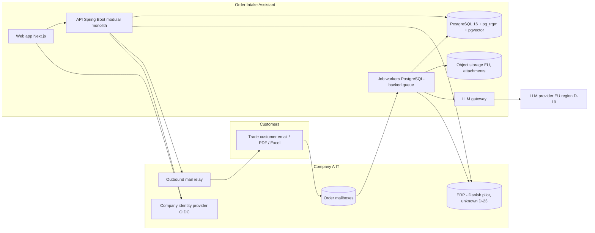

# Deployment and Operations

Source: `04-specify/11-solution-architecture.md` (owner).

## 1. System context and containers

Actors: OH, OL, AD, AN (staff), trade customers (email only), system principals (webhooks). External systems: mail platform (default Microsoft 365 via Graph, D-29), ERP (adapter, D-23), identity provider (default Entra ID, D-29), LLM provider (D-19), object storage, outbound mail relay, secrets manager, error tracking. R2: telephony/speech-to-text provider, vision/OCR provider, EDI gateway (D-31). R3: transport-visibility tool (D-18).

Containers: (1) `web` Next.js; (2) `api` Spring Boot (HTTP + scheduler); (3) `worker` the same artifact started with the worker profile (consumes jobs); (4) PostgreSQL; (5) object storage; (6) secrets store. One deployable image, two process profiles (ADR-11).

## 6. Migration and seeding strategy
- Flyway versioned migrations `V1__baseline.sql` (= `schema.sql`), then `V<n>__<change>.sql`; `ddl-auto=validate`; repeatable `R__reference_data.sql` for markets, role names, thresholds defaults, template defaults, onboarding step keys, component names.
- `demo`/`staging` seed from `build-pack/seed-data-spec.md` (fictional office, customers, SKUs, sample messages in Danish, expected extraction results for evaluation); `prod` = reference data only. Master data in prod comes from the ERP sync, never from seed files.
- Rollback: migrations are forward-only; destructive changes use expand/contract across two releases.

## 14. Observability
Structured JSON logs with correlation ids across API, jobs and adapter calls; message text and attachment names never logged; Actuator health/readiness; Micrometer metrics (queue depth, job latency, model call latency/cost/outcome, ERP success/failure, sync age); error tracking with PII scrubbing; alerts from the NFR profile: mailbox failing > 10 min, ERP write failure rate > 5% over 15 min, model error rate > 10% over 15 min, sync age > CP-09, backlog age > CP-12, availability probe failing.

## 15. Environments, deployment, CI/CD and cost
- **Environments:** dev, staging (shadow-mode rehearsal with seed data and a test mailbox), prod; EU region (D-30); one managed PostgreSQL per environment.
- **Hosting (default stack, with one approved change, D-32):** backend and worker as Docker images on Render/Fly/Railway (default). **Frontend: container alongside the backend instead of Vercel (D-32 decided)** because the proxy carries customer message content and a third-party edge network would become an additional processor.
- **CI/CD (GitHub Actions):** lint → unit tests → contract test against `openapi.yaml` → integration tests (Testcontainers) → build image → scan → migrate staging → Playwright → manual promotion to prod; automatic rollback on failed health checks.
- **Release and rollback:** blue/green or rolling with readiness checks; migrations expand/contract; feature flags per market (F-16).
- **Cost (proposed topology, list prices from S-065, Low-Medium reliability):**

| Item | Launch (monthly) | 12-month load |
|---|---|---|
| API web service (Render Standard, 2 GB) × 1-2 | $25-50 | $50-170 (Standard × 2 / Pro) |
| Worker service | $25 | $50-85 |
| Frontend container | $7-25 | $25 |
| Staging (Starter services) | $14-21 | $21-50 |
| Managed PostgreSQL with pgvector/pg_trgm (Fly Basic $38 / Starter $72 as reference) | $38-72 | $72-282 |
| Object storage, backups, error tracking | estimate not available | estimate not available |
| **LLM usage** | **not estimated: measured in shadow mode** | measured |
Total infrastructure excluding LLM and storage at launch ≈ $110-190 per month by these list prices; the 12-month column is an upper-bound sketch.

## 16. ADR log
| ADR | Decision | Alternatives rejected | Rationale | Source |
|---|---|---|---|---|
| 01 | Overlay on the existing ERP; no replacement | ERP replacement | R-26; Lidl and Travis Perkins | S-029, R-26 |
| 02 | Human approval before any ERP write; confirmation after write | Auto-write; confirmation first | Control, trust, automation illusion | S-053, R-28 |
| 03 | Company OIDC; backend as resource server; Auth.js in the frontend | Backend-issued JWT with local users (stack default) | SSO is required; avoids a second credential store; deviation from default `auth` | D-29 |
| 04 | PostgreSQL for relational data, full-text, trigram and vectors | Separate search/vector database | One store to operate; scale is moderate | S-063 |
| 05 | Rules (not AI) for price, stock, credit; AI for extraction and matching | AI for pricing | Correctness and auditability | R-28 |
| 06 | Job queue on PostgreSQL | Kafka/SQS | No extra infrastructure at this scale | — |
| 07 | S3-compatible EU object storage for attachments | Blobs in PostgreSQL | Size and cost | — |
| 08 | LLM gateway with provider port, EU region, prompt versions | Direct provider calls | Privacy, injection controls, portability | S-055, S-062 |
| 09 | Ports/adapters for ERP and mail | Hard-wired integrations | Markets R3; unknown ERP | D-23 |
| 10 | No employee-level data model | Per-user productivity | R-26, S-014 | R-26 |
| 11 | Modular monolith, one image, API and worker profiles | Microservices | Team size, 12-week plan | R-30 |
| 12 | Contract-first OpenAPI | Code-first | Parallel build, generated clients | stack rules |
| 13 | Order of events: approve → write → confirm | Confirm first | Never confirm a non-existent order | 09 §7 |
| 14 | Frontend container next to the backend (approved change from Vercel, D-32) | Vercel | Message content through the proxy | D-32 |
