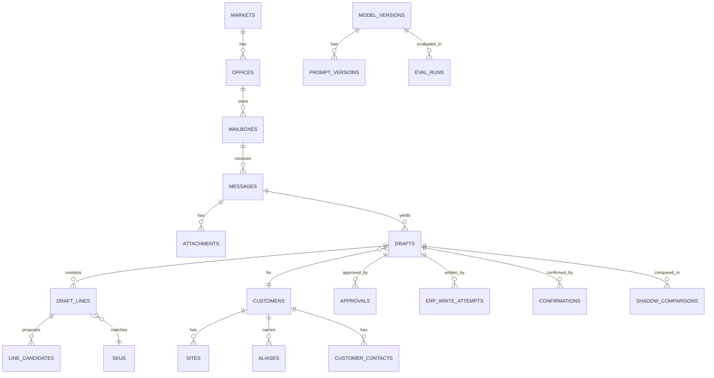

# Domain Model (generated from schema.sql — the SQL is authoritative)

Generated by script from `schema.sql`; every column in the SQL appears here. The PII flag is taken from the `-- personal` / `-- may contain personal data` comments in the SQL. Constraint text is abbreviated. Columns that reference `app_users` are staff identifiers (pseudonymous personal data) even where not flagged individually.

## Entity: markets  (used by SCR-20, US-48, US-62)
| Field | Type | Required | Constraints / enum | PII | Notes |
|---|---|---|---|---|---|
| id | uuid | yes | PK | none |  |
| code | text | yes | code IN ('DK','NO','SE'); unique | none |  |
| name | text | yes |  | none |  |
| enabled | boolean | yes | default false | none |  |
| language_codes | text[] | yes | default '{}' | none |  |
| created_at | timestamptz | yes |  | none |  |

## Entity: offices  (used by SCR-12, SCR-19, US-29)
| Field | Type | Required | Constraints / enum | PII | Notes |
|---|---|---|---|---|---|
| id | uuid | yes | PK | none |  |
| market_id | uuid | yes | FK→markets | none |  |
| code | text | yes | unique | none |  |
| name | text | yes |  | none |  |
| mode | text | yes | mode IN ('baseline','shadow','live'); default 'baseline' CHECK | none |  |
| created_at | timestamptz | yes |  | none |  |
| updated_at | timestamptz | yes |  | none |  |

## Entity: app_users  (used by SCR-01, US-37)
| Field | Type | Required | Constraints / enum | PII | Notes |
|---|---|---|---|---|---|
| id | uuid | yes | PK | none |  |
| idp_subject | text | yes | unique | none |  |
| display_name | text | yes |  | personal | personal (staff) |
| email | text | yes |  | personal | personal (staff) |
| status | text | yes | status IN ('active','disabled'); default 'active' CHECK | none |  |
| last_seen_at | timestamptz | no |  | none |  |
| created_at | timestamptz | yes |  | none |  |
| updated_at | timestamptz | yes |  | none |  |

## Entity: role_mappings  (used by SCR-19, US-37)
| Field | Type | Required | Constraints / enum | PII | Notes |
|---|---|---|---|---|---|
| id | uuid | yes | PK | none |  |
| idp_group | text | yes |  | none |  |
| role | text | yes | role IN ('OH','OL','AD','AN') | none |  |
| office_id | uuid | no | FK→offices | none | NULL = all offices of the market (AD, AN) |
| market_id | uuid | yes | FK→markets | none |  |
| created_at | timestamptz | yes |  | none |  |

## Entity: user_scopes  (used by US-37, US-38)
| Field | Type | Required | Constraints / enum | PII | Notes |
|---|---|---|---|---|---|
| user_id | uuid | yes | FK→app_users | none |  |
| role | text | yes | role IN ('OH','OL','AD','AN') | none |  |
| office_id | uuid | no | FK→offices | none |  |
| market_id | uuid | yes | FK→markets | none |  |
| resolved_at | timestamptz | yes |  | none |  |

## Entity: notification_preferences  (used by SCR-23, US-35)
| Field | Type | Required | Constraints / enum | PII | Notes |
|---|---|---|---|---|---|
| user_id | uuid | yes | PK; FK→app_users | none |  |
| in_app | boolean | yes | default true | none |  |
| email | boolean | yes | default false | none |  |
| digest_time | time | no |  | none |  |
| language | text | yes | language IN ('da','en','nb','sv'); default 'da' CHECK | none |  |
| updated_at | timestamptz | yes |  | none |  |

## Entity: notifications  (used by SCR-02, US-35)
| Field | Type | Required | Constraints / enum | PII | Notes |
|---|---|---|---|---|---|
| id | uuid | yes | PK | none |  |
| user_id | uuid | yes | FK→app_users | none |  |
| kind | text | yes |  | none |  |
| payload | jsonb | yes | default '{}' | none | counts and links only, never message content |
| created_at | timestamptz | yes |  | none |  |
| read_at | timestamptz | no |  | none |  |

## Entity: onboarding_progress  (used by SCR-29, US-49)
| Field | Type | Required | Constraints / enum | PII | Notes |
|---|---|---|---|---|---|
| user_id | uuid | yes | FK→app_users | none |  |
| step_key | text | yes |  | none |  |
| done_at | timestamptz | yes |  | none |  |

## Entity: feedback  (used by SCR-25, US-50)
| Field | Type | Required | Constraints / enum | PII | Notes |
|---|---|---|---|---|---|
| id | uuid | yes | PK | none |  |
| office_id | uuid | no | FK→offices | none |  |
| user_id | uuid | no | FK→app_users | none | optional; ratings are reported only as team aggregates |
| rating | smallint | no | rating BETWEEN 1 AND 5 | none |  |
| text | text | no |  | personal | may contain personal data |
| created_at | timestamptz | yes |  | none |  |

## Entity: mailboxes  (used by SCR-15, US-01)
| Field | Type | Required | Constraints / enum | PII | Notes |
|---|---|---|---|---|---|
| id | uuid | yes | PK | none |  |
| office_id | uuid | yes | FK→offices | none |  |
| address | text | yes |  | none |  |
| provider | text | yes | provider IN ('graph','imap') | none |  |
| status | text | yes | status IN ('pending','connected','failed','paused'); default 'pending' CHECK | none |  |
| last_checked_at | timestamptz | no |  | none |  |
| last_error | text | no |  | none |  |
| filters | jsonb | yes | default '{}' | none |  |
| secret_ref | text | yes |  | none | reference into the secrets manager, never the secret |
| created_at | timestamptz | yes |  | none |  |
| updated_at | timestamptz | yes |  | none |  |

## Entity: threads  (used by US-02)
| Field | Type | Required | Constraints / enum | PII | Notes |
|---|---|---|---|---|---|
| id | uuid | yes | PK | none |  |
| mailbox_id | uuid | yes | FK→mailboxes | none |  |
| external_thread_key | text | yes |  | none |  |
| created_at | timestamptz | yes |  | none |  |

## Entity: messages  (used by SCR-02, SCR-03, SCR-08, US-01..US-06)
| Field | Type | Required | Constraints / enum | PII | Notes |
|---|---|---|---|---|---|
| id | uuid | yes | PK | none |  |
| mailbox_id | uuid | no | FK→mailboxes | none |  |
| office_id | uuid | yes | FK→offices | none |  |
| thread_id | uuid | no | FK→threads | none |  |
| external_id | text | no |  | none |  |
| internet_message_id | text | no |  | none |  |
| content_hash | text | yes |  | none |  |
| direction | text | yes | direction IN ('inbound','outbound'); default 'inbound' CHECK | none |  |
| channel | text | yes | channel IN ('email','voicemail','photo','edi_change'); default 'email' CHECK | none |  |
| from_address | text | no |  | personal | personal (customer contact) |
| from_name | text | no |  | personal | personal (customer contact) |
| to_addresses | text[] | yes | default '{}' | none |  |
| subject | text | no |  | none |  |
| body_text | text | no |  | personal | may contain personal data |
| language | text | no |  | none |  |
| status | text | yes | default 'received' CHECK | none |  |
| category | text | no | category IN ('order','quote_request','status_request','complaint','other') | none |  |
| category_confidence | numeric(4,3) | no | category_confidence BETWEEN 0 AND 1 | none |  |
| flags | text[] | yes | default '{}' | none | suspicious_content, unsupported_language, speech_to_text ... |
| legal_hold | boolean | yes | default false | none |  |
| received_at | timestamptz | yes |  | none |  |
| deleted_at | timestamptz | no |  | none |  |
| created_at | timestamptz | yes |  | none |  |
| updated_at | timestamptz | yes |  | none |  |

## Entity: attachments  (used by SCR-30, US-06)
| Field | Type | Required | Constraints / enum | PII | Notes |
|---|---|---|---|---|---|
| id | uuid | yes | PK | none |  |
| message_id | uuid | yes | FK→messages | none |  |
| file_name | text | yes |  | none |  |
| content_type | text | yes |  | none |  |
| size_bytes | bigint | yes | size_bytes >= 0 | none |  |
| storage_key | text | no |  | none |  |
| status | text | yes | status IN ('stored','skipped','unreadable'); default 'stored' CHECK | none |  |
| skip_reason | text | no |  | none |  |
| created_at | timestamptz | yes |  | none |  |

## Entity: customers  (used by SCR-03, US-12)
| Field | Type | Required | Constraints / enum | PII | Notes |
|---|---|---|---|---|---|
| id | uuid | yes | PK | none |  |
| market_id | uuid | yes | FK→markets | none |  |
| erp_customer_no | text | yes |  | none |  |
| name | text | yes |  | personal | personal when the customer is a sole trader |
| status | text | yes | status IN ('active','blocked','closed'); default 'active' CHECK | none |  |
| synced_at | timestamptz | yes |  | none |  |

## Entity: customer_contacts  (used by US-41)
| Field | Type | Required | Constraints / enum | PII | Notes |
|---|---|---|---|---|---|
| id | uuid | yes | PK | none |  |
| customer_id | uuid | yes | FK→customers | none |  |
| email | text | no |  | personal | personal |
| name | text | no |  | personal | personal |
| phone | text | no |  | personal | personal |
| created_at | timestamptz | yes |  | none |  |

## Entity: sites  (used by SCR-03, US-04)
| Field | Type | Required | Constraints / enum | PII | Notes |
|---|---|---|---|---|---|
| id | uuid | yes | PK | none |  |
| customer_id | uuid | yes | FK→customers | none |  |
| erp_site_ref | text | no |  | none |  |
| address_line | text | yes |  | none |  |
| postal_code | text | no |  | none |  |
| city | text | no |  | none |  |
| contact_name | text | no |  | personal | personal |
| contact_phone | text | no |  | personal | personal |
| access_notes | text | no |  | none |  |
| synced_at | timestamptz | yes |  | none |  |

## Entity: skus  (used by SCR-04, US-07, US-12)
| Field | Type | Required | Constraints / enum | PII | Notes |
|---|---|---|---|---|---|
| id | uuid | yes | PK | none |  |
| market_id | uuid | yes | FK→markets | none |  |
| sku_no | text | yes |  | none |  |
| description | text | yes |  | none |  |
| base_unit | text | yes |  | none |  |
| status | text | yes | status IN ('active','withdrawn'); default 'active' CHECK | none |  |
| in_scope | boolean | yes | default false | none |  |
| search_vec | tsvector | no |  | none |  |
| embedding | vector(1024) | no |  | none |  |
| synced_at | timestamptz | yes |  | none |  |

## Entity: sku_units  (used by US-07)
| Field | Type | Required | Constraints / enum | PII | Notes |
|---|---|---|---|---|---|
| id | uuid | yes | PK | none |  |
| sku_id | uuid | yes | FK→skus | none |  |
| unit_code | text | yes |  | none |  |
| factor_to_base | numeric(18,6) | yes | factor_to_base > 0 | none |  |
| label | text | no |  | none |  |

## Entity: customer_purchase_history  (used by US-08)
| Field | Type | Required | Constraints / enum | PII | Notes |
|---|---|---|---|---|---|
| customer_id | uuid | yes | FK→customers | none |  |
| sku_id | uuid | yes | FK→skus | none |  |
| last_bought_at | date | yes |  | none |  |
| times_bought | integer | yes | times_bought >= 1 | none |  |
| typical_qty | numeric(18,3) | no |  | none |  |

## Entity: aliases  (used by SCR-10, US-11)
| Field | Type | Required | Constraints / enum | PII | Notes |
|---|---|---|---|---|---|
| id | uuid | yes | PK | none |  |
| customer_id | uuid | yes | FK→customers | none |  |
| alias_text | text | yes |  | none |  |
| normalized_text | text | yes |  | none |  |
| sku_id | uuid | yes | FK→skus | none |  |
| status | text | yes | status IN ('proposed','active','inactive'); default 'active' CHECK | none |  |
| proposed_by | uuid | no | FK→app_users | none |  |
| approved_by | uuid | no | FK→app_users | none |  |
| created_at | timestamptz | yes |  | none |  |
| updated_at | timestamptz | yes |  | none |  |

## Entity: model_versions  (used by SCR-18, US-47)
| Field | Type | Required | Constraints / enum | PII | Notes |
|---|---|---|---|---|---|
| id | uuid | yes | PK | none |  |
| kind | text | yes | kind IN ('classification','extraction','matching','estimate') | none |  |
| name | text | yes |  | none |  |
| provider | text | yes |  | none |  |
| region | text | yes |  | none |  |
| status | text | yes | status IN ('candidate','active','retired'); default 'candidate' CHECK | none |  |
| activated_at | timestamptz | no |  | none |  |
| created_at | timestamptz | yes |  | none |  |

## Entity: prompt_versions  (used by SCR-18, US-42)
| Field | Type | Required | Constraints / enum | PII | Notes |
|---|---|---|---|---|---|
| id | uuid | yes | PK | none |  |
| model_version_id | uuid | yes | FK→model_versions | none |  |
| name | text | yes |  | none |  |
| content | text | yes |  | none |  |
| content_hash | text | yes |  | none |  |
| created_at | timestamptz | yes |  | none |  |

## Entity: eval_runs  (used by SCR-18, US-28)
| Field | Type | Required | Constraints / enum | PII | Notes |
|---|---|---|---|---|---|
| id | uuid | yes | PK | none |  |
| model_version_id | uuid | yes | FK→model_versions | none |  |
| prompt_version_id | uuid | no | FK→prompt_versions | none |  |
| set_name | text | yes |  | none |  |
| status | text | yes | status IN ('running','completed','failed'); default 'running' CHECK | none |  |
| field_accuracy | numeric(5,4) | no |  | none |  |
| line_match_accuracy | numeric(5,4) | no |  | none |  |
| edit_rate | numeric(5,4) | no |  | none |  |
| details | jsonb | yes | default '{}' | none |  |
| started_at | timestamptz | yes |  | none |  |
| finished_at | timestamptz | no |  | none |  |

## Entity: model_calls  (used by US-42, SCR-12)
| Field | Type | Required | Constraints / enum | PII | Notes |
|---|---|---|---|---|---|
| id | uuid | yes | PK | none |  |
| correlation_id | text | yes |  | none |  |
| purpose | text | yes |  | none |  |
| model_version_id | uuid | no | FK→model_versions | none |  |
| prompt_version_id | uuid | no | FK→prompt_versions | none |  |
| tokens_in | integer | no |  | none |  |
| tokens_out | integer | no |  | none |  |
| cost_micro_eur | bigint | no |  | none |  |
| latency_ms | integer | no |  | none |  |
| outcome | text | yes | outcome IN ('ok','invalid_output','timeout','refused','error') | none |  |
| created_at | timestamptz | yes |  | none |  |

## Entity: thresholds  (used by SCR-16, US-46)
| Field | Type | Required | Constraints / enum | PII | Notes |
|---|---|---|---|---|---|
| id | uuid | yes | PK | none |  |
| market_id | uuid | yes | FK→markets | none |  |
| version | integer | yes |  | none |  |
| classification_min | numeric(4,3) | yes | classification_min BETWEEN 0 AND 1 | none |  |
| field_min | numeric(4,3) | yes | field_min BETWEEN 0 AND 1 | none |  |
| line_match_min | numeric(4,3) | yes | line_match_min BETWEEN 0 AND 1 | none |  |
| review_below | numeric(4,3) | yes | review_below BETWEEN 0 AND 1 | none |  |
| active | boolean | yes | default false | none |  |
| created_at | timestamptz | yes |  | none |  |

## Entity: sku_scopes  (used by SCR-16, US-46)
| Field | Type | Required | Constraints / enum | PII | Notes |
|---|---|---|---|---|---|
| id | uuid | yes | PK | none |  |
| market_id | uuid | yes | FK→markets | none |  |
| name | text | yes |  | none |  |
| rule | jsonb | yes |  | none |  |
| active | boolean | yes | default false | none |  |
| created_at | timestamptz | yes |  | none |  |

## Entity: templates  (used by SCR-17, US-25)
| Field | Type | Required | Constraints / enum | PII | Notes |
|---|---|---|---|---|---|
| id | uuid | yes | PK | none |  |
| market_id | uuid | yes | FK→markets | none |  |
| kind | text | yes | kind IN ('confirmation','status_answer','missing_info','complaint_ack','delivery_notice') | none |  |
| language | text | yes | language IN ('da','en','nb','sv') | none |  |
| version | integer | yes |  | none |  |
| subject | text | yes |  | none |  |
| body | text | yes |  | none |  |
| active | boolean | yes | default false | none |  |
| created_by | uuid | no | FK→app_users | none |  |
| created_at | timestamptz | yes |  | none |  |

## Entity: feature_flags  (used by SCR-20, US-48)
| Field | Type | Required | Constraints / enum | PII | Notes |
|---|---|---|---|---|---|
| id | uuid | yes | PK | none |  |
| market_id | uuid | yes | FK→markets | none |  |
| key | text | yes |  | none |  |
| enabled | boolean | yes | default false | none |  |
| updated_at | timestamptz | yes |  | none |  |

## Entity: sync_runs  (used by SCR-26, US-12)
| Field | Type | Required | Constraints / enum | PII | Notes |
|---|---|---|---|---|---|
| id | uuid | yes | PK | none |  |
| market_id | uuid | yes | FK→markets | none |  |
| kind | text | yes | kind IN ('catalogue','customers','purchase_history','prices') | none |  |
| status | text | yes | status IN ('running','succeeded','failed') | none |  |
| counts | jsonb | yes | default '{}' | none |  |
| error | text | no |  | none |  |
| started_at | timestamptz | yes |  | none |  |
| finished_at | timestamptz | no |  | none |  |

## Entity: component_health  (used by SCR-26, US-43)
| Field | Type | Required | Constraints / enum | PII | Notes |
|---|---|---|---|---|---|
| component | text | yes | PK | none |  |
| status | text | yes | status IN ('ok','degraded','down') | none |  |
| detail | text | no |  | none |  |
| checked_at | timestamptz | yes |  | none |  |

## Entity: drafts  (used by SCR-02, SCR-03, US-04..US-18)
| Field | Type | Required | Constraints / enum | PII | Notes |
|---|---|---|---|---|---|
| id | uuid | yes | PK | none |  |
| message_id | uuid | yes | FK→messages | none |  |
| office_id | uuid | yes | FK→offices | none |  |
| parent_draft_id | uuid | no | FK→drafts | none |  |
| draft_type | text | yes | draft_type IN ('order','status_request','change'); default 'order' CHECK | none |  |
| status | text | yes | default 'new' CHECK | none |  |
| customer_id | uuid | no | FK→customers | none |  |
| customer_text | text | no |  | none |  |
| site_id | uuid | no | FK→sites | none |  |
| site_text | text | no |  | none |  |
| delivery_wish_text | text | no |  | none |  |
| delivery_wish_date | date | no |  | none |  |
| proposed_delivery_date | date | no |  | none |  |
| delivery_confidence | text | no | delivery_confidence IN ('high','medium','low') | none |  |
| delivery_reason | text | no |  | none |  |
| overall_confidence | numeric(4,3) | no | overall_confidence BETWEEN 0 AND 1 | none |  |
| evidence | jsonb | yes | default '{}' | none |  |
| flags | text[] | yes | default '{}' | none |  |
| language | text | no |  | none |  |
| extraction_model_id | uuid | no | FK→model_versions | none |  |
| extraction_prompt_id | uuid | no | FK→prompt_versions | none |  |
| assigned_to_user_id | uuid | no | FK→app_users | none |  |
| locked_by_user_id | uuid | no | FK→app_users | none |  |
| lock_expires_at | timestamptz | no |  | none |  |
| service_due_at | timestamptz | no |  | none |  |
| erp_order_no | text | no |  | none |  |
| idempotency_key | uuid | yes | unique | none |  |
| approved_at | timestamptz | no |  | none |  |
| approved_by_user_id | uuid | no | FK→app_users | none |  |
| approved_without_edits | boolean | no |  | none |  |
| edited | boolean | yes | default false | none |  |
| manual_check_confirmed | boolean | yes | default false | none |  |
| version | integer | yes | default 0 | none |  |
| created_at | timestamptz | yes |  | none |  |
| updated_at | timestamptz | yes |  | none |  |

## Entity: draft_lines  (used by SCR-03, SCR-04, US-07..US-15)
| Field | Type | Required | Constraints / enum | PII | Notes |
|---|---|---|---|---|---|
| id | uuid | yes | PK | none |  |
| draft_id | uuid | yes | FK→drafts | none |  |
| line_no | integer | yes |  | none |  |
| source_text | text | yes |  | none |  |
| source_span | jsonb | no |  | none |  |
| quantity | numeric(18,3) | no | quantity > 0 | none |  |
| unit_code | text | no |  | none |  |
| quantity_original | numeric(18,3) | no |  | none |  |
| unit_original | text | no |  | none |  |
| sku_id | uuid | no | FK→skus | none |  |
| match_confidence | numeric(4,3) | no | match_confidence BETWEEN 0 AND 1 | none |  |
| confidence_level | text | no | confidence_level IN ('sure','check','unsure') | none |  |
| state | text | yes | default 'proposed' CHECK | none |  |
| contract_price_minor | bigint | no |  | none |  |
| currency | char(3) | no |  | none |  |
| customer_stated_price_minor | bigint | no |  | none |  |
| price_flag | boolean | yes | default false | none |  |
| stock_available | numeric(18,3) | no |  | none |  |
| stock_checked_at | timestamptz | no |  | none |  |
| credit_status | text | no | credit_status IN ('ok','warning','blocked','unknown') | none |  |
| shortfall_action | text | no | shortfall_action IN ('split','backorder','substitute') | none |  |
| note | text | no |  | none |  |

## Entity: line_candidates  (used by SCR-04, US-07)
| Field | Type | Required | Constraints / enum | PII | Notes |
|---|---|---|---|---|---|
| id | uuid | yes | PK | none |  |
| draft_line_id | uuid | yes | FK→draft_lines | none |  |
| sku_id | uuid | yes | FK→skus | none |  |
| rank | smallint | yes | rank BETWEEN 1 AND 10 | none |  |
| score | numeric(5,4) | yes |  | none |  |
| reason | text | no |  | none |  |

## Entity: approvals  (used by US-16, US-58)
| Field | Type | Required | Constraints / enum | PII | Notes |
|---|---|---|---|---|---|
| id | uuid | yes | PK | none |  |
| draft_id | uuid | yes | FK→drafts | none |  |
| approved_by_user_id | uuid | no | FK→app_users | none |  |
| role | text | no |  | none |  |
| draft_version | integer | yes |  | none |  |
| edits_count | integer | yes | default 0 | none |  |
| auto_approved | boolean | yes | default false | none |  |
| policy_version | integer | no |  | none |  |
| approved_at | timestamptz | yes |  | none |  |

## Entity: erp_write_attempts  (used by US-22, US-23)
| Field | Type | Required | Constraints / enum | PII | Notes |
|---|---|---|---|---|---|
| id | uuid | yes | PK | none |  |
| draft_id | uuid | yes | FK→drafts | none |  |
| attempt_no | integer | yes |  | none |  |
| method | text | yes | method IN ('api','rpa') | none |  |
| outcome | text | yes | outcome IN ('success','rejected','error','duplicate') | none |  |
| erp_order_no | text | no |  | none |  |
| error_detail | text | no |  | none |  |
| started_at | timestamptz | yes |  | none |  |
| finished_at | timestamptz | no |  | none |  |

## Entity: confirmations  (used by SCR-05, US-24)
| Field | Type | Required | Constraints / enum | PII | Notes |
|---|---|---|---|---|---|
| id | uuid | yes | PK | none |  |
| draft_id | uuid | yes | FK→drafts | none |  |
| template_id | uuid | no | FK→templates | none |  |
| language | text | yes |  | none |  |
| subject | text | yes |  | none |  |
| body_text | text | yes |  | none |  |
| original_body | text | no |  | none |  |
| body_edited | boolean | yes | default false | none |  |
| status | text | yes | status IN ('pending','sent','failed','suppressed_shadow'); default 'pending' CHECK | none |  |
| error | text | no |  | none |  |
| sent_at | timestamptz | no |  | none |  |
| created_at | timestamptz | yes |  | none |  |

## Entity: status_requests  (used by SCR-07, US-20)
| Field | Type | Required | Constraints / enum | PII | Notes |
|---|---|---|---|---|---|
| draft_id | uuid | yes | PK; FK→drafts | none |  |
| erp_order_no | text | no |  | none |  |
| order_status | text | no |  | none |  |
| expected_date | date | no |  | none |  |
| proposed_answer | text | no |  | none |  |
| answer_sent_at | timestamptz | no |  | none |  |
| answer_snapshot | jsonb | no |  | none |  |

## Entity: post_order_exceptions  (used by SCR-09, US-21)
| Field | Type | Required | Constraints / enum | PII | Notes |
|---|---|---|---|---|---|
| id | uuid | yes | PK | none |  |
| office_id | uuid | yes | FK→offices | none |  |
| draft_id | uuid | no | FK→drafts | none |  |
| erp_order_no | text | yes |  | none |  |
| type | text | yes | type IN ('missing_site_data','stock_shortfall') | none |  |
| status | text | yes | status IN ('open','resolved','auto_closed'); default 'open' CHECK | none |  |
| detected_at | timestamptz | yes |  | none |  |
| resolved_at | timestamptz | no |  | none |  |

## Entity: corrections  (used by US-27, US-61)
| Field | Type | Required | Constraints / enum | PII | Notes |
|---|---|---|---|---|---|
| id | uuid | yes | PK | none |  |
| draft_id | uuid | no | FK→drafts | none |  |
| draft_line_id | uuid | no | FK→draft_lines | none |  |
| field | text | yes |  | none |  |
| machine_value | jsonb | no |  | none |  |
| corrected_value | jsonb | no |  | none |  |
| correction_type | text | yes | correction_type IN ('edit','reclassify','merge','sku_change','date_change','unit_change') | none |  |
| model_version_id | uuid | no | FK→model_versions | none |  |
| created_at | timestamptz | yes |  | none |  |

## Entity: shadow_comparisons  (used by SCR-13, US-30)
| Field | Type | Required | Constraints / enum | PII | Notes |
|---|---|---|---|---|---|
| id | uuid | yes | PK | none |  |
| draft_id | uuid | yes | FK→drafts | none |  |
| erp_order_no | text | no |  | none |  |
| status | text | yes | status IN ('linked','unmatched','reviewed'); default 'unmatched' CHECK | none |  |
| diff_count | integer | yes | default 0 | none |  |
| created_at | timestamptz | yes |  | none |  |
| updated_at | timestamptz | yes |  | none |  |

## Entity: shadow_field_diffs  (used by SCR-14, US-30)
| Field | Type | Required | Constraints / enum | PII | Notes |
|---|---|---|---|---|---|
| id | uuid | yes | PK | none |  |
| comparison_id | uuid | yes | FK→shadow_comparisons | none |  |
| field | text | yes |  | none |  |
| assistant_value | text | no |  | none |  |
| human_value | text | no |  | none |  |

## Entity: baseline_samples  (used by SCR-12, US-29)
| Field | Type | Required | Constraints / enum | PII | Notes |
|---|---|---|---|---|---|
| id | uuid | yes | PK | none |  |
| office_id | uuid | yes | FK→offices | none |  |
| message_id | uuid | no | FK→messages | none |  |
| channel | text | yes | channel IN ('email','phone','voicemail','photo','edi','web','app','other') | none |  |
| format | text | yes | format IN ('email_text','pdf','excel','photo','phone','edi','web','other') | none |  |
| is_order | boolean | yes | default true | none |  |
| lines_count | integer | no | lines_count >= 0 | none |  |
| handling_minutes | numeric(8,2) | no | handling_minutes >= 0 | none | sampled at office level, never per person |
| observed_at | timestamptz | yes |  | none |  |

## Entity: baseline_credit_notes  (used by SCR-12, US-29)
| Field | Type | Required | Constraints / enum | PII | Notes |
|---|---|---|---|---|---|
| id | uuid | yes | PK | none |  |
| office_id | uuid | yes | FK→offices | none |  |
| erp_ref | text | yes |  | none |  |
| reason_code | text | yes | reason_code IN ('wrong_item','wrong_quantity','wrong_price','other') | none |  |
| lines_count | integer | yes | default 1 | none |  |
| issued_on | date | yes |  | none |  |

## Entity: metric_events  (used by US-32, SCR-12)
| Field | Type | Required | Constraints / enum | PII | Notes |
|---|---|---|---|---|---|
| id | bigserial | yes | PK | none |  |
| event_name | text | yes |  | none |  |
| occurred_at | timestamptz | yes |  | none |  |
| office_id | uuid | no | FK→offices | none |  |
| market_id | uuid | no | FK→markets | none |  |
| draft_id | uuid | no |  | none |  |
| message_id | uuid | no |  | none |  |
| properties | jsonb | yes | default '{}' | none | no names, emails or message text (US-32) |

## Entity: metric_rollups  (used by SCR-12, US-31)
| Field | Type | Required | Constraints / enum | PII | Notes |
|---|---|---|---|---|---|
| id | uuid | yes | PK | none |  |
| office_id | uuid | yes | FK→offices | none |  |
| period_start | date | yes |  | none |  |
| period_end | date | yes |  | none |  |
| metric | text | yes |  | none |  |
| value | numeric(18,4) | no |  | none |  |
| sample_size | integer | yes |  | none |  |

## Entity: retention_policies  (used by SCR-22, US-40)
| Field | Type | Required | Constraints / enum | PII | Notes |
|---|---|---|---|---|---|
| market_id | uuid | yes | PK; FK→markets | none |  |
| message_retention_days | integer | yes | message_retention_days > 0 | none |  |
| attachment_retention_days | integer | yes | attachment_retention_days > 0 | none |  |
| updated_at | timestamptz | yes |  | none |  |

## Entity: dsr_requests  (used by SCR-22, US-41)
| Field | Type | Required | Constraints / enum | PII | Notes |
|---|---|---|---|---|---|
| id | uuid | yes | PK | none |  |
| type | text | yes | type IN ('access','rectification','deletion') | none |  |
| subject_email | text | yes |  | personal | personal |
| status | text | yes | status IN ('registered','executed','failed','closed'); default 'registered' CHECK | none |  |
| match_counts | jsonb | yes | default '{}' | none |  |
| closing_note | text | no |  | none |  |
| registered_at | timestamptz | yes |  | none |  |
| executed_at | timestamptz | no |  | none |  |

## Entity: audit_events  (used by SCR-21, US-39)
| Field | Type | Required | Constraints / enum | PII | Notes |
|---|---|---|---|---|---|
| id | bigserial | yes | PK | none |  |
| occurred_at | timestamptz | yes |  | none |  |
| actor_user_id | uuid | no |  | personal | personal (staff identifier) |
| actor_role | text | no |  | none |  |
| event_type | text | yes |  | none |  |
| object_type | text | no |  | none |  |
| object_id | uuid | no |  | none |  |
| before_state | jsonb | no |  | none |  |
| after_state | jsonb | no |  | none |  |
| correlation_id | text | no |  | none |  |

## Entity: cases  (used by SCR-32, US-55)
| Field | Type | Required | Constraints / enum | PII | Notes |
|---|---|---|---|---|---|
| id | uuid | yes | PK | none |  |
| message_id | uuid | yes | FK→messages | none |  |
| office_id | uuid | yes | FK→offices | none |  |
| category | text | yes | category IN ('complaint','return') | none |  |
| linked_order_no | text | no |  | none |  |
| status | text | yes | status IN ('open','acknowledged','closed'); default 'open' CHECK | none |  |
| assigned_to_user_id | uuid | no | FK→app_users | none |  |
| acknowledgement_sent_at | timestamptz | no |  | none |  |
| closed_at | timestamptz | no |  | none |  |
| created_at | timestamptz | yes |  | none |  |

## Entity: auto_approval_policies  (used by SCR-33, US-58)
| Field | Type | Required | Constraints / enum | PII | Notes |
|---|---|---|---|---|---|
| id | uuid | yes | PK | none |  |
| market_id | uuid | yes | FK→markets | none |  |
| version | integer | yes |  | none |  |
| rules | jsonb | yes |  | none |  |
| active | boolean | yes | default false | none |  |
| paused | boolean | yes | default false | none |  |
| created_at | timestamptz | yes |  | none |  |

## Entity: auto_approval_samples  (used by SCR-33, US-59)
| Field | Type | Required | Constraints / enum | PII | Notes |
|---|---|---|---|---|---|
| id | uuid | yes | PK | none |  |
| approval_id | uuid | yes | FK→approvals | none |  |
| status | text | yes | status IN ('pending','correct','wrong'); default 'pending' CHECK | none |  |
| reviewed_at | timestamptz | no |  | none |  |

## Entity: estimate_models  (used by SCR-35, US-60)
| Field | Type | Required | Constraints / enum | PII | Notes |
|---|---|---|---|---|---|
| id | uuid | yes | PK | none |  |
| market_id | uuid | yes | FK→markets | none |  |
| kind | text | yes | kind IN ('rule','ml') | none |  |
| active | boolean | yes | default false | none |  |
| evaluation | jsonb | yes | default '{}' | none |  |
| created_at | timestamptz | yes |  | none |  |

## Entity: market_readiness_items  (used by SCR-36, US-62)
| Field | Type | Required | Constraints / enum | PII | Notes |
|---|---|---|---|---|---|
| id | uuid | yes | PK | none |  |
| market_id | uuid | yes | FK→markets | none |  |
| item_key | text | yes | item_key IN ('adapters_tested','language_templates_reviewed','thresholds_evaluated','consu | none |  |
| done | boolean | yes | default false | none |  |
| done_at | timestamptz | no |  | none |  |
| done_by_role | text | no |  | none |  |

## Entity: delivery_exceptions  (used by SCR-37, US-65)
| Field | Type | Required | Constraints / enum | PII | Notes |
|---|---|---|---|---|---|
| id | uuid | yes | PK | none |  |
| office_id | uuid | yes | FK→offices | none |  |
| erp_order_no | text | yes |  | none |  |
| type | text | yes | type IN ('delay','missing_site_data','other') | none |  |
| source_event_id | text | yes |  | none |  |
| status | text | yes | status IN ('open','notified','resolved'); default 'open' CHECK | none |  |
| notice_sent_at | timestamptz | no |  | none |  |
| created_at | timestamptz | yes |  | none |  |

## CRUD by role (OH order handler, OL order-office lead, AD administrator, AN analyst, SYS system)

| Entity group | Create | Read | Update | Delete |
|---|---|---|---|---|
| messages, attachments, threads | SYS (ingest) | OH, OL (office scope) | OH, OL (status, category via actions) | SYS (retention job), AD (DSR execution) |
| drafts, draft_lines, line_candidates | SYS (extraction) | OH, OL (office scope) | OH, OL (with lock) | SYS (retention keeps non-personal fields) |
| approvals, erp_write_attempts, confirmations | OH, OL, SYS | OH, OL; AD metadata only | SYS | — |
| aliases | OH, OL | OH, OL | OH, OL (OL approves proposals) | — (deactivate) |
| customers, customer_contacts, sites, skus, sku_units, purchase history | SYS (sync) | OH, OL | SYS | SYS (sync); AD (DSR) |
| corrections | SYS | AD (no user identifiers exist) | — | SYS (retention keeps non-personal fields) |
| shadow_comparisons, shadow_field_diffs, baseline_*, metric_* | SYS; OL/AD (manual link, import) | OL, AN, AD | OL, AD | — |
| mailboxes, thresholds, sku_scopes, templates, feature_flags, role_mappings, user_scopes, model/prompt versions, eval_runs | AD (user_scopes: SYS at sign-in) | AD | AD | AD (deactivate) |
| audit_events | SYS | AD | — (append-only trigger) | — |
| retention_policies, dsr_requests | AD | AD | AD | — |
| notification_preferences, notifications, onboarding_progress | own user / SYS | own user | own user | own user |
| feedback | any user | AD (text); OL, AN see aggregates only | — | — |
| cases, auto_approval_*, estimate_models, market_readiness_items, delivery_exceptions | per release (R2, R3) | per release | per release | — |
| markets, offices | AD | all roles (own scope) | AD (mode: OL for own office) | — |
| model_calls, sync_runs, component_health | SYS | AD | SYS | SYS (retention) |

## ER diagram (core)

